# preENM 

<!-- badges: start -->
[](https://github.com/kkonowalik/preENM/actions/workflows/R-CMD-check.yaml)
<!-- badges: end -->

**Data preparation for ENM/SDM:** point filtering, background point
selection, environmental thinning, correlation analysis, and model selection.

`preENM` covers the steps before and after fitting ecological niche models /
species distribution models. It does not fit models itself, so it works
alongside any modelling software: biomod2, ENMeval, Maxent, tidymodels or
your own code.

## Installation

Install R (≥ 4.1) from <https://cran.r-project.org> and, optionally, RStudio
from <https://posit.co/download/rstudio-desktop/>. Then run in R:

```r
install.packages("remotes")
remotes::install_github("kkonowalik/preENM")

install.packages("ggrepel")   # optional: neater labels in plots
```

## The workflow at a glance

The sections follow the order of a modelling project: prepare the records
and the calibration area, prepare and choose the predictors, fit the models
in the software of your choice, then evaluate, select and report. Every
step can be used on its own.

| | Section | Step | Functions |
|---|---|---|---|
| Before | [1](#1-point-filtering) | **Name matching and point filtering** (especially GBIF) | `read_gbif()`, `match_names()`, `filter_occurrences()`, `filter_settings()`, `filter_layers()` |
| Before | [2](#2-accessible-area-m) | **Accessible area (M)** | `linking_distance()`, `delimit_m()` (incl. spatially adaptive buffers and simulated dispersal), `m_scenarios()` (the default practice), `m_simulate()`, `m_minimal()`, `m_availability()`, `plot_m_area()`, `m_report()`, `write_m_area()`, `crop_to_m()` |
| Before | [3](#3-cutting-raster-files-to-m) | **Cutting raster files to M** | `crop_rasters()`, `crop_to_m()` |
| Before | [4](#4-computing-derived-climate-terrain-and-soil-variables) | **Derived climate, terrain and soil variables** (indices of water balance, heat, cold, season and light, the 19 bioclim variables with the composite ones flagged and smooth substitutes; terrain indices from a DEM; SoilGrids soil layers for a region; present, future and past) | `download_chelsa_monthly()`, `download_chelsa_trace21k()`, `monthly_files()`, `climate_indices()`, `climate_index_names()`, `topo_indices()`, `download_soilgrids()` |
| Before | [4](#which-climate-product-comparing-sources-before-choosing-one) | **Comparing climate products** at the records and across M (agreement, correlation, offset, distributions, collinearity structure, map of disagreement) | `climate_source_compare()`, `plot_climate_sources()`, `write_climate_sources()` |
| Before | [5](#5-checks-before-modelling) | **Checks** (sample size, record years vs climate period) | `check_sample_size()`, `match_climate_period()` |
| Before | [6](#6-imprecise-records-keep-propagate-or-drop) | **Coordinate uncertainty in environmental terms**: keep, propagate (replicate datasets jittered within each record's uncertainty) or drop | `uncertainty_environment()`, `jitter_uncertainty()`, `plot_jitter()`, `write_jitter()` |
| Before | [7](#7-one-point-per-raster-cell-and-background-points) | **One point per raster cell, background points** | `merge_occurrences()` (with `data_type` per source), `thin_by_cell()`, `sample_background()` |
| Before | [8](#8-environmental-thinning) | **Environmental thinning** (without truncating the niche) | `thin_environment()`, `plot_env_thinning()`, `write_env_thinning()` |
| Before | [9](#9-background-strategies-and-recording-effort) | **Background strategies and recording effort**, target-group background, how many background points | `sample_background(method = ...)`, `gbif_effort_sql()`, `gbif_target_group_sql()`, `download_gbif_effort()`, `gbif_effort_rasters()`, `background_sufficiency()`, `plot_background_sufficiency()` |
| Before | [10](#10-which-bias-correction-sensitivity-of-the-data-design) | **Bias-correction sensitivity** (thinning method and radius, background strategy and size: records kept, environmental coverage against random removal, spatial clustering, niche kept, background coverage and overlap) | `bias_sensitivity()`, `plot_bias_sensitivity()` |
| Before | [11](#11-checking-that-the-niche-is-not-truncated-by-m) | **Niche truncation check** (is M large enough? is a nested model needed?) and **what to do about it** (extend M, donor regions, nested datasets) | `niche_truncation()`, `plot_niche_truncation()`, `niche_coverage()`, `plot_niche_coverage()`, `classify_points()`, `unfilled_records()`, `truncation_remedy()`, `plot_truncation_remedy()`, `write_truncation_remedy()` |
| Before | [12](#12-selecting-predictor-variables-across-periods-and-regions) | **Correlation analysis and variable selection** (across periods, scenarios and regions) | `sample_environment()`, `select_variables()`, `best_sets()`, `recommend_sets()`, `correlation_by_region()`, `plot_variable_tree()`, `plot_correlation()`, `plot_variable_sets()`, `write_variable_selection()` |
| Before | [13](#13-are-the-selected-predictors-better-than-random-variables) | **Predictors against random variables** | `variable_relevance()`, `random_variables()`, `compare_to_random()` |
| Before | [14](#14-does-the-design-depend-on-the-grain) | **Grain sensitivity** (records kept, records too uncertain, correlation structure and the selected variable set at coarser grains) | `grain_sensitivity()`, `plot_grain_sensitivity()`, `write_grain_sensitivity()` |
| Before | [15](#15-mapping-where-a-projection-extrapolates) | **Extrapolation risk of projections** (ExDet, MOP; disappearing and new conditions) | `extrapolation_risk()`, `environment_shift()` |
| Before | [16](#16-preparing-data-for-integrated-models) | **Data for integrated SDMs** (presence-only, presence-absence and count datasets in the input structure of intSDM, PointedSDMs or biomod2) | `merge_occurrences(data_type = )`, `export_integrated()`, `write_integrated()` |
| After | [17](#17-model-evaluation-and-selection) | **Model evaluation and selection** | `evaluate_models()`, `evaluate_cv()`, `suggest_block_size()`, `spatial_folds()`, `select_models()`, `plot_pareto()`, `plot_selection()`, `plot_models()` |
| After | [17](#calibration-can-the-predictions-be-read-as-probabilities) | **Calibration** (reliability diagram, calibration slope and intercept, Brier decomposition) | `calibration_curve()`, `brier_decompose()`, `brier_score()`, `plot_calibration()` |
| After | [17](#the-boyce-index-with-few-presences) | **Boyce index with few presences** (smoothed P/E curve, bootstrap interval) | `boyce_index(smooth = , n_boot = )`, `plot_boyce()` |
| After | [17](#response-curves-are-they-ecologically-plausible) | **Plausibility of response curves** (shape, turning points, rising edges, agreement with records) | `response_check()`, `plot_response_check()` |
| After | [20](#prediction-scales-0-1-0-100-0-1000) | **Prediction scales** checked per model, 0-100 and 0-1000 rescaled to 0-1 | `rescale = TRUE` in `evaluate_models()`, `ensemble_models()`, ... |
| After | [21](#21-how-the-selection-works) | **How the selection works** (Pareto front, compromise distance, bootstrap robustness) | `pareto_rank()` |
| After | [22](#auditing-the-folds-leakage-separation-and-spatial-sorting-bias) | **Auditing cross-validation folds** (leakage, spatial and environmental separation, spatial sorting bias), environmental folds | `fold_report()`, `plot_folds()`, `environmental_folds()`, `spatial_sorting_bias()` |
| After | [22](#fossil-temporal-validation) | **Validation with fossil records** (hindcasts) | `temporal_validation()`, `download_neotoma()`, `neotoma_records()`, `calibrate_radiocarbon()`, `fossil_site_bins()`, `site_bin_slices()` |
| After | [22](#ensembles-and-disagreement) | **Ensemble of the selected models and the disagreement between them** | `ensemble_models()`, `plot_ensemble()` |
| After | [22](#thresholds-how-much-does-the-mapped-range-depend-on-the-rule) | **Thresholds under several rules** and the cells on which they agree | `thresholds()`, `threshold_agreement()`, `plot_thresholds()` |
| After | [23](#23-range-metrics-for-conservation-assessment) | **Range metrics** (EOO, AOO, locations, patches, fragmentation) under each threshold rule, change between projections, IUCN thresholds | `range_metrics()`, `plot_range_metrics()`, `write_range_metrics()` |
| After | [24](#24-testing-the-models-against-sampling-bias) | **Significance against sampling bias** | `null_model_test()` |
| After | [25](#25-is-a-projected-change-driven-by-the-data-or-by-the-study-design) | **Design bias of projections** (models of random points, with the sampling bias of the records) | `null_occurrences()`, `transfer_bias_test()`, `plot_transfer_bias()` |
| After | [26](#26-which-source-of-uncertainty-dominates-a-set-of-projections) | **Partitioning projection uncertainty** (GCM, scenario, algorithm, run; dominant source per cell) | `partition_uncertainty()`, `plot_partition()` |
| After | [26](#spread-due-to-coordinate-error) | **Spread due to coordinate error** (models fitted to jittered replicates), compared with the disagreement between models | `coordinate_spread()`, `plot_coordinate_spread()` |
| After | [27](#27-where-are-the-data-too-sparse-to-trust-a-prediction) | **Maps of biogeographical ignorance** from recording effort, joint map with suitability | `ignorance_map()`, `record_ignorance()`, `taxon_complexity()`, `plot_ignorance()` |
| After | [28](#28-how-different-are-the-niches-of-two-groups) | **Niche overlap** between species, lineages or cytotypes (D, I, breadth, expansion/unfilling, equivalency and similarity tests) and its sensitivity to methodological choices | `niche_overlap()`, `overlap_scenarios()`, `plot_niche_overlap()`, `prediction_overlap()` |
| After | [29](#29-reporting-with-odmap) | **Reporting** (ODMAP protocol filled from the workflow) | `odmap_table()` |

Inputs can be GeoTIFF paths, `terra` rasters, CSV files or `sf` objects.
Points are re-projected to each raster automatically.

**Every figure can be saved** by the function that draws it: add
`file = "figure.pdf"` (or `.png`, `.jpeg`, `.tiff`, `.svg`),
`file = c("figure.png", "figure.pdf")` for several formats, or a name
without extension (`file = "figure"`) for both PNG and PDF; `width` and
`height` set the size in inches. The plot is still returned and can be
changed further with ggplot2.

## Before modelling

Records, calibration area and predictors.

### 1. Point filtering

`filter_occurrences()` removes records unsuitable for niche modelling with a
fixed, ordered list of transparent rules. It is designed especially for
**GBIF downloads**, but works on any table with coordinates: tests whose
columns are missing are skipped. Nothing is removed silently. Each record
keeps the **first** test it failed in the `reason` column and is kept only if
it passes every active test, so every decision can be checked.

| Group | Tests (in order) | Needs |
|---|---|---|
| Names | `name_unmatched` (not resolved, or only above the genus), `name_synonym_conflict` (resolves to an accepted name other than the target; hybrid names), `rank_conflict` (only the genus, or an infraspecific taxon out of scope) | the columns of `match_names()`, `target_taxon` |
| Records and metadata | `invalid_coordinates`, `duplicate`, `grid_cell_centre` (atlas cell centres recognised from the uncertainty), `gbif_issue`, `basis_of_record`, `establishment_means`, `coord_uncertainty`, `coarse_decimals`, `garden_text`, `settlement_text`, `locality_is_country`, `too_old`, `manual_exclude`, `excluded_dataset` | GBIF columns |
| Gridded datasets | `grid_uncertainty_block`, `lattice_dataset`, `stacked_dataset` (atlas or grid data recognised per dataset) | `datasetKey` |
| CoordinateCleaner | `country_mismatch`, `coordinatecleaner` (centroids, institutions, zeros, GBIF HQ, urban areas) | the CoordinateCleaner package |
| Layers | `outside_range`, `at_sea` / `on_water`, `no_climate_data`, `built_up`, `cropland`, `ghs_dense`, `ghs_building_nearby` | range polygon, shoreline, climate, land-cover rasters |
| Isolation and climate | `isolated_climate_outlier`, `small_isolated_cluster`, `climate_limit`, `climate_soft_limit` (beyond a soft limit, kept only with a climatic refuge nearby, e.g. a valley below cold mountains) | climate raster, thresholds |

**You choose the tests and thresholds.** Two presets give sensible defaults:
`"strict"` for presence records used in modelling, and `"lenient"` for
delimiting the accessible area (M). Climate thresholds depend on the species,
so they are off until you set them.

```r
library(preENM)

occ <- read_gbif("0020328-260928105237408.zip")       # your GBIF download

settings <- filter_settings(
  "strict",
  max_coord_unc_m = 1000,
  climate_limit = 22, climate_soft_limit = 16,         # deg C, warmest quarter
  refuge_limit = 11, refuge_radius_km = 10,            # e.g. an arctic-alpine plant
  target_taxon = "Dryas octopetala",                   # accepted name
  drop_tests = "too_old")                              # switch tests off/on

layers <- filter_layers(
  range    = "range_polygon.shp",                      # optional, any CRS
  land     = download_shoreline("data/coast"),         # GSHHG, downloaded once
  climate  = "CHELSA_bio10_1981-2010_V.2.1.tif",
  built    = download_landcover("built", "data"),      # ESA WorldCover ~1 km
  cropland = download_landcover("cropland", "data"))

occ <- match_names(occ, kingdom = "Plantae")          # names against GBIF

res <- filter_occurrences(occ, settings, layers,
                          exclude_ids = c("1701093660"),   # gbifID lists
                          keep_ids    = c("2571281411"))
res                                    # records removed per test
filter_report(res, by = "countryCode") # which tests remove records where
filter_sensitivity(res, "climate", c(16, 18, 20, 22, 24))  # choose thresholds
record_fate(res, c("2571281411", "1701093660"))
write_filter_results(res, "results", "species_strict")       # CSV files
clean <- kept(res)
```

Only tests whose data you supply are run; the others are listed as
skipped. Optional helpers download the layers: `download_shoreline()`,
`download_landcover()` and `aggregate_ghs()` (GHS-BUILT-S settlement layers).
See `?filter_occurrences` and `?filter_settings` for every test and
threshold.

**Is the name right?** Records arrive under synonyms, outdated names,
misspellings, genus-only, aggregate and hybrid names. Cleaning pipelines
differ most in how they treat them, and none found misidentified specimens
without expert knowledge (Fuehrding-Potschkat et al. 2022, *Ecology and
Evolution* 12, e9168); records that could not be confidently assigned to
the accepted taxon are best excluded and the losses documented (Lipinski
2026, *Conservation* 6, 40). `match_names()` resolves each distinct name
once against a backbone and adds the matched and accepted name, the
accepted species, rank, status, match type (exact, fuzzy, higher rank,
none), confidence and flags for synonyms, hybrids, aggregates, higher-rank
and fuzzy matches:

- `backbone = "gbif"` (default; rgbif), `"checklistbank"` (a ChecklistBank
  dataset, by default the Catalogue of Life) or a Darwin Core taxon table
  such as the World Flora Online backbone, matched locally without
  internet;
- results are cached for the session and, with `cache_file`, across
  sessions, so a large download is looked up only once;
- for GBIF downloads the verbatim name is matched by default, so you see
  what GBIF's own interpretation did.

The three name tests then come first in `filter_occurrences()`. Which
infraspecific taxa belong to the unit you model is yours to declare, not a
fixed rule: in polyploid complexes cytotypes are often recorded under an
aggregate or a species name.

```r
settings <- filter_settings(
  "strict",
  target_taxon = "Aus bus",                           # accepted name(s)
  infraspecific_include = c("Aus bus subsp. bus",     # in scope
                            "Aus bus subsp. cus"),
  infraspecific_exclude = "Aus bus subsp. dus",       # always out
  aggregates_in_scope = TRUE,                         # "Aus bus agg." kept
  accept_fuzzy = FALSE)                               # misspelled: removed
```

**Different data, different tests.** For records of several kinds (see
`data_type` in `merge_occurrences()`), give `filter_occurrences()` a list
of settings named by data type, e.g. `list(presence_only =
filter_settings("strict"), presence_absence = filter_settings("lenient",
drop_tests = "coarse_decimals"))`; see [section 16](#16-preparing-data-for-integrated-models).

**Relation to CoordinateCleaner.** Its standard tests are called, not
re-implemented, so please also cite Zizka et al. (2019), *Methods in Ecology
and Evolution* 10: 744-751. The other tests are specific to `preENM`: atlas
grid detection, gridded datasets, coordinate decimals, text clues, shoreline
distance, settlement, range, climate and isolation.

### 2. Accessible area (M)

`delimit_m()` draws the area the species could have reached (the M of the BAM
diagram), where background points are drawn and to which the predictors are
clipped. Instead of choosing buffer radii by hand, one number is derived from
the records: the **linking distance L**. The thinned records are joined by
single-linkage clustering (their minimum spanning tree). Gaps within a
continuous range are sampling gaps; gaps between separate parts of the range
are much longer. L is the last link before the largest jump in the sorted
links (searched between 100 and 600 km by default). Everything else follows
from L: buffers of L/2 join every chain of records linked at L into one
patch.

| Method | What it draws |
|---|---|
| `"delaunay"` (default) | Delaunay triangles with all edges up to L, plus L/2 buffers, closed by L/2, holes filled. Follows concave outlines; e.g. the M of alpine plant *Dryas octopetala* in Europe (L = 340 km). |
| `"cluster_hull"` | convex (or concave, `hull_ratio < 1`) hull of each cluster linked at L: fills hollows inside a cluster automatically |
| `"convex_hull"` | one convex hull around all records: the most generous M |
| `"buffer"` | buffers of fixed radius (`buffer_km`), e.g. as a reference |
| `"simulation"` | dispersal simulated from the records over the landscape (`env`), with a niche ellipsoid, a dispersal kernel and optional barriers (Machado-Stredel et al. 2021, *Frontiers of Biogeography* 13, e48814; `m_simulate()`): conceptually closest to the definition of M |
| `"adaptive"` | spatially adaptive buffers for unevenly surveyed areas (Barbosa 2026, *Biodiversity Informatics* 20): each cluster linked at L buffered by the mean distance between its records, isolated records by a small circle (`adaptive_min_km`), so unsurveyed land is not pulled into M; generous for one large, well-surveyed cluster |

**Room for expert judgement.** The automatic M can leave out areas the
species could have crossed, e.g. a hollow between two mountain chains. You
can then:
- add polygons drawn in a GIS (`add`);
- add sites known from the literature with a radius (`add_sites`);
- join isolated parts by corridors along the spanning tree, up to a second
  linking distance L2 (`corridors = TRUE`);
- choose a hull method that fills hollows;
- set L by hand (`link_km`), remove areas (`exclude`), clip to a study
  `extent`, or trim the sea (`land`).

The report states how much area the expert additions contribute, so it can
be reported as expert-based.

```r
env <- terra::rast(list.files("layers", "\\.tif$", full.names = TRUE))
occ <- merge_occurrences(GBIF = clean, Neotoma = fossils)  # e.g. modern + fossil
occ$time <- ifelse(occ$source == "Neotoma", "fossil", "modern")

lk <- linking_distance(occ, group = "time")   # diagnostics: is L sensible?
lk
plot_linking(lk)                              # the jump at L

m <- delimit_m(occ, group = "time",
               extent = c(-26, 74, 38, 82),                  # lon/lat box
               add = "additional_areas.gpkg",                # expert polygons
               add_sites = data.frame(name = c("Jan Mayen", "Bjornoya"),
                                      lon = c(-8.3, 19.0), lat = c(71.0, 74.4),
                                      buffer_km = 60))
m                                   # L, settings and areas
plot_m_area(m)                      # preview: automatic M + expert additions
m_report(m, raster = env)           # areas (incl. land area), records inside
m_class_shares(m, "CHELSA_kg0_1981-2010_V.2.1.tif",
               labels = koppen_geiger_labels(), fact = 3)   # climate types

# sensitivity: several methods side by side, compared with the default
sc <- m_scenarios(occ, group = "time", extent = c(-26, 74, 38, 82))
sc$comparison                       # area, records inside, overlap, Jaccard
plot_m_area(sc)

write_m_area(m, "M_area", "species_M")     # GeoPackage, CSV reports, PNG maps
env_m <- crop_to_m(env, m)               # predictors clipped to M
```

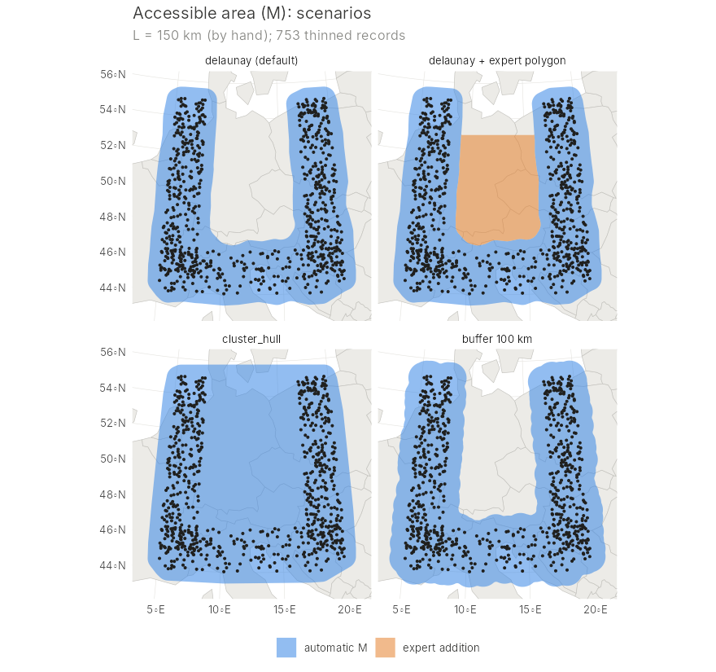

The example above uses simulated records with a hollow between two arms of the
range. The default Delaunay M leaves the hollow out; an expert polygon or a
cluster hull includes it.

**Compare several M by default.** The calibration area was the most
influential choice in simulations of model accuracy, explaining half of its
variance, more than regularisation, collinearity treatment and spatial
thinning together (Luna et al. 2024, *Biodiversity Informatics* 18, 43-55).
Treat `m_scenarios()` as part of choosing M, not as an optional check, and
report how much the candidates differ.

**M by simulated dispersal.** `m_simulate()` (or `delimit_m(method =
"simulation", env = env)`) follows Machado-Stredel et al. (2021): a niche
ellipsoid on the first principal components of the layers decides where
dispersers can establish; from random halves of the records, dispersers
move over `n_events` steps with a normal kernel (`kernel_sd` cells), and
the cells reached most often, without the 5% least accessed, form M. Cells
without values and `barrier` polygons cannot be crossed, so M stops at a
barrier wider than the kernel allows; the cells of all records are always
added. The grid is aggregated on disk when it is very large.

With `past` (the same layers for a glacial climate, e.g. the Last Glacial
Maximum), the simulation runs through a glacial cycle, as in their
"changing framework": a transition to glacial conditions, a glacial
period, a transition back and a current period (5, 10, 5 and 10 thousand
years by default, `periods`), in scenarios of 1 ka, each a weighted mean of
the two climates projected with the present PCA. Populations go extinct
where a new scenario is unsuitable; cells that had values only in the past
(shelves exposed at low sea level) can carry dispersal while the glacial
climate dominates, so land bridges are crossed. M is the accessed cells
with values today.

```r
ms <- m_simulate(occ, env_region, barrier = "mountain_ranges.gpkg",
                 kernel_sd = 2, n_events = 30)
ms_lgm <- m_simulate(occ, env_region, past = env_lgm,   # glacial cycle
                     kernel_sd = 2, n_events = 5)
ms; plot(ms)
sc <- m_scenarios(occ, scenarios = list(
  delaunay = list(),
  simulated = list(method = "simulation", env = env_region,
                   simulation = list(kernel_sd = 2, n_events = 30))))
```

**Minimal background area.** `m_minimal()` grows circles around the centre
of the records in steps of records included, then beyond the farthest one,
as in MinBAR (Rotllan-Puig & Traveset 2021, *Ecological Modelling* 439,
109353), but asks a model-free question: from which extent on does the
available environment stop changing? Consecutive extents count as stable
when their environments cannot be told apart (largest Kolmogorov-Smirnov
distance over the layers below its 5% critical value) for two steps. The
stable extent is a lower bound to compare with the other delimitations; a
continental gradient may never stabilise, and the printout then says so.

**Is the environment of M offered evenly?** Uneven availability of climates
inside the calibration area biases the estimated niche (Jimenez & Soberon
2022, *Ecological Modelling* 464, 109823). `m_availability()` (or
`m_report(m, env = env)`) is the continuous analogue of `m_class_shares()`:
for each predictor it cuts the records' range into bins, compares the share
of M's cells in each with an even spread, and flags variables with a large
thinly represented part, gaps, or low evenness. Read their response curves
with care, or consider a background stratified in environmental space.

```r
av <- m_availability(env, occ, m = m)
av                                   # flagged predictors, in plain words
plot_m_availability(av)
```

### 3. Cutting raster files to M

`crop_rasters()` cuts whole folders of rasters (e.g. the layers of every period or
scenario) to M or any polygon and writes them to a new folder. GDAL does the
work file to file, so memory use stays low. Finished files are skipped when
the run is repeated, and a failing file does not stop the others.

```r
res <- crop_rasters(c("climate/bio", "climate/orog"),      # folders of rasters
                    m,                                  # or "species_M.gpkg"
                    out_dir = "climate/M_area",
                    variables = c("bio01", "bio04", "bio05", "bio06", "bio10",
                                  "bio12", "bio17", "scd", "dem"))
table(res$status)
```

**Values are copied exactly.** CHELSA stores integers with a scale and offset
in the file metadata (e.g. temperature x 10 in Kelvin). Cropping by reading
the values into R and writing them back in the original integer type, e.g.
`terra::crop(r, v, mask = TRUE, filename = ..., datatype = datatype(r))`, can
round the values and drop the scale and offset. In our test it gave errors of
up to 0.95 deg C. `crop_rasters()` keeps the raw values, the data type, the
scale/offset and NoData, on exactly the input grid (nothing is resampled). For
a single raster in memory, `crop_to_m()` is enough.

### 4. Computing derived climate, terrain and soil variables

Bioclimatic variables describe temperature and precipitation, but not the
water balance, the heat and cold stress, the length of the season or the
light that limit many species.
`climate_indices()` computes such variables from **monthly
climatologies**: the 12 monthly means of maximum (`tasmax`), minimum
(`tasmin`) and mean (`tas`) temperature and precipitation (`pr`). Daily data
are not needed.

| Index | Group | Meaning | Unit | Useful for | Source |
|---|---|---|---|---|---|
| `vpd` | water | mean vapour pressure deficit (dew point from Tmin) | kPa | dryness of the air: stomatal closure and transpiration of plants, desiccation of amphibians, snails and insects | Allen et al. 1998; Grossiord et al. 2020 |
| `pet` | water | potential evapotranspiration (Hargreaves-Samani) | mm/year | evaporative demand and available energy; plant productivity and species richness | Hargreaves & Samani 1985; Allen et al. 1998 |
| `cmd` | water | climatic moisture deficit: sum of monthly PET − P where positive | mm/year | drought not met by rain: forest-steppe limits, drought-sensitive trees, C3 versus C4 grasses | Stephenson 1990; Wang et al. 2012 |
| `aridity` | water | aridity index P / PET (< 0.05 hyper-arid, > 0.65 humid) | – | the humid-arid gradient: biome limits, dryland and desert taxa | UNEP 1992 |
| `heat_stress` | heat | sum over months of Tmax above `heat_threshold` | °C × months | exposure to hot months: upper thermal limits of alpine and boreal taxa and of ectotherms; C4 advantage | this package; Ehleringer et al. 1997 |
| `sri` ⚑ | season | summer rain index: precipitation of the warmest quarter / annual (bio18 / bio12) | 0-1 | rain in the warm season: C4 versus C3 grasses, monsoon versus Mediterranean taxa | Teeri & Stowe 1976; Paruelo & Lauenroth 1996 |
| `synchronicity` ⚑ | season | heat-rain synchrony: 1 = the warmest and the wettest month coincide, 0 = six months apart | 0-1 | whether water arrives when it is warm: summer-rain versus winter-rain floras, C3/C4 balance | this package; Paruelo & Lauenroth 1996 |
| `t_wet` | season | mean temperature weighted by monthly precipitation (smooth bio8) | °C | temperature when water is available | this package; after Booth 2022 |
| `t_dry` | season | mean temperature weighted by monthly dryness, max(P) − P (smooth bio9) | °C | temperature of the dry season | this package; after Booth 2022 |
| `p_warm` | season | precipitation weighted by monthly warmth, T − min(T), × 3 (smooth bio18) | mm/quarter | rain in the warm season, like bio18 and `sri` | this package; after Booth 2022 |
| `p_cold` | season | precipitation weighted by monthly coldness, max(T) − T, × 3 (smooth bio19) | mm/quarter | rain in the cold season, like bio19 | this package; after Booth 2022 |
| `bio1` … `bio19` | bioclim | the standard bioclimatic variables from the same monthly layers; bio8, bio9, bio18, bio19 ⚑ | °C, mm | the usual predictors, on exactly the grid and period of the other indices | Busby 1991; Hijmans et al. 2005; O'Donnell & Ignizio 2012 |
| `gdd` | heat | growing degree days: monthly Tmean above `gdd_base` × days | °C × days | heat sum for growth and development: cold range limits of plants, number of insect generations | Woodward 1987; Prentice et al. 1992 |
| `cold_stress` | cold | sum over months of Tmin below `frost_threshold` | °C × months | winter severity: frost-sensitive plants, survival of overwintering stages | Woodward 1987; Sakai & Larcher 1987 |
| `frost_months` | cold | number of months with Tmin below `frost_threshold` | months | duration of frost: evergreen versus deciduous plants, length of dormancy or hibernation | Woodward 1987; Sakai & Larcher 1987 |
| `continentality` | heat | Tmean of the warmest month − that of the coldest | °C | annual temperature amplitude: oceanic versus continental species | Rivas-Martínez et al. 2011 |
| `dry_months` | water | months with P < 2 × Tmean (the dry season of Walter-Lieth diagrams) | months | length of the dry season: Mediterranean and savanna taxa, drought-deciduous plants | Bagnouls & Gaussen 1953; Walter & Lieth 1960 |
| `lgp` | season | length of the growing period: months with Tmean ≥ `gdd_base` and P ≥ PET / 2 | months | time when both warmth and water allow growth: crops and their wild relatives, annual plants | FAO 1978 |
| `emberger` | water | Emberger's pluviothermic quotient 2000 P / (M² − m²), M and m in Kelvin | – | Mediterranean bioclimatic stages (arid to humid); lower = drier | Emberger 1955; Daget 1977 |
| `ellenberg` | water | Ellenberg's quotient: Tmean of the warmest month / annual P × 1000 | °C/mm × 1000 | humidity gradient of temperate forests: beech dominates below about 30, oaks above | Ellenberg 1963; Fang & Lechowicz 2006 |
| `kira_warmth` | heat | Kira's warmth index: sum over months of Tmean − 5 where Tmean > 5 °C | °C × months | vegetation zones of East Asia (evergreen broad-leaved forest between 85 and 180) | Kira 1945; Kira 1991 |
| `kira_coldness` | cold | Kira's coldness index: sum over months of Tmean − 5 where Tmean < 5 °C (zero or negative) | °C × months | cold limit of evergreen broad-leaved trees in East Asia (about -10) | Kira 1945; Kira 1991 |
| `ra` | light | mean extraterrestrial radiation over the year (latitude only) | MJ m⁻² day⁻¹ | light at the top of the atmosphere; in a model a smooth stand-in for latitude | Allen et al. 1998 |
| `ra_gs` | light | extraterrestrial radiation received in the months with Tmean ≥ `gdd_base` | MJ m⁻² | light available while it is warm enough to grow: productivity at high latitudes and elevations | this package; Allen et al. 1998 |
| `daylength_start` | light | day length in the middle of the month in which the growing season starts | hours | photoperiod at the onset of growth: bud burst, flowering of long-day plants, end of diapause | Körner & Basler 2010; Way & Montgomery 2015 |
| `daylength_end` | light | day length in the middle of the month in which the growing season ends | hours | photoperiod at the end of the season: growth cessation and bud set of trees, start of diapause | Bradshaw & Holzapfel 2007; Way & Montgomery 2015 |
| `daylength_gs` | light | mean day length of the months with Tmean ≥ `gdd_base` | hours | photoperiod during growth: long-day versus short-day plants, daily activity time of diurnal animals | Saikkonen et al. 2012 |
| `daylight_gs` | light | hours of daylight in the months with Tmean ≥ `gdd_base` | hours | time for photosynthesis or foraging in the season: a short northern summer with long days against a long southern one | this package; Saikkonen et al. 2012 |
| `daylength_max` | light | day length on the summer solstice (latitude only; 24 = midnight sun) | hours | the longest day: species that need a critical day length to flower or to breed; like `ra` a stand-in for latitude | Allen et al. 1998; Bradshaw & Holzapfel 2007 |
| `days_to_solstice` | light | days from the start of the growing season to the summer solstice (negative = it starts later) | days | share of the season on lengthening days: phenological timing, species whose flowering is triggered before the solstice | this package; Körner & Basler 2010 |

⚑ = flagged as a composite variable (see
[below](#composite-bioclimatic-variables-and-smooth-substitutes)); flagged
variables are left out by default.

"Useful for" gives examples of the questions an index was made for or is
commonly used in; it is not a limit on its use. "Source" is the origin of
the index or of its ecological use (full references in `?climate_indices`);
"this package" marks definitions that are ours.

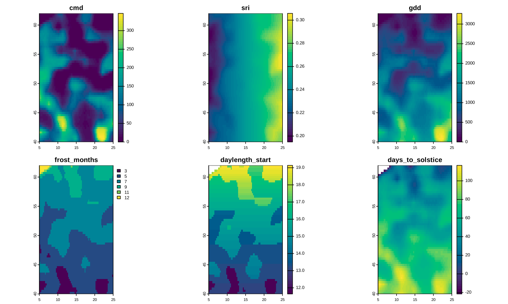

All unflagged indices from monthly data (42) are computed by default.
Choose some by name or by group (the Group column) with
`climate_index_names()`:

```r
climate_index_names()                       # all names, without the flagged
climate_index_names(flagged = TRUE)         # with bio8, bio9, bio18, bio19, sri, synchronicity
climate_index_names(table = TRUE)           # group, meaning, unit, relevance, source, flag
climate_indices(tmax, tmin, prec, indices = climate_index_names("water"))
climate_indices(tmax, tmin, prec, indices = c("cold", "gdd"))   # a group and a name
climate_indices(tmax, tmin, prec, indices = climate_index_names(drop = "light"))
```

The indices are computed from monthly means, so `gdd`, `lgp`,
`frost_months`, `cold_stress`, `dry_months` and the day-length indices of
the growing season approximate the daily quantities (`days_to_solstice` to
about one or two weeks). Several are correlated with each other and with
bioclim variables; let `select_variables()` choose among them, and
`variable_relevance()` tell which ones the species responds to.

**Light and day length.** Day length needs no extra data: it follows from
latitude and the day of the year. `ra` and `daylength_max` depend on
latitude alone, so in a model they stand in for latitude. The other light
indices combine latitude with the temperature season (when it is warm
enough to grow, `gdd_base`), so they differ between a mountain and its
foreland and change with the climate of another period: the photoperiod
when growth starts (`daylength_start`) and ends (`daylength_end`), the
mean day length and the hours of daylight of the season (`daylength_gs`,
`daylight_gs`), and how long before the summer solstice the season starts
(`days_to_solstice`). They are meant for photoperiod-sensitive organisms
(bud burst and bud set of trees, flowering of long-day plants, diapause of
insects), and can be useful outside niche modelling, e.g. in phenology or
growth models.

#### Composite bioclimatic variables and smooth substitutes

bio8 (mean temperature of the wettest quarter), bio9 (of the driest
quarter), bio18 (precipitation of the warmest quarter) and bio19 (of the
coldest quarter) combine temperature and precipitation over a quarter
that is chosen anew in every cell. Where two quarters are nearly equally
wet or warm, neighbouring cells pick different quarters, and the variable
jumps by many degrees or hundreds of millimetres along a line that has no
climatic meaning (Booth 2022, *Austral Ecology* 47, 1506–1514). The
artefacts are regional, often in equatorial and bimodal-rainfall areas,
and Booth advises to check the maps of the study area before use rather
than drop the variables everywhere. preENM's `sri` (bio18 / bio12) and
`synchronicity` (based on the months of the maxima) share the problem.

These six variables carry a flag in `climate_index_names(table = TRUE)`.
`climate_index_names()` leaves them out unless `flagged = TRUE`, with a
message the first time; `climate_indices()` computes them when asked by
name, with a message; and `select_variables()` warns when a top-ranked
set contains one (it recognises the usual layer names, e.g.
`wc2.1_30s_bio_18` or `CHELSA_bio8_1981-2010_V.2.1`).

As substitutes, `t_wet`, `t_dry`, `p_warm` and `p_cold` keep the
contrast of the four variables without choosing a quarter: every month
counts, weighted by how wet, dry, warm or cold it is. They change smoothly
where the quarters switch, so they can replace bio8, bio9, bio18 (and
`sri`) and bio19 in a model. They are our construction after Booth's
suggestions, not variables from the literature.

```r
ci <- climate_indices(tmax, tmin, prec, indices = c("season", "bioclim"))
# flagged variables only on request (then check their maps)
climate_indices(tmax, tmin, prec, indices = c("bio8", "bio18"))
```

#### Terrain variables

At fine grain, terrain shapes the microclimate, moisture and soils that
climate grids miss; for plants, especially in mountains, terrain and
remote-sensing variables add to climate (Schwager & Berg 2021, *Basic and
Applied Ecology* 54, 1–13). `topo_indices()` derives them from an
elevation raster. They form the `terrain` group of
`climate_index_names(table = TRUE)`, so `climate_index_names("terrain")` lists them
and the layers join any predictor stack for `sample_environment()` and
`select_variables()`.

| Index | Meaning | Unit | Source |
|---|---|---|---|
| `slope` | steepest gradient | degrees | Horn 1981 |
| `northness`, `eastness` | cos / sin of aspect × sin of slope: 0 on flat ground | −1 to 1 | after Guisan et al. 1999 |
| `tri` | terrain ruggedness: root of the summed squared differences to the 8 neighbours | m | Riley et al. 1999 |
| `tpi_<r>` | topographic position: elevation minus the mean within radius `r` (one layer per radius); + ridges, − valleys | m | Weiss 2001 |
| `dev_<r>` | deviation from mean elevation: TPI / SD of elevation in the same window, comparable between hills and mountains | – | De Reu et al. 2013 |
| `twi` | topographic wetness index ln(a / tan β) with D8 flow accumulation | – | Beven & Kirkby 1979 |
| `hli` | heat load: potential annual direct radiation from slope, aspect and latitude | MJ cm⁻² yr⁻¹ | McCune & Keon 2002 |

```r
ti <- topo_indices(dem, radius = c(0.5, 2, 5), radius_unit = "km",
                   path = "terrain", prefix = "DEM_")
```

Compared with `terra::terrain()`, `topo_indices()` adds:
- TPI at several radii, in cells or km, with round windows on
  longitude/latitude grids;
- its scale-free form, DEV;
- a TWI whose upslope area is summed from true cell areas, so it is
  correct on longitude/latitude grids;
- an HLI that uses each cell's latitude and folds aspect by hemisphere,
  so south-west slopes are warmest in the north and north-west slopes in
  the south.

The TWI needs the whole DEM in memory, so it stops above `max_cells`
(clip or aggregate the DEM first). The other indices are computed in
blocks and can be written straight to disk.

#### Soil variables

Soil is missing from climate grids, yet for plants it can matter as much
as topography: in-situ soil chemistry (B-horizon C:N, exchangeable
calcium) predicted forest understorey plants as well as topographic
variables did (Roe et al. 2022, *Journal of Biogeography* 49, 753–766).
`download_soilgrids()` fetches the mapped counterparts from SoilGrids 2.0
(Poggio et al. 2021, about 250 m): pH, organic carbon, nitrogen, CEC,
clay, sand and silt by default, plus bulk density, coarse fragments and
organic carbon density on request. It adds the C:N ratio and the depth to
bedrock from SoilGrids 2017 (Shangguan et al. 2017; not mapped in
SoilGrids 2.0). As with the CHELSA download, only your region is read from
the global files. Values are converted to the usual units (pH, g/kg, %,
cmol(c)/kg).

```r
# top 5 cm (the default), on its own 250 m grid
soil <- download_soilgrids("soil", extent = c(5, 30, 45, 56))
# 5-15 cm, warped onto the climate grid (averaging the 250 m cells)
soil <- download_soilgrids("soil", depth = "5-15cm",
                           template = "chelsa/CHELSA_bio1_1981-2010_V.2.1.tif")
climate_index_names("soil", table = TRUE)   # meanings, units, sources
```

SoilGrids maps six depth intervals: 0–5, 5–15, 15–30, 30–60, 60–100 and
100–200 cm. The top one or two suit most plants. The layers are
themselves predictions with large uncertainty where soil profiles are
few: download `stat = "Q0.05"` and `"Q0.95"`, or `"uncertainty"`, to see
where. Exchangeable cations, the strongest soil predictors in Roe et al.,
are not mapped, and pH is a poor indicator of fertility in acidic soils,
so C:N and CEC are worth keeping alongside it. If the server cannot be
reached, the function stops with an explanation; layers already
downloaded are kept, and an interrupted run continues where it stopped.

**1. Get the monthly files.** They can be downloaded automatically from
CHELSA V2.1 (no account needed). With `extent`, only your region is read
from the global files over the internet and saved, with the original values,
scale and offset:

```r
# present climate (1981-2010), 4 variables x 12 months
download_chelsa_monthly("chelsa_monthly", extent = c(-170, -30, -56, 72))
# future: any period, GCM and scenario
for (gcm in c("IPSL-CM6A-LR", "MPI-ESM1-2-HR", "UKESM1-0-LL"))
  for (ssp in c("ssp126", "ssp370", "ssp585"))
    download_chelsa_monthly("chelsa_monthly", period = "2071-2100",
                            gcm = gcm, ssp = ssp, extent = c(-170, -30, -56, 72))
```

A large region still means a large download (each global file is about
110 MB, and at least the full rows of the region are read; 48 files per
period and scenario). Interrupted downloads continue where they stopped.
You can also download the files by hand from
[chelsa-climate.org](https://chelsa-climate.org) (*Downloads → V2.1 →
climatologies*: `tasmax`, `tasmin`, `tas`, `pr` for months 01–12), or use
WorldClim monthly `tmax`, `tmin`, `tavg`, `prec`; any 12-layer monthly data
in °C and mm/month work. Cite CHELSA (Karger et al. 2017) when you use it.

**2. Compute the indices.**

```r
f <- function(v, ...) monthly_files("chelsa_monthly", v, must_contain = c(...))
ci <- climate_indices(tmax = f("tasmax", "1981-2010"), tmin = f("tasmin", "1981-2010"),
                      prec = f("pr", "1981-2010"), tmean = f("tas", "1981-2010"),
                      path = "indices", prefix = "CHELSA_1981-2010_")

# the same for every future scenario
for (gcm in c("ipsl-cm6a-lr", "mpi-esm1-2-hr", "ukesm1-0-ll"))
  for (ssp in c("ssp126", "ssp370", "ssp585"))
    climate_indices(f("tasmax", gcm, ssp), f("tasmin", gcm, ssp),
                    f("pr", gcm, ssp), tmean = f("tas", gcm, ssp),
                    path = "indices", prefix = paste0("CHELSA_", gcm, "_", ssp, "_"))
```

Existing output files are kept, so interrupted runs continue. Compute on
the original longitude/latitude grid (cut to your region with
`crop_rasters()` if you downloaded global files) and project the results
afterwards if you need another projection: that is faster than projecting
48 monthly layers, and the indices are computed from unsmoothed values.
Then add the new variables to `sample_environment()` / `select_variables()`
like any other layer.

**3. The same indices for the past.** CHELSA-TraCE21k (Karger et al. 2023)
gives monthly `tasmax`, `tasmin` and `pr` for every century of the last
22,000 years at about 1 km, so all indices can also be computed for, say,
the Last Glacial Maximum or the Younger Dryas, on the same grid as the
present. `download_chelsa_trace21k()` gets the files, for a region if you
give `extent`:

```r
trace21k_time(c(0, 12, 21))        # ka BP -> time id: 20, -100, -190
download_chelsa_trace21k("trace_monthly", kyr_bp = c(0, 12, 21),
                         extent = c(-26, 74, 38, 82))

for (id in c(20, -100, -190)) {
  f <- function(v) monthly_files("trace_monthly", v,
                                 must_contain = paste0("_", id, "_V1"))
  climate_indices(f("tasmax"), f("tasmin"), f("pr"),     # no tas: (tmax + tmin) / 2
                  path = "indices", prefix = paste0("TraCE21k_", id, "_"))
}

# the 19 bioclimatic variables of the same time steps
download_chelsa_trace21k("trace_bio", vars = "bio", kyr_bp = c(0, 12, 21),
                         extent = c(-26, 74, 38, 82))
```

Compare the past with the present of the same source (time step 0 ka BP)
or use an anomaly (`sample_environment(anomalies = ...)`), so that
differences between data sources are not read as climate change. Day
length is computed for today's orbit; at 21 ka BP the difference is small
compared with the monthly resolution, but it is an approximation. Check
the units of the downloaded files once (`terra::rast(file)`): temperatures
are stored in tenths of Kelvin, which `climate_indices()` recognises.

**Units.** Temperatures must be in °C and precipitation in mm/month.
CHELSA V2.1 stores temperature as Kelvin × 10 with a scale and offset in the
file, which terra applies on reading: the values are already °C, so do
**not** divide them by 10. `climate_indices()` checks this: Kelvin is
converted, and values that look divided by 10 stop with an explanation.

**Formulas** (all of them in `?climate_indices`): saturation vapour pressure
e(T) = 0.6108 exp(17.27 T / (T + 237.3)); VPD = (e(Tmax) + e(Tmin)) / 2 −
e(Tmin); PET = 0.0023 × 0.408 × Ra × (Tmean + 17.8) × √(Tmax − Tmin) mm/day,
with extraterrestrial radiation Ra (MJ m⁻² day⁻¹) from latitude and the
mid-month day (FAO-56 eq. 21; 0.408 converts it to mm of water); summer
quarters are any three consecutive months, including December–February.

#### Which climate product? Comparing sources before choosing one

WorldClim, CHELSA, regional atlases and reanalyses differ, most where
stations are sparse. Models fitted with different products differ too,
and some algorithms are more sensitive to the choice than others
(Rodríguez-Rey & Jiménez-Valverde 2024, *Ecological Informatics* 79,
102387). If you have downloaded two or more products,
`climate_source_compare()` shows how exposed your data are before you
commit to one. It reads every product at the records and at a sample of
cells of M, only at those points, and reports per variable:
- agreement (Lin's concordance correlation, graded after McBride 2005);
- Pearson and Spearman correlation;
- the systematic offset and the RMSE, in units and in SD of the reference;
- the overlapping index of the two distributions and the range covered;
- whether the correlations among the variables, which guide variable
  selection, are the same in each product (Mantel r);
- where the products disagree.

```r
wc <- terra::rast(list.files("worldclim", "bio_.*tif$", full.names = TRUE))
ch <- terra::rast(list.files("chelsa", "bio.*tif$", full.names = TRUE))
cs <- climate_source_compare(list(WorldClim = wc, CHELSA = ch), records,
                             m = m$m, reference = "CHELSA")
cs                                       # IN SHORT, exposure per variable
plot_climate_sources(cs)                 # agreement, correlation, offset
plot_climate_sources(cs, "map", variable = "bio12", file = "bio12_disagreement")
plot_climate_sources(cs, "scatter")      # product against reference
plot_climate_sources(cs, "density")      # the two distributions
write_climate_sources(cs, "climate_sources")
```

Layer names in the usual bioclim schemes (`bio_01`, `wc2.1_30s_bio_1`,
`CHELSA_bio1_1981-2010_V.2.1`) are matched automatically; other layers
need the same names in every product. The map shows the standardised
difference at the cells of M, with the records marked and the 5% of
cells with the largest disagreement ringed. It shows whether the records
sit where the products disagree.

Where agreement is poor, fit the model with each product and compare the
results, prefer the product validated for your region, or drop the
variable if others carry the same information. An offset of more than
3 SD usually means different units (°C against kelvin, values × 10).

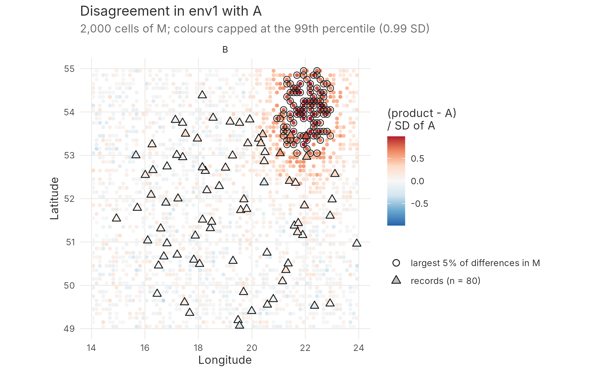

### 5. Checks before modelling

```r
check_sample_size(occ_thinned, env, k = 5)       # enough records? per predictor? per fold?
occ <- match_climate_period(occ, c(1981, 2010))  # records from the period of the climate data?
```

`check_sample_size()` counts occupied cells and compares them with the
minimum numbers of van Proosdij et al. (2016; 14 for narrow-ranged, 25 for
widespread species), with 10 records per predictor and with 5 per fold.
`match_climate_period()` adds `period_match` (`within`, `before`, `after`,
`unknown`) and `years_outside`, and prints the counts.

### 6. Imprecise records: keep, propagate or drop

Records are usually dropped above a fixed coordinate uncertainty, e.g.
1 km. That discards many usable records, often the older ones and those
from poorly sampled regions, and narrows the sampled niche: 5 km of
uncertainty on a plain changes the climate of a record very little, while
1 km on a steep slope can change it a lot. `uncertainty_environment()`
measures this directly. For each record it finds the cells that its
uncertainty circle touches and divides the range of every predictor among
them by the breadth of the species' niche on that predictor (the distance
between the 5th and 95th percentile of the values at all records):

```r
u <- uncertainty_environment(occ, env, max_rel = 0.1)
table(u$unc_ok, useNA = "ifany")
occ_ok <- u[which(u$unc_ok), ]
```

`unc_ok` is `TRUE` when the true conditions cannot differ from the
recorded ones by more than `max_rel` (here a tenth) of the niche breadth
on any layer. `unc_rel_<layer>` gives the value for each layer and
`unc_limiting` the layer that decides. Records without an uncertainty get
`NA` (or assume one with `na_uncertainty`); records above `max_radius_km`
are rejected without being examined. Use the layers and the resolution you
will model with, and run `filter_occurrences()` with a generous
`max_coord_unc_m` beforehand.

**Propagate instead of dropping.** A record whose environment varies within
its radius need not be dropped: its uncertainty can be carried into the
models. `unc_action` says what to do with each record: `"keep"` (uniform
environment), `"propagate"` (it varies) or `"drop"` (radius above
`max_radius_km`). Models built from positionally uncertain records can
remain ecologically interpretable: in simulations, positional error lowered
predictive performance more than it changed variable importance and
response shapes, especially for spatially homogeneous predictors (Gabor et
al. 2023, *Ecography* e06358). `jitter_uncertainty()` makes `n` replicate
datasets in which every record is moved to a random point within its own
uncertainty circle (uniform over its area), optionally only inside M, on
land and in cells with values in every layer; records with an uncertainty
of 0 do not move, and records without one stay fixed or get a default
radius (`na_uncertainty`):

```r
j <- jitter_uncertainty(occ, env, n = 20, m = m_area, land = "land.gpkg",
                        seed = 1)
j                       # IN SHORT: is propagating worth the extra runs?
plot_jitter(j)          # per record: uncertainty against environmental change
for (d in j$replicates) {
  # thin_by_cell(d, env), fit the model in your software, predict, save
}
write_jitter(j, "jittered")                       # or one CSV per replicate
```

The printout answers the practical question: how many records change their
environment by more than `max_rel` of the niche breadth across the
replicates (the same scale as `uncertainty_environment()`). If almost none
do, the replicates are environmentally the same dataset and propagating is
not worth the model runs. `propagate = "variable"` moves only the records
that `uncertainty_environment()` marks as `"propagate"`, keeping the others
where they are. After modelling, `coordinate_spread()` turns the replicate
predictions into the spread due to coordinate error (section 26 below).
Coordinates can also be optimised within the radius against model
performance (Wu et al. 2026, *Environmental Modelling & Software* 204,
107096); that needs the model and is left to the modelling software.

### 7. One point per raster cell and background points

After filtering, merge your sources, keep one record per cell of the
predictor rasters, and draw background points from the same grid:

```r
env <- crop_to_m(env, m)                     # predictors within M (see above)

occ <- merge_occurrences(sNMF = "genetic_samples.csv",   # your own samples
                         GBIF = clean,                     # filtered GBIF
                         species = "Genus species")
pres <- thin_by_cell(occ, env, priority = c("sNMF", "GBIF"))  # own samples win
bg   <- sample_background(env, n = 10000, n_sets = 10,
                          exclude = pres, seed = 123)

write.csv(pres[c("species", "lon", "lat")], "presences_1perCell.csv",
          row.names = FALSE)
for (k in unique(bg$set)) {
  write.csv(bg[bg$set == k, c("lon", "lat")],
            sprintf("background_10000_set%d.csv", k), row.names = FALSE)
}
```

`thin_by_cell()` moves each kept record to the centre of its cell and keeps
the original coordinates in `lon_orig` / `lat_orig`. Records outside the
rasters, or in cells where any layer has no value, are dropped.
`sample_background()` draws only from cells where all layers have values, one
point per cell, with an independent, reproducible seed for each set.

### 8. Environmental thinning

One record per cell still leaves densely sampled regions (e.g. typically Western Europe, North America etc.) over-represented in environmental space. `thin_environment()`
evens out that density without choosing a target number and without
truncating the niche:

```r
th <- thin_environment(pres, env,
                       radius_km = 1,          # positional accuracy of records
                       protect = list(source = "sNMF"),  # always kept
                       block_km = 50, block_min = 2,     # geographic quota
                       seed = 1)
th                                   # what was kept and why; checks
plot_env_thinning(th)                # PC pairs and the map, kept vs removed
write_env_thinning(th, "out", "presences_envThinned")
pres_env <- kept(th)
```

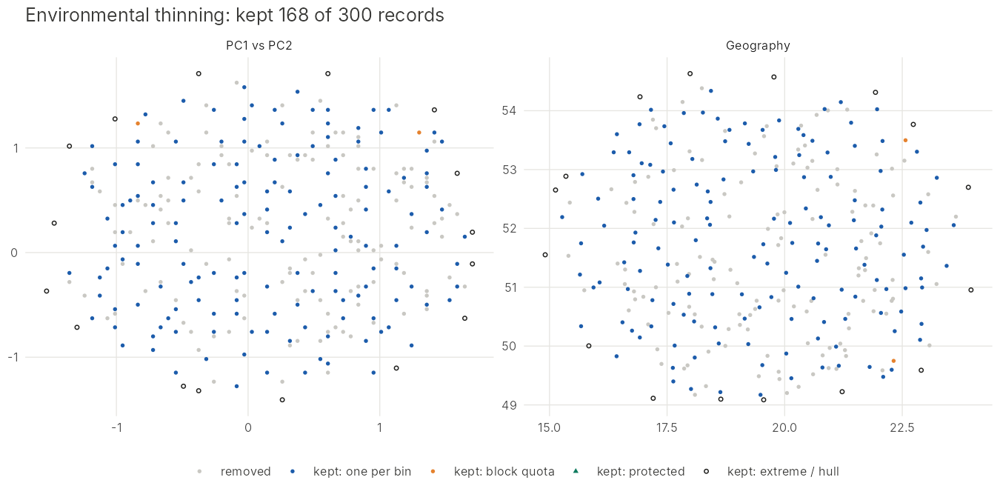

How it works:

1. A PCA of the whole area (random cells of `env`, precipitation amounts
   log-transformed) gives the environmental space; the first PCs with 95% of
   the variance are used (`axes = "raw"` for standardised layers).
2. **The bin width comes from the data**: the range of each axis among the
   cells within `radius_km` of a record is its environmental uncertainty;
   the median over records is the bin width. Two records in one bin differ
   less than one record's own uncertainty.
3. One record per occupied bin is kept (the most central). Every removed
   record therefore has a kept neighbour less than one bin away on every
   axis: only density changes, not the occupied space.
4. Always kept: protected records, the minimum and maximum of every layer,
   and the convex-hull vertices of every pair of axes (extreme combinations).
5. A geographic quota keeps at least `block_min` records in every
   `block_km` equal-area block, choosing the least represented environments
   first, so isolated areas are not lost.

The report shows that the ranges of all layers are identical before and
after, how far removed records are from kept ones, and how the number of
occupied bins changes with the bin width. Pass `template = th` to thin a
subset (e.g. one lineage) in exactly the same space.

### 9. Background strategies and recording effort

`sample_background(method = ...)` offers six ways to draw background
points (each with `n_sets` reproducible sets):

| `method` | Background | Use |
|---|---|---|
| `"uniform"` (default) | random cells | the classic choice |
| `"envstrat"` | even coverage of environmental bins (PCA of the layers) | common climates no longer dominate the background |
| `"effort"` | cells weighted by recording effort | like a target-group background: corrects the sampling bias of presences |
| `"enveffort"` | environmental bins with equal weight, effort-weighted cells within each bin | both corrections at once |
| `"target_group"` | cells weighted by the records of a target group (genus, family, ... recorded by the same people), raw or kernel-smoothed, optionally weighted by observer and stratified by environment | the dominant bias correction; see below |
| `"aggregation"` | cells weighted by how densely the presences themselves cluster around them in environmental and geographic space (Xu et al. 2024) | bias correction without a target group; see below |

No strategy is best for every species: which one gives the most
transferable models depends on how biased the records are and on how the
species' niche lies in the study area. Treat the method as one more choice
to test: fit models with two or more backgrounds and compare them on the
same hold-out folds and, where available, on independent (e.g. fossil)
records; `"uniform"` is a sound reference.

```r
bg <- sample_background(env, n = 10000, n_sets = 10, exclude = pres,
                        method = "enveffort", effort = effort$n_species,
                        seed = 123)
```

**Recording effort from GBIF.** One SQL download counts, per cell, all
vascular-plant records, the number of species recorded (the recommended
proxy) and records of companion species:

```r
q <- gbif_effort_sql(extent = c(-32, 75, 34, 82), cell = 0.1,
                     target = c("Silene acaulis", "Salix herbacea"))
tab <- download_gbif_effort(q, "gbif_effort")   # takes minutes to hours
effort <- gbif_effort_rasters(tab, c(-32, 75, 34, 82), cell = 0.1,
                              path = "gbif_effort")
```

This needs a free GBIF account and the `rgbif` package. **Never write your
password in a script.** Store the credentials once in your `.Renviron` file:
run `file.edit("~/.Renviron")` in R, add

```
GBIF_USER=your_user_name
GBIF_PWD=your_password
GBIF_EMAIL=your_email
```

save, and restart R. Cite the download DOI written to
`gbif_effort/effort_download_DOI.txt`.

**Target-group background.** Background drawn where related species were
recorded carries the same sampling bias as the presences. Among four
common corrections it emulated known sampling effort best, though it
sometimes overcompensated, so check the maps for realism (Barber et al.
2021, *Diversity and Distributions* 28, 128-141). `gbif_target_group_sql()`
builds the GBIF download of a genus, family or other group without your
species, record by record (with `recordedBy`) or counted per cell:

```r
q  <- gbif_target_group_sql(extent = c(5, 17, 43, 48),
                            group = c(family = "Rosaceae"),
                            exclude_species = "Genus species",
                            years = c(1980, 2025))
tg <- download_gbif_effort(q, "target_group")
bg <- sample_background(env, n = 10000, method = "target_group",
                        target = tg, target_bandwidth_km = 5,   # kernel (km)
                        exclude = pres, seed = 123)
```

- `target_bandwidth_km = 0` uses the records per cell (the classic
  target-group background); a bandwidth smooths them with a Gaussian
  kernel. Balej et al. (2025, *Ecography* e08202) recommend this smoothed
  version ("TGOB+") when no independent data are available; no single
  bandwidth was best, so try a few (e.g. 1, 2 and 4 cell widths).
- `target_observer = "recordedBy"` with `presences` weights each observer's
  normalised density by their share of the records of your species (their
  PW-OOA method, the best when checked against independent data).
- `target_stratify = TRUE` combines the target density with the
  environmental bins of `"enveffort"`.

**Aggregation background.** Without a target group, the sampling bias can
be estimated from the presences themselves. `method = "aggregation"`
weights each cell by the kernel density of the presences on each
standardised layer, each presence weighted by the inverse of its
geographic distance (`aggregation_k = 1`; `0` uses the environment only,
their "similarity background"), averaged over the layers (Xu et al. 2024,
*Ecological Informatics* 81, 102604). In their simulations it was more
accurate than the target-group background, and better than spatial
filtering with up to about 70 presences:

```r
bg <- sample_background(env, n = 10000, method = "aggregation",
                        presences = pres, seed = 123)
```

**How many background points?** The number and the spread of background
points change presence-background models in a species-dependent way
(Whitford et al. 2024, *Ecological Modelling* 488, 110604).
`background_sufficiency()` answers the part that does not depend on the
model: how many points represent the environment of M. It draws the
background (with your method and arguments) at an increasing series of `n`
and returns the saturation curve: the share of the environmental bins of M
holding a background point, the share of its area, and the largest
Kolmogorov-Smirnov distance of the marginal distributions. The printout
gives the `n` at which coverage saturates and says whether the usual 10 000
is enough:

```r
bs <- background_sufficiency(env, ns = c(1000, 2500, 5000, 10000, 25000),
                             method = "target_group", target = tg,
                             n_presences = nrow(pres))
bs
plot_background_sufficiency(bs, file = "background_sufficiency")
```

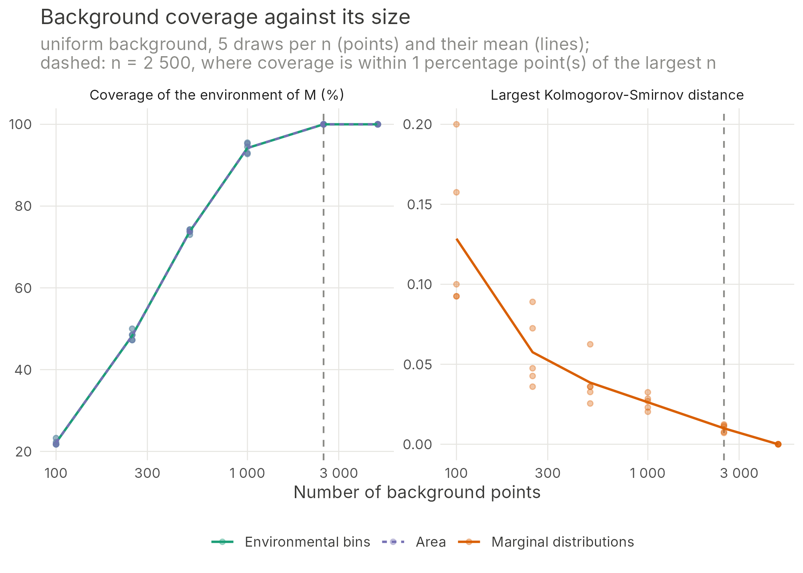

This is a lower bound for representing M, not the best number for a model:
in simulations the most accurate current predictions came from about
0.5-1 background points per presence or about 5% of the cells, and the
number mattered little for projections to future climates
(Rausell-Moreno et al. 2025, *Ecological Modelling* 507, 111177).

### 10. Which bias correction? Sensitivity of the data design

Sections 7 to 9 offer several corrections of sampling bias, and none can
be chosen from first principles: there is no optimal spatial filtering
distance (Lamboley & Fourcade 2024, *Journal of Biogeography* 51,
1783-1794), thinned records often did no better than the same number of
records removed at random (Ten Caten & Dallas 2023, *Ecosphere* 14, e4703),
and the best correction depends on the structure of the bias and can make
predictions worse for narrow niches (Inman et al. 2021, *Ecosphere* 12,
e03422). Without independent test data, internal evaluation is a poor guide
to whether a correction helps, so present models with and without
correction (Baker et al. 2024, *Diversity and Distributions* 30, e13802).

`bias_sensitivity()` makes the choice transparent on the data side. It
applies a grid of corrections and reports how each changes the design; it
fits no model and reports no predictive performance.

```r
bs <- bias_sensitivity(
  occ, env_m,
  thin = c("none", "cell", "distance", "environment"),
  thin_km = c(5, 10, 25, 50), env_mult = c(1, 2),
  background = list(uniform = list(),
                    target  = list(method = "target_group", target = tg)),
  bg_n = c(1000, 10000))
bs                                        # IN SHORT: what matters, what does not
plot_bias_sensitivity(bs, "n", "env_coverage")
plot_bias_sensitivity(bs, "bg_coverage", "overlap")
```

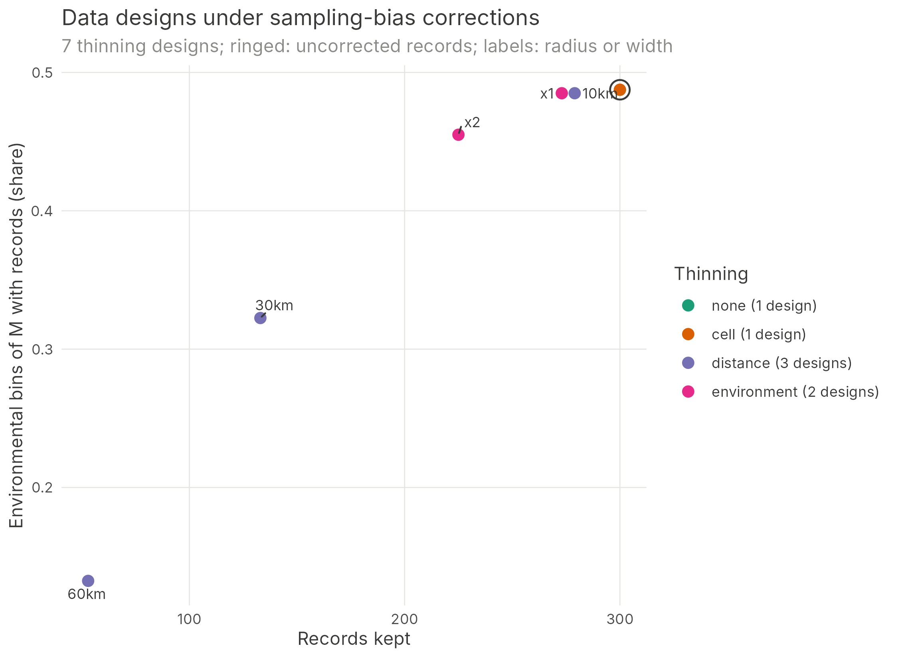

For each thinning design: records kept; the share of the environmental bins
of M that hold a record and of the records' own bins still occupied; the
same coverage for random subsets of the same size (does the thinning keep
more environment than losing records at random?); the Clark-Evans ratio of
nearest-neighbour distances; the range of each layer still spanned and the
gaps to the limits of M (as in `niche_truncation()`); and the shift from
the uncorrected records in environmental space. For each background: its
coverage of M, its shift from a uniform background, and its overlap with
the records. The printout names the choices that change the design most
and those that barely matter, and the thinning designs that leave the niche
intact.

### 11. Checking that the niche is not truncated by M

A model learns only the part of a species' response that the calibration
area contains. If the records are still frequent where the conditions of M
end, the limit of the niche lies outside M, and a projection to conditions
beyond M extrapolates a curve whose end was never seen.
`niche_truncation()` checks every predictor at both ends:

```r
tr <- niche_truncation(occ, env_m,
                       projections = list(lgm = env_lgm, ssp370 = env_2070))
tr
plot_niche_truncation(tr)
```

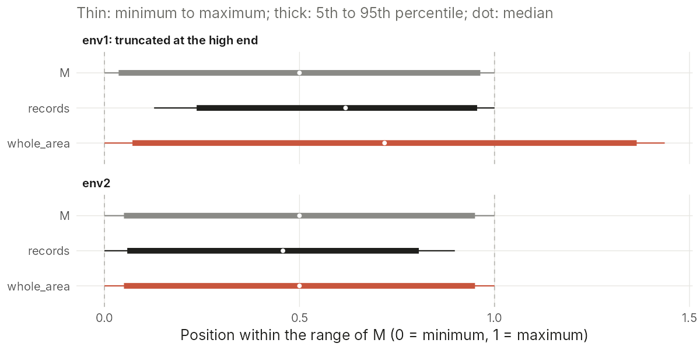

* `edge_low`, `edge_high`: how often records fall in the outer 5% of M's
  conditions, relative to how common those conditions are in M (0 = the
  species avoids the margin, so its limit is inside M; 1 or more = it uses
  the margin at least as often as M offers it: `truncated_*`).
* `gap_low`, `gap_high`: the distance between the most extreme record and
  the limit of M, as a share of M's range.
* For each projection, the share of cells beyond M and beyond the records,
  and `risk_low` / `risk_high` where a truncated end is exceeded.

For a flagged variable, consider a larger M, another variable, or clamping
and a cautious reading of the projection. The flags are a screening aid: a
species may truly live up to a coast or a mountain crest where M ends, and
sampling bias near an edge inflates them, so use thinned records.

**Modelling a widespread species in one region: is a nested model
needed?** Many studies model a species only in a region of interest, e.g.
one country, although it lives far beyond. The regional model then learns
only the conditions the species meets there, which is the truncation above
caused by the borders of the study rather than by M. Spatially nested
(hierarchical) models combine a model of the whole range, often coarser,
with the regional one (e.g. the regional model gets the whole-range model as
a covariate, or the two are multiplied). In 108 tree species of Spain and
Switzerland, they removed truncation and extrapolation and predicted better
than regional-only models (Goicolea et al. 2025, *Ecography* e07328). Whether
you need one depends on how much of the niche your region contains.
`niche_coverage()` measures this from records of the whole range (e.g.
GBIF) and layers covering it:

```r
nc <- niche_coverage(occ_whole_range, env_whole_range, region = country,
                     log_vars = "auto",   # log1p of precipitation amounts
                     file = c("niche_coverage.png", "niche_coverage.pdf"))
nc                                    # results, statistics, advice
plot_niche_coverage(nc)               # niche space and map side by side
unfilled_records(nc)                  # records in the unfilled niche, to check

# with a separate regional data set (e.g. a national survey), the usual
# case for nested models
nc <- niche_coverage(occ_whole_range, env_whole_range, region = country,
                     region_points = occ_national)
```

Large global layers (e.g. 30 arc-second CHELSA) are fine: the function
reads values only at the records and at random locations in the region
(`n`, default 100,000), so memory does not grow with the size of the
rasters.

**The records and the layers must cover the whole range of the species.**
Records outside the layers have no values and are left out; the function
says how many. If only the records of the region remain (e.g. the layers
were cut to M, or the records are those already thinned within M), the
region trivially contains their niche: the function warns and the advice
reads "cannot be judged". The region itself can be a country or the M of
the regional model.

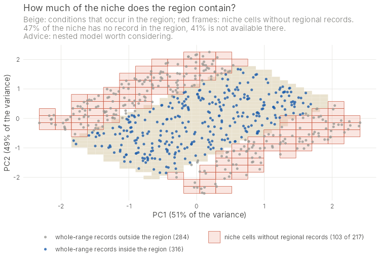

| Result | Meaning |
|---|---|
| `unfilling` | share of the species' niche without a regional record, the measure of Goicolea et al. (2025): the space of the first two principal components is cut into cells, the niche is the cells holding whole-range records, and each cell counts once however many records it holds |
| `not_available` | share of the niche cells whose conditions do not occur in the region at all; no regional model can learn them |
| `unfilling_records`, `not_available_records` | the same counted by records; for comparison only (see below) |
| per variable: `coverage`, `outside_records`, `outside_region` | part of the variable's range covered by the regional records, and the share of whole-range records beyond the regional records and beyond the region's conditions |
| `unfilling_lo`, `unfilling_hi` | bootstrap 95% interval of `unfilling` (resampled records) |
| `unfilling_null`, `unfilling_ses`, `unfilling_p` | the unfilling a random sample of the whole-range records of the size of the regional records would leave, and how far the region's value is beyond it |
| robustness tables | `unfilling` when a niche cell needs 1, 2, 3 or 5 records, and with a coarser and a finer grid; the printout gives the resulting range |
| `advice` | graded by `unfilling` (`limits = c(0.1, 0.25, 0.5)`): small gap, regional model sufficient; moderate gap, a nested model worth considering for projections; large gap, nested model advised; very large gap (above 50%, "very poorly filled" in Goicolea et al. 2025, the only limit taken from the paper), strongly advised; "cannot be judged" if all records lie in the region |

**How serious is the gap?** The bootstrap interval says how much the
unfilling depends on the particular records. The null comparison separates
two causes: if the region leaves much more of the niche unfilled than a
random sample of the same number of whole-range records would (large SES,
small p), the region lacks conditions of the niche; if not, the gap is
about what its number of records alone would leave, and more regional
records may close it.

**Sparse records and the grid.** One record in a remote cell counts as
much as a thousand in another, so a handful of outliers, records of a
related taxon or wrong coordinates can decide the advice. The printout
gives the unfilling when cells need 2, 3 or 5 records and with a coarser
and a finer grid, and sums it up as a range, e.g. "19% to 36%: from a
moderate to a large gap"; `unfilled_records()` lists the records in
unfilled cells with their coordinates so you can map and check them. The
grid is 20 x 20 cells by default and coarser with fewer than about 1,200
records, so that occupied cells hold several records on average
(`n_bins` to set it).

**Why niche cells and not records.** Regions of interest are usually the
best-sampled part of a range. If 93% of the records come from the region,
the share of *records* in the unfilled niche can never exceed 7%, even if
the other 7% reveal a large part of the niche: a broad niche known from few
records elsewhere would hardly count, and the advice would wrongly say that
a regional model is enough. Counting each occupied cell of environmental
space once removes this dependence on sampling effort. The printout gives
both, and the plot frames the unfilled niche cells in red. Per variable,
the shares are smaller than in the niche, because a record can lie within
the range of every single variable but in a combination of conditions that
the region lacks.

If `unfilling` is much larger than `not_available`, the missing conditions
exist in the region but the species has no records there (absent,
undersampled or limited by other factors), which a nested model does not
solve by itself. Then run `niche_truncation()` on the regional calibration
area to see along which predictors and at which end the response is cut.

**What a nested model adds to projections.** A model of the whole range
knows conditions that the regional records lack. A species common across
Europe and modelled only in Poland, for example: as Poland becomes warmer,
its future conditions leave the Polish niche, and a regional model predicts
losses, although the species lives in such conditions further south. The
whole-range model does not predict those losses. This assumes that the
regional populations can live in the conditions of the populations
elsewhere (or be replaced by them); strong local adaptation would make the
nested model too optimistic. `classify_points()` shows how much of the
region is in that situation: it places any points in the same niche space,
e.g. the region under a future (or past) climate, evaluation sites or
fossil sites. Projected conditions in cells known only from elsewhere are
where the nested model changes the prediction. With `predicted` (whether
your regional model predicted each point as suitable), it counts the misses
per category:

```r
fut <- terra::spatSample(env_2070_region, 5000, na.rm = TRUE)  # or values at sites
cl <- classify_points(nc, values = fut)
cl                                         # share of points per category
cl <- classify_points(nc, values = site_values, predicted = suitable)
cl                                         # where the misses are
```

| Category | Meaning for a nested model |
|---|---|
| `filled` | conditions known from regional records: a nested model adds nothing; misses here come from the model, the variables or the records |
| `elsewhere, available` / `elsewhere, absent` | conditions known only from records outside the region (occurring in the region today, or not): a nested model can help |
| `region only`, `available, unoccupied`, `unoccupied` | conditions with too few or no records of the species anywhere |
| `outside` | beyond all conditions the species is known from: extrapolation for any model |

New values must be in the units of the layers used in `niche_coverage()`;
points that land far beyond the whole range in the niche space, or
variables with a median far from that of the records (e.g. Kelvin against
degrees Celsius), give a warning.

**Acting on truncation.** Ignoring truncation is costly: models lose
accuracy when transferred over distance and with extrapolation (Rousseau &
Betts 2022, *Ecography* e06060), when the niche has changed (Liu et al.
2022, *Ecology* 103, e3719), and in invaded ranges (Nguyen & Leung 2022,
*Global Ecology and Biogeography* 31, 1051-1065). `truncation_remedy()`
takes the result of `niche_truncation()`, the records, layers that reach
beyond M and M itself, and proposes a remedy for each truncated end:

- **Extend M** when the missing conditions are adjacent: the band of
  conditions just beyond M's limit (a quarter of M's range, with the other
  variables within the records' range) begins next to M, and a modest
  extension towards it (at most three times M's area) samples every part
  of the band. The printout says how far and how much larger.
- **Integrate donor regions** when the conditions occur only farther away:
  regions where they do, with their distance and the ends they supply, so
  that you can look for records there and combine the data (Chevalier et
  al. 2021, *Ecological Applications* 31, e02427).
- **Accept the truncation**, and state it, when the conditions occur
  nowhere in the layers (e.g. only in a future climate): projections into
  them extrapolate.

It also prepares a spatially nested design: a *parent* dataset (records of
the whole range, `parent_records`, within the extended extent and the donor
regions, to be modelled at a coarser resolution with climatic variables) and
a *child* dataset (the records in M at full resolution). Fit the parent
first, project it onto the child's grid, and use the projection as a
covariate of the child model, or multiply the two predictions (geometric
mean); the covariate strategy was the more accurate (Goicolea et al. 2025).

```r
rem <- truncation_remedy(tr, occ, env_europe, m,
                         parent_records = gbif_whole_range)
rem                                  # remedy per truncated end, in plain words
plot_truncation_remedy(rem)          # M, the extension, the donor regions
write_truncation_remedy(rem, "nested")   # parent/child CSV, extents, README
```

### 12. Selecting predictor variables across periods and regions

Collinearity between predictors can change through time. A set that is
uncorrelated today may be collinear at the Last Glacial Maximum or in 2070,
or inside a mountain range, and a model projected there then rests on
unstable relationships. `select_variables()` therefore searches **every**
subset of the candidate variables. It keeps the sets uncorrelated in all
periods (or scenarios) and regions, scores them on transferability, and
returns a **ranked list of sets** for you to choose from on ecological
grounds, instead of one automatic answer.

1. `sample_environment()` draws area-proportional random cells from each
   data set (e.g. present, LGM, future scenarios), plus cells common to all.
   It can add anomaly ("delta") data sets at those cells, and assigns cells
   to regions (polygons such as mountain ranges, or a grid of tiles).
2. **Screen:** a set passes when every pair has |Spearman rho| < 0.8 and the
   rank-based VIF is at most 5 in every data set. Inside regions the limits
   are softer (0.85 and 10). Optionally, every set must contain at least one
   variable of each group, e.g. one temperature and one moisture variable.
3. **Scores:**
   - `novelty`: the share of cells of the target period outside present
     conditions (MESS < 0);
   - `gradient_min`: whether each variable keeps its spatial pattern
     between periods;
   - `agreement_min`: the agreement of two data sources for the same period;
   - `worst_vif` and `regional_vif`.
4. **Ranking:** within each set size, the Pareto front and a transparent
   mean rank. There is no hand-made total score.

```r
vars <- c("bio01", "bio04", "bio05", "bio06", "bio07", "bio10", "bio11",
          "bio12", "bio13", "bio14", "bio15", "bio16", "bio17")
regions <- sf::st_read("regions.gpkg")     # polygons, e.g. mountain ranges;
                                           # or tiles: list(x = c(-30, 20, 70), y = c(35, 60, 85))
es <- sample_environment(
  list(present = "M_area_present",         # folders, files or SpatRasters;
       YDS     = "M_area_12ka",            # layers are matched by name,
       LGM     = "M_area_21ka"),           # e.g. ..._bio01_... -> bio01
  vars = vars, regions = regions, n = 1e5, seed = 1,
  fix_scale = TRUE)    # same scale in all data sets (e.g. a layer stored x 10 in one of them)

vs <- select_variables(
  es, sizes = 3:6,
  targets = c("YDS", "LGM"),                     # periods scored for novelty
  require_one_of = list(
    temperature = c("bio01", "bio05", "bio06", "bio10", "bio11"),
    moisture    = c("bio12", "bio13", "bio14", "bio16", "bio17")),
  reference_sets = list(first_choice = c("bio04", "bio05", "bio06",
                                         "bio14", "bio15")))
vs                               # best sets, a summary in words, then the details
best_sets(vs, n = 10, size = 4)  # ranked sets of one size with their scores
recommend_sets(vs)               # the summary alone
vs$frequency                     # how often each variable is in good sets
vs$pairs                         # each pair: rho per data set, driver, ...
plot_variable_sets(vs)           # score card of the best sets
plot_variable_tree(vs)           # tree of the variables with the best sets below

# save the results
write.csv(best_sets(vs, n = 10), "best_variable_sets.csv", row.names = FALSE)
write_variable_selection(vs, "correlation", "species")   # all tables and figures
```

Printing `vs` shows the result in the order you need it: the **best sets**
of every size, then **in short** a few sentences (the suggested set and how
good it is, close alternatives, the sizes for which nothing passes and
why, variables that the good sets share or that never pass, correlations
that change between periods, what the regional screen excluded), then the
details. The suggested set is the best-ranked one of the largest size that
passes; treat it as a starting point and choose among the top sets on
ecological grounds. If no set of a size passes, `best_sets(vs, size = 4)`
returns no rows and says at which filter they were lost, e.g. that every
combination of four variables contains a collinear pair.

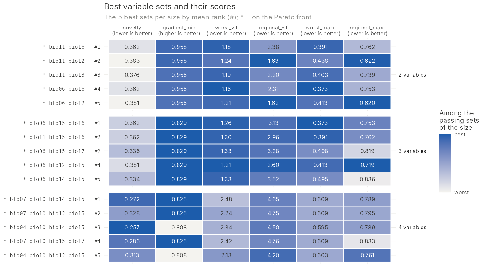

In the score card each row is a set and each column a score, and `*` marks
the Pareto front. The shading compares the passing sets of one size:
darker = better, i.e. the **lowest** value in columns marked "lower is
better" (novelty, VIF, correlations) and the **highest** in columns marked
"higher is better". Choose what it shows and save it:

```r
plot_variable_sets(vs, sizes = 2:3, n = 4)       # sizes 2 and 3, 4 sets each
plot_variable_sets(vs, sizes = 3, n = "all")     # every passing set of size 3
plot_variable_sets(vs, file = "variable_sets.pdf")   # or .png, .svg
write_variable_selection(vs, "out", format = c("png", "pdf"))
```

`plot_variable_sets(vs, type = "scatter")` shows all passing sets on two
scores instead.

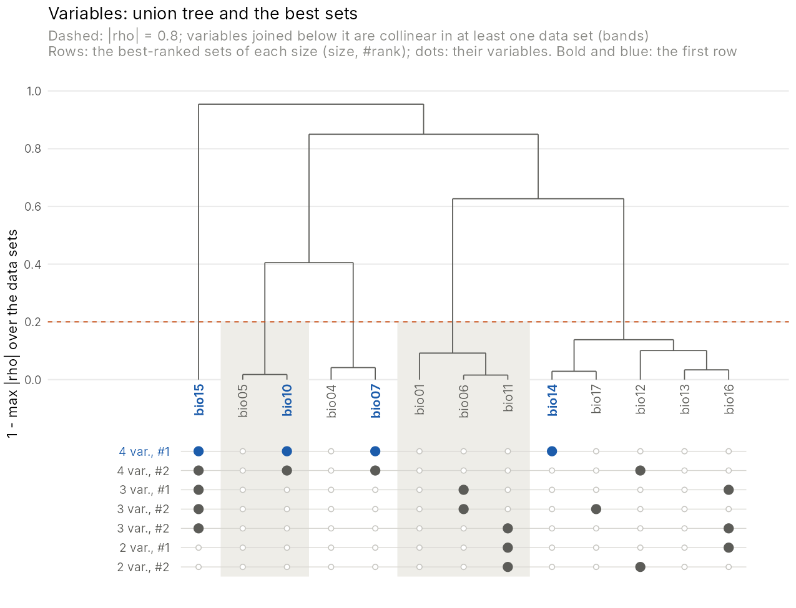

In the tree, variables joined below the dashed line are collinear in at
least one data set; these clusters are shaded alternately. Each row below
the tree is one set (its size and rank on the left) and the dots mark its
variables, so you can see that a set takes one variable from a cluster and
which variables are interchangeable. The first row is in blue and its
variables are in bold. Show your own choice next to the best set with
`plot_variable_tree(vs, c(best = best_sets(vs)$set[1], mine = "bio05 bio15 bio17"))`.

**Regions.** Each region of each data set is reported on its own line, so
you can see where a correlation comes from:

```r
correlation_by_region(vs)        # all candidate variables
#>  data_set      region cells screened max_abs_rho          pair pairs_above max_vif passes
#>   present        Alps 12350     TRUE       0.991 bio05 ~ bio10          21   310.2  FALSE
#>   present Carpathians  8120     TRUE       0.987 bio01 ~ bio10          19   270.8  FALSE
#>       LGM        Alps 11980     TRUE       0.994 bio12 ~ bio16          24   402.5  FALSE
#>   ...
correlation_by_region(vs, best_sets(vs)$set[1])   # the set you chose
#>  data_set      region cells screened max_abs_rho          pair pairs_above max_vif passes
#>   present        Alps 12350     TRUE       0.612 bio04 ~ bio15           0    2.31   TRUE
#>   present Carpathians  8120     TRUE       0.701 bio06 ~ bio14           0    2.87   TRUE
#>       LGM        Alps 11980     TRUE       0.823 bio05 ~ bio14           0    4.90   TRUE
#>   ...
```

(The numbers are illustrative.) The first table shows the whole pool,
where nearly every region holds collinear pairs; the second shows a set,
with `passes` for the regional limits. `best_sets()` gives for every set
its largest regional correlation (`regional_maxr`) and the region where it
occurs (`worst_region`), and `vs$pairs` the same for every pair
(`max_abs_regional`, `regional_driver`). Regions with fewer than
`min_region_n` sampled cells are listed with `screened = FALSE` and not
used; draw more cells (`n`) or lower the limit to include them.

**Ice and sea in past periods.** Palaeoclimate layers usually have values
under the ice sheets and over what was sea. Those cells are sampled like
any other, and a region that was glaciated is screened as if it were land,
which can exclude good sets for no reason. Leave such cells out per data
set with `exclude` (polygons or a raster) or restrict a data set with
`keep`, or leave a region out of the screen for one period:

```r
es <- sample_environment(
  list(present = "M_area_present", YDS = "M_area_12ka", LGM = "M_area_21ka"),
  vars = vars, regions = regions, n = 1e5, seed = 1,
  exclude = list(YDS = "ice_12ka.gpkg",       # e.g. DATED-1 ice extents (Hughes et al. 2016),
                 LGM = "ice_21ka.gpkg"),      # or a glacier raster such as TraCE21k glz
  keep    = list(LGM = "land_21ka.tif"))      # optional: the land of that period

vs <- select_variables(es, sizes = 3:6,
                       skip_regions = "LGM | Scandes")   # or skip one region in one period
```

A raster mask takes every cell with a value other than `NA` and 0, so look
at the layer first. Nothing is downloaded automatically: ice reconstructions
differ between regions and authors, and the choice is yours. Without a
mask, data sets whose names or files look like past periods (`LGM`, `21ka`,
TraCE21k time ids, ...) give a warning; if your layers are already cut to
the land of each period, switch it off with
`options(preENM.past_warning = FALSE)`. The summary also names the regions
in which pairs are excluded only by the regional screen, which is where to
look first.

**Two sources for one period, and anomalies.** If you have the calibration
period from two sources (e.g. an observation-based climatology and the
present-day step of the palaeoclimate model), add both and name them in
`agreement`: variables on which the sources disagree are scored down.
`anomalies` builds "delta" data sets at the sampled cells, the
high-resolution present plus the model's change:

```r
es <- sample_environment(
  list(present = "M_area_present", model_present = "M_area_0ka",
       LGM = "M_area_21ka"),
  vars = vars, n = 1e5, seed = 1, fix_scale = TRUE,
  anomalies = list(LGM_delta = c(current = "present", past = "LGM",
                                 model_present = "model_present")),
  ratio_vars = c("bio12", "bio13", "bio14", "bio16", "bio17"))  # change as a ratio
vs <- select_variables(es, sizes = 3:6, targets = c("LGM", "LGM_delta"),
                       agreement = c("present", "model_present"))
```

For future climate, use the scenarios as data sets, e.g.
`list(present = ..., ssp126_2070 = ..., ssp585_2070 = ...)`. Every scenario
then enters the screen, and `novelty` reports the worst one.

The figures above use simulated climate (thirteen layers in five groups
of collinear variables, three periods, six regions).

### 13. Are the selected predictors better than random variables?

A set of uncorrelated predictors can still hold layers that mean nothing to
the species. The test of Konowalik (2022) answers this by modelling the
predictors together with random variables and removing those that are no
more important than the random ones. preENM offers it in two forms.

**Before any modelling.** `variable_relevance()` compares, for each layer,
the values at the records with the values available in the calibration
area (Kolmogorov-Smirnov distance `D`), and asks how often a random layer
reaches the same distance at the same records:

```r
rel <- variable_relevance(occ_thinned, env, n_null = 499)
rel
#>        layer     D null_mean null_95 p_value relevant shift_sd breadth_ratio
#>  temperature 0.458     0.190   0.311   0.002     TRUE    0.705         0.459
#>     rainfall 0.290     0.179   0.319   0.080    FALSE   -0.306         0.478
#>        slope 0.063     0.185   0.310   0.995    FALSE   -0.029         0.911
```

The random layers are not white noise. Real layers are smooth and records
are clustered, so a meaningless smooth layer differs from the background at
the records far more than noise does (Fourcade et al. 2018 predicted
distributions from paintings). The null layers therefore have the spatial
structure of the real one: `null = "field"` draws smooth random surfaces
with the same autocorrelation range (any shape of M), `null = "shift"`
moves the layer itself around the raster (torus translation, Harms et al.
2001; faster and exact, for an M that fills most of the rectangle).
`null = "noise"` is the classic random variable without spatial structure
(the layer's values shuffled among the cells); it is there for comparison
and nearly every layer passes it.
`shift_sd` and `breadth_ratio` say how the species responds: its optimum
is shifted from the mean of the area, or its niche is narrower than the
area.

It is a screen and it has limits: it looks at one layer at a time (an
interaction can be missed), a layer correlated with a true driver passes
too, recording bias along a layer looks like a response (use thinned
records), and a layer that is one gradient across the whole area cannot be
told apart from geography.

**With cross-validation, run it within the folds.** The test uses the
records, so dropping layers because of it is feature selection on the
response. If the models are later cross-validated, selection on all records
lets the test records influence the models, a common form of data leakage
(Stock et al. 2023, Table 1): run it on the training records of each fold.
Collinearity screening with `select_variables()` does not use the records
and can be done once.

**Inside the models, with any software.** `random_variables()` writes
random layers to add to the predictors. Each takes the values of one real
layer (same distribution, same empty cells) and arranges them in smooth
random patches of the same size as in the real layer; `method = "shuffle"`
gives the classic white-noise variable.

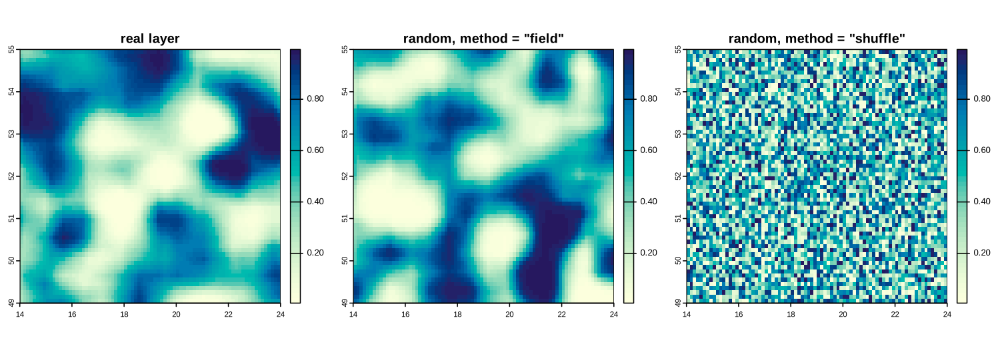

```r
rnd <- random_variables(env, n = 5, seed = 1, filename = "random.tif")
# fit your models with c(env, rnd), several algorithms and runs, and
# collect the importance of every variable in a long table
keep <- compare_to_random(importance, variable = "variable",
                          value = "importance", algorithm = "algorithm",
                          run = "run")
keep
#>     variable Maxent  GLM   RF  GBM  GAM algorithms mean_importance  keep
#>  temperature    1.0  1.0  1.0  1.0  1.0          5            41.2  TRUE
#>     rainfall    0.8  0.4  1.0  0.6  0.2          3            12.9  TRUE
#>        slope    0.0  0.2  0.4  0.0  0.0          0             2.1 FALSE
```

The columns of the algorithms give the share of runs in which the
predictor was more important than the best random variable
(`threshold = "max"`; a number such as `0.95` uses that quantile of the
random variables instead, which is less dependent on how many there are).
A predictor is dropped only when most algorithms do not support it. Remove
those, make new random variables, fit again, and repeat until every
predictor is kept, because importance is shared among predictors and
changes when one is removed.

### 14. Does the design depend on the grain?

The grain (cell size) of a model is usually whatever resolution the rasters
happen to have, yet spatial scale and resolution can change the
conclusions of distribution models (Henderson et al. 2023), and how well
suitability predicts local abundance depends on grain and on the scale of
the covariates (Brambilla et al. 2023; Ferrer-Ferrando et al. 2025).
`grain_sensitivity()` repeats the preparation at a series of coarser
grains and reports how the design changes. At each grain it:

1. aggregates the layers on disk with GDAL, one grain at a time (as
   `crop_rasters()` does), to the mean of the native cells, in floating
   point so that averages of integer layers are not rounded;
2. keeps one record per cell (`thin_by_cell()`, section 7) and thins the
   records in environmental space (`thin_environment()`, section 8);
3. counts the records whose coordinate uncertainty spans too much of the
   niche at that grain (`uncertainty_environment()`, section 6);
4. samples the layers and runs the variable selection
   (`sample_environment()`, `select_variables()`, section 12).

```r
g <- grain_sensitivity(records, list(present = now, LGM = lgm),
                       factors = c(1, 2, 4, 8), sizes = 3:6, seed = 1)
g                                 # IN SHORT: up to which grain the set is stable
plot_grain_sensitivity(g, file = "grain_sensitivity")
write_grain_sensitivity(g, "grain")
```

The printout starts with the practical answer: the coarsest grain at which
the selected variable set (the top-ranked set of `size` variables) is still
the same as at the finest grain. Agreement between grains is measured with
the Jaccard index of the selected sets and of the collections of passing
sets; the latter is safer when several sets share the top rank. The table
also gives the records kept after cell and environmental thinning, the
share of records too uncertain for the grain, the number of collinear
pairs and the mean change of Spearman rho. Give the periods or scenarios of
the projections as data sets, as in your own selection, so that novelty and
gradient stability rank the sets too. A record that sits near the edge of
a coarse cell may span two cells with different values, so the share of
records too uncertain can rise as well as fall with grain.

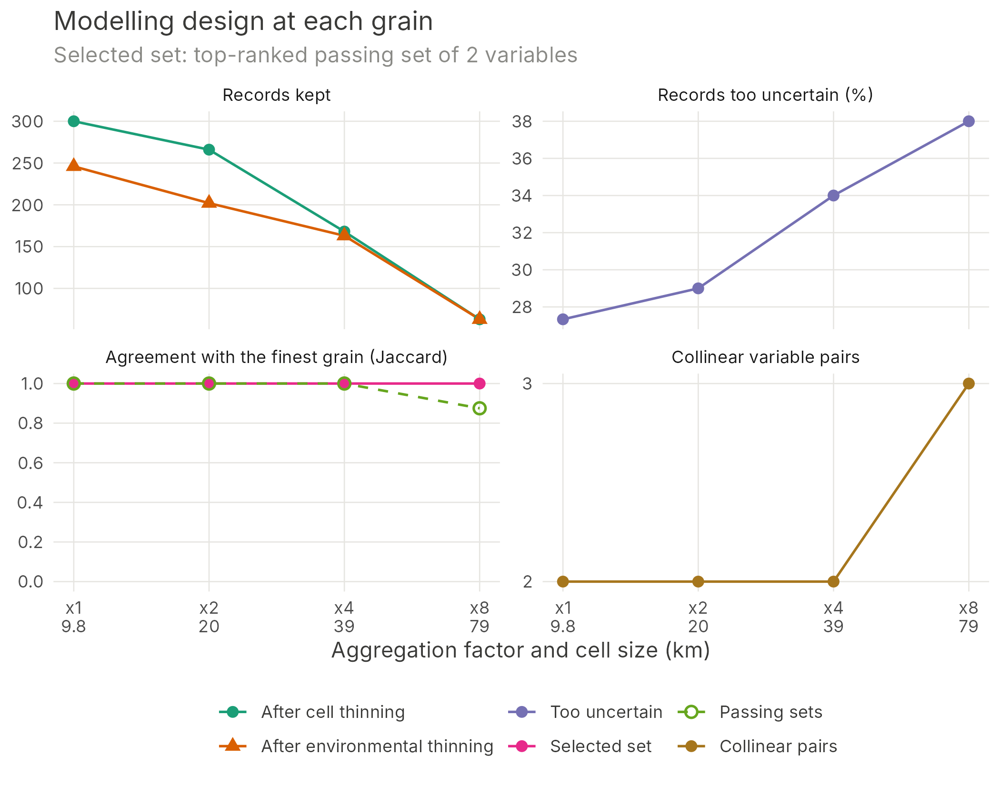

Grain is a choice about the ecology (the scale at which the species
responds) and the data (the positional accuracy of the records); the stable
range is the room within which to make it. Treat "stable" (by default the
same set) as a rule of thumb, not a published limit.

### 15. Mapping where a projection extrapolates

`niche_truncation()` answers per variable; `extrapolation_risk()` maps it,
so that predictions in novel conditions can be masked or read with care:

```r
ex <- extrapolation_risk(reference = env_m, projection = env_2070)
terra::plot(ex[[c("nt1", "nt2", "mop")]])
novel <- ex$nt1 < 0 | ex$nt2 > 1          # outside a range, or a new combination
```

`nt1` (ExDet) is 0 inside the range of every variable and negative
outside; `nt2` above 1 marks combinations of values that the calibration
data lack although each value is within range, which range checks and
MESS miss; `mop` grades similarity to the nearest tenth of the calibration
data; `n_outside` and `most_novel` say how many variables are out of range
and which is the farthest. `reference` can also be a table of the values
at the records and background points used for fitting.

`environment_shift()` gives the summary in numbers, in both directions:
how much of the present environment of the study area is gone in the
projection, and how much of the projection is new (Williams et al. 2007).

```r
environment_shift(env_m, list(period_2 = env_p2, period_3 = env_p3))
#>  projection       variable shift_sd disappearing novel
#>    period_2          bio01     1.04         0.30  0.30
#>    ...
#> - period_2: 30% of present cells have conditions that disappear and 30%
#>     of projected cells have new ones. Expect a predicted decline that
#>     does not depend on the records; ...
```

The disappearing share matters as much as the new one: a model can only
call suitable what it saw during training, so when present conditions
disappear, most methods predict a decline for *any* species
([section 25](#25-is-a-projected-change-driven-by-the-data-or-by-the-study-design)).

### 16. Preparing data for integrated models

Integrated species distribution models combine presence-only records,
presence-absence surveys and counts in one model, each with its own
observation process (Zulian et al. 2021, *Diversity and Distributions* 27,
2498-2509; Morera-Pujol et al. 2023, *Ecography* e06451). For
data-deficient, narrow-ranged species, integration improved models
compared with presence-absence data alone, though only slightly, and more
clearly compared with presence-only data (Makinen et al. 2026, *Diversity
and Distributions* e70157). preENM does not fit them; it prepares their
input, keeping track of the kind of data each record is from merging to
export.

1. **Merge with a data type per source.** `merge_occurrences()` adds
   `data_type` (`"presence_only"`, `"presence_absence"`, `"abundance"` or
   your own label) and `response` (1 for presences, 1/0 for surveys, the
   count otherwise; read from `occurrenceStatus`, `present`,
   `individualCount` or a column you name). Presence-only records whose
   `occurrenceStatus` is `ABSENT` are reported.
2. **Filter each type with its own settings.** `filter_occurrences()`
   takes a list of settings named by data type: a structured survey need
   not pass the coordinate-precision tests meant for herbarium records.
   Absences are exempt from the tests that judge whether a presence is
   plausible (range, isolation, climate limits). `filter_report()` gives
   one column per data type and `record_fate()` shows the type and
   response of each record.
3. **Export.** `export_integrated()` returns one dataset per data type
   (or per source, `split = "source"`) in the structure the modelling
   package expects, with no dependency on it.

```r
occ <- merge_occurrences(GBIF = gbif, herbarium = specimens, survey = plots,
                         counts = transects,
                         data_type = c(survey = "presence_absence",
                                       counts = "abundance"))
st <- list(presence_only    = filter_settings("strict"),
           presence_absence = filter_settings("lenient",
                                drop_tests = c("coarse_decimals",
                                               "grid_cell_centre")),
           abundance        = filter_settings("lenient"))
res <- filter_occurrences(occ, st, layers)
filter_report(res)                    # outcomes per data type

ex <- export_integrated(res, "PointedSDMs", split = "source",
                        crs = "EPSG:3035")
ex                                    # datasets, prevalence, warnings
# PointedSDMs::startISDM(ex$export$data, Projection = ex$export$args$Projection,
#                        responsePA = "present", responseCounts = "counts", ...)
```

| Format | What you get |
|---|---|
| `"intSDM"` | per dataset, the arguments of `$addStructured()`: `dataStructured` (`sf`), `datasetType` (`"PO"`, `"PA"`, `"Counts"`), `responseName`, `trialsName`, `speciesName`, `datasetName`; `do.call(workflow$addStructured, d)` |
| `"PointedSDMs"` | `data`: named `sf` objects, presence-absence with column `present`, counts with `counts`, presence-only without a response column (how PointedSDMs recognises them); `args`: `responsePA`, `responseCounts`, `trialsPA`, `Projection`, `speciesName` |
| `"biomod2"` | per dataset and species, the arguments of `BIOMOD_FormatingData()`: `resp.name`, `resp.var`, `resp.xy`, `data.type` (`"binary"`, `"count"`, `"abundance"`); biomod2 models each data type separately rather than integrating them (Gueguen et al. 2026, *Ecography* e08588) |
| `"generic"` | data.frames with `species`, `x`, `y`, `response`, `data_type`, `source` |

The printout warns about presence-absence datasets without absences (they
cannot inform a presence-absence likelihood), extreme prevalence and small
datasets; `write_integrated()` saves one CSV per dataset. Thin presence-only
data with `thin_by_cell()` per data type, not across types: a survey
absence and an opportunistic presence in one cell are both information.

## After modelling

Fit your models with any software, then evaluate, select and report them.

### 17. Model evaluation and selection

The model-selection tools implement the approach of:

> Konowalik, K., Nosol, A. (2021). Evaluation metrics and validation of
> presence-only species distribution models based on distributional maps with
> varying coverage. *Scientific Reports* 11, 1482.
> <https://doi.org/10.1038/s41598-020-80062-1>

One finding of the paper was that **AUC and MAE used together** are a reliable
way to compare models (Figure 6 in the paper). AUC measures how well a model
*ranks* presences above absences. MAE measures how *close* the predicted
suitability values are to what was observed. A model can have an excellent
AUC and still be badly calibrated, and MAE reveals this (see section 18 as well).

On top of this, the package offers:

- **any metrics you choose:** AUC vs MAE by default, plus TSS, the
  continuous Boyce index, bias, the calibration slope and intercept, the
  Brier score or your own metrics;
- **Pareto-front selection** with a tolerance for ties, or conventional
  **minimum values**;
- **bootstrap** confidence intervals and the probability that each model is on
  the Pareto front;
- **spatial block cross-validation** across folds and background sets;
- **temporal validation** of hindcasts against fossil or other dated records;
- a **check of the response curves** for ecological plausibility;
- ready-to-publish `ggplot2` figures.

#### Calibration: can the predictions be read as probabilities?

Discrimination (AUC, TSS, Boyce) only asks whether presences get higher
predictions than absences; calibration asks whether a prediction of 0.3
means the species is found at about 30% of such places. MAE is one answer;
the machine-learning literature has since formalised the question into a
standard toolkit (Silva Filho et al. 2023, *Machine Learning* 112,
3211-3260), which `calibration_curve()` implements:

```r
tab <- extract_predictions(models, presence, absence)
cc <- calibration_curve(tab)                 # every model; bins = 10
cc                                           # over- or under-confident?
plot_calibration(cc, file = "calibration.pdf")
brier_decompose(tab$obs, tab$GLM)            # reliability, resolution, uncertainty
```

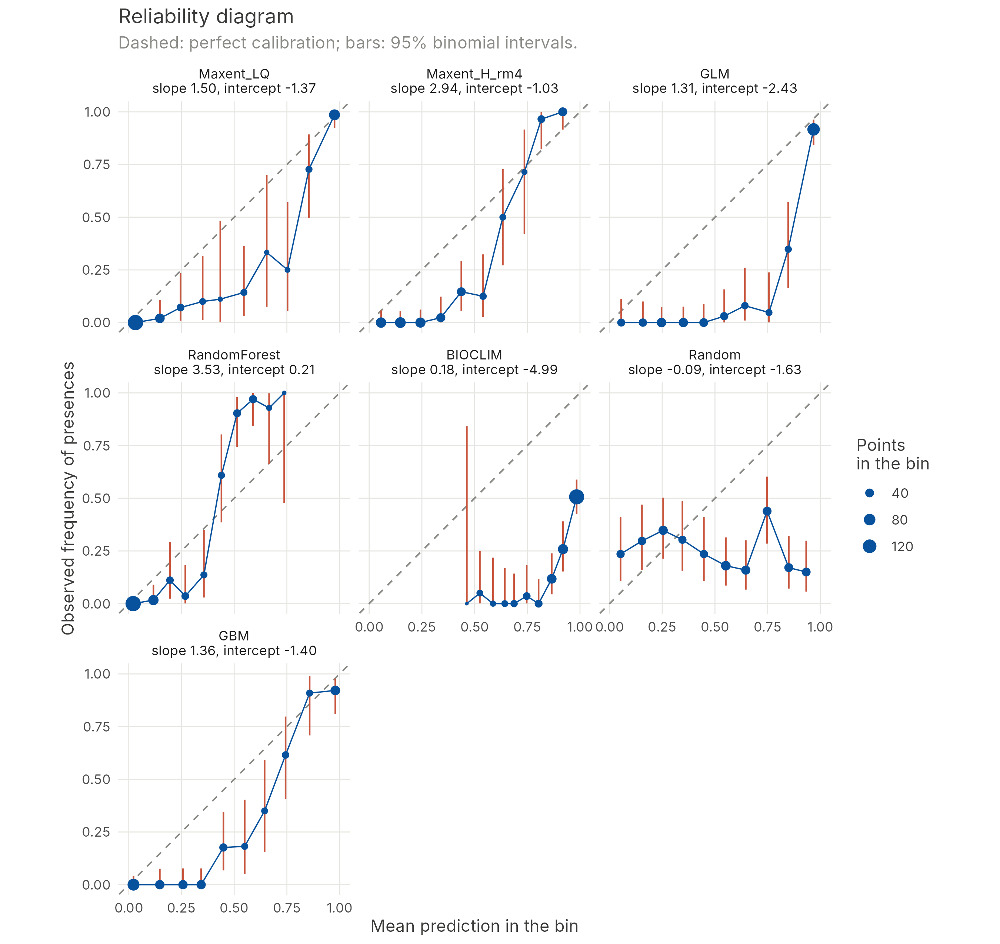

- **Reliability diagram**: the predictions are cut into bins of equal width
  (or, with `binning = "count"`, equal numbers of points); for each bin the
  observed frequency of presences is plotted against the *mean prediction*
  of the bin, with a binomial confidence interval. Points on the dashed 1:1
  line mean good calibration.
- **Calibration slope**: the slope of a logistic regression of the
  observations on the logit of the predictions. 1 is calibrated; below 1 the
  model is *over-confident* (too extreme: high predictions too high, low
  ones too low); above 1 *under-confident* (too moderate).
- **Calibration intercept**: the intercept of the same regression with the
  slope fixed at 1. 0 is calibrated; above 0 the predictions are too low on
  average, below 0 too high.
- **Brier score** and its decomposition: Brier = reliability - resolution +
  uncertainty, plus two small within-bin terms that make it exact with
  binned predictions (Stephenson et al. 2008). Lower reliability (calibration
  loss) and higher resolution are better; uncertainty is the same for every
  model.

The three can be **Pareto criteria** next to AUC and MAE, which gives the
evaluation all three sides, discrimination, calibration and ranking:

```r
evaluate_models(data = tab, criteria = c(AUC = "max",
                                         calibration_slope = "one"))
evaluate_models(data = tab, metrics = "brier")   # only add the column
```

`"one"` is a direction like `"max"`, `"min"` and `"zero"`: closer to 1 is
better.

**Presence-background data.** With background points instead of true
absences, the "observed frequency" in a bin is the share of presences among
presences and background points. It depends on the number of background
points and on how well they represent the environment of the study area
(the environmental representativeness effect; Jimenez-Valverde 2025,
*Ecology and Evolution* 15, e72573; 2026, *Biodiversity Informatics* 20,
74-80). Then these values **compare models evaluated on the same presences
and background**; they do not measure calibration in absolute terms.
Predictions must be on the 0-1 scale (e.g. Maxent cloglog, not raw output).

#### The Boyce index with few presences

The continuous Boyce index (Hirzel et al. 2006) correlates the
predicted-to-expected (P/E) ratio, the share of presences divided by the
share of background points, with the predicted value. The classical
estimator computes the ratio in a moving window; with few presences the
ratios of neighbouring windows fluctuate and every fluctuation lowers the
index, so it is underestimated below about 50-200 presences (Liu et al.
2024, *Ecography* 2025, e07218). Liu et al. instead model the probability
that a point is a presence rather than a background point as a smooth
function of the prediction, from all points at once; the odds of that
curve are proportional to the P/E ratio.

```r
pres <- tab$GLM[tab$obs == 1]
bg <- tab$GLM[tab$obs == 0]
boyce_index(pres, bg)                         # moving window (default)
b <- boyce_index(pres, bg, smooth = "spline", n_boot = 199, seed = 1)
b                                             # index, interval, P/E curve
plot_boyce(b, file = "boyce.pdf")
evaluate_models(data = tab, metrics = "Boyce_smooth")   # next to Boyce
```

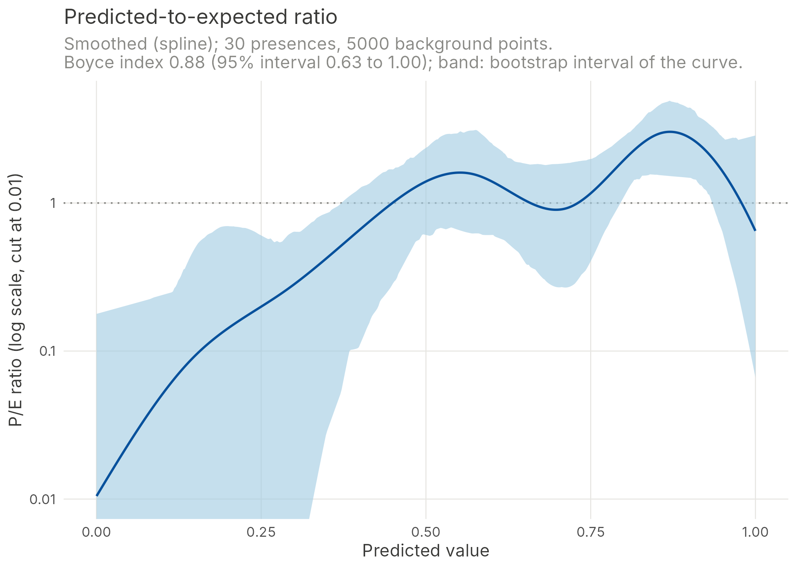

`smooth = "spline"` is a penalised logistic regression spline computed
without extra packages, `"gam"` the thin plate spline of Liu et al. (needs
mgcv; the two agree closely), `"loess"` a local regression. `n_boot`
resamples presences and background for a confidence interval of the index
and a band around the curve; `details = TRUE` returns the curve without
bootstrap.

**Which estimator?** The moving window stays the default, so earlier
results do not change, and because the smoothed index has two weaknesses
of its own. For a model no better than random the fitted curve is nearly a
straight line, and the Spearman correlation of any straight line is +1 or
-1: in 200 simulated random models with 50 presences, the smoothed index
was 0.9 or more in a third, the moving window never. And for good models it
is often exactly 1, so it no longer separates them (in the example data,
four of five good models score 1.000 against 0.91-0.98 with the moving
window). The printout therefore tests the smoothed curve against a flat one
and says when the index cannot be read. Use the smoothed index with few
presences, together with its bootstrap interval, and compare models with
the same estimator.

#### Response curves: are they ecologically plausible?

Performance metrics do not tell whether a model responds to the
environment in a plausible way. Models selected by the usual metrics can
have implausible responses that extrapolate badly under climate change
(Fiorentino et al. 2025, *Ecological Modelling* 508, 111207), and
machine-learning models overfit into irregular responses that the metrics
do not reveal (Chollet Ramampiandra et al. 2023, *Ecological Modelling* 481,
110353). The shape also decides how a model behaves under new conditions:
predictions hold where new conditions fall near the optimum and fail in the
tails (Allyn et al. 2025, *Diversity and Distributions* 31, e70036), and a
truncated niche worsens extrapolation (Yau et al. 2026, *Ecological
Informatics* 99, 104008).

`response_check()` takes the response curves your modelling software
exports (a long table of `variable`, `value`, `suitability`, optionally by
`model` and `run`), or raw predictions with the predictor values (then the
mean prediction in classes of each predictor, a marginal response):

```r
rc <- response_check(curves, occurrences = env_at_presences,
                     background = env_at_background,
                     projection = future_env)       # data.frame or rasters
rc                                    # implausible shapes, rising edges
plot_response_check(rc, file = "responses.pdf")
```

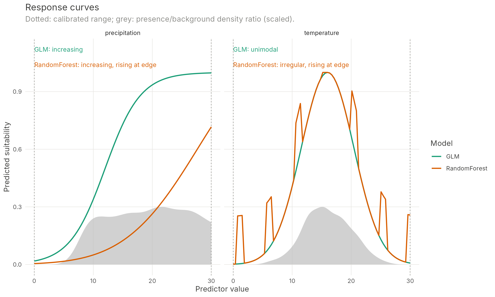

For each variable and model it reports the **shape** (increasing,
decreasing, unimodal, U-shaped, irregular or flat), the number of
**turning points** (reversals larger than 5% of the curve's range), the
**wiggliness** (total variation / range: 1 for a monotonic curve, up to 2
for one peak; above 3 irregular), the **optimum** and its position in the
calibrated range, and whether the curve is **still rising at an edge** of
the calibrated range, where the optimum may lie beyond the data and
predictions beyond depend on how the algorithm extrapolates. With
`occurrences` (and `background`) it says whether the curve follows the
records along the gradient, and with `projection` how much of the projected
area lies beyond a rising edge (compare `extrapolation_risk()` and
`environment_shift()`). The limits are rules of thumb.

**Which shape is plausible?** It depends on the gradient and on how much of
it the data cover (Austin 2002, *Ecological Modelling* 157, 101-118):

| Gradient | Plausible shape |
|---|---|
| Direct, acting on the physiology (temperature, pH) | a bell: highest at the optimum, falling to zero beyond the tolerance; narrow or broad, skewed, with a peak or a plateau (Fiorentino et al. 2025) |
| Resource (water, nutrients) | a rise that levels off (plateau) |
| Covered only on one side of the niche | monotonic, **still rising at the edge**: a truncated niche, not a wrong model; the response beyond the edge is unknown (see [section 11](#11-checking-that-the-niche-is-not-truncated-by-m)) |
| Indirect (elevation, latitude) | any shape; the curve says little about the species |
| Any | irregular curves and U-shapes are rarely plausible: the model fits noise or follows where records happen to lie |

The curve should not follow how common the values of a predictor are in the
area (the raster's own distribution, often unimodal), but how much more often
the species occurs at a value than that value is available. Give
`background` so that the comparison uses the ratio of presence to background
density; otherwise a bell of records can merely mirror a bell of available
conditions. Background drawn
evenly in environmental space (`sample_background(method = "envstrat")`)
gives response curves closer to the species' true response (Broussin et al.
2024, *Ecological Modelling* 498, 110865).

### 18. Quick start: model selection with example data

```r
library(preENM)

sim <- simulate_enm_data(seed = 1)          # 7 example "models" + points
res <- evaluate_models(sim$models, sim$presence, sim$absence,
                       n_boot = 500, seed = 1)
res
plot_pareto(res)
plot_pareto(res, zoom = TRUE)               # zoom in on the best models
```

```
ENM evaluation: 7 model(s), 100 presence and 300 absence/background points
Bootstrap: 500 resamples, 95% percentile intervals
Criteria: AUC (higher is better), MAE (lower is better)
Pareto front (best trade-offs): Maxent_LQ, GLM, Maxent_H_rm4

 rank        model   AUC AUC_lower AUC_upper   MAE MAE_lower MAE_upper   bias   TSS  Boyce pareto_front p_pareto distance
    1    Maxent_LQ 0.980     0.967     0.990 0.164     0.143     0.185 -0.109 0.850  0.908            1    1.000    0.001
    2          GLM 0.981     0.969     0.991 0.316     0.296     0.336 -0.290 0.883  0.911            1    0.386    0.234
    3 Maxent_H_rm4 0.980     0.968     0.990 0.247     0.231     0.264 -0.146 0.857  0.961            1    0.344    0.128
    4 RandomForest 0.978     0.964     0.989 0.204     0.193     0.216  0.027 0.877  0.941            2    0.352    0.062
    5          GBM 0.968     0.951     0.982 0.239     0.218     0.259 -0.162 0.820  0.978            3    0.028    0.116
    6      BIOCLIM 0.821     0.777     0.863 0.623     0.610     0.637 -0.604 0.587  0.830            4    0.000    0.739
    7       Random 0.457     0.396     0.523 0.522     0.495     0.549 -0.261 0.033 -0.263            4    0.000    0.896
```

In the plots, axes are oriented so that **better models are top-right**: the
MAE axis is reversed because lower MAE is better.


In the zoomed plot, the top five models have overlapping AUC intervals, so
AUC alone cannot separate them. MAE can. `Maxent_LQ` is on the Pareto front in
100% of bootstrap resamples, which makes it a robust choice. `GLM`,
`Maxent_H_rm4` and `RandomForest` reach the front only about a third of the
time.

### 19. Choosing which metrics to compare

AUC vs MAE is the default, but any metric pair, or more than two metrics, can
be compared. Give each criterion a direction: `"max"` (higher is better),
`"min"` (lower is better) or `"zero"` (closer to 0 is better):

```r
# TSS and the Boyce index instead of AUC and MAE
res2 <- evaluate_models(sim$models, sim$presence, sim$absence,
                        criteria = c(TSS = "max", Boyce = "max"),
                        n_boot = 500, seed = 1)
plot_pareto(res2)

# three criteria: AUC, MAE and bias (closer to 0 is better)
res3 <- evaluate_models(sim$models, sim$presence, sim$absence,
                        criteria = c(AUC = "max", MAE = "min", bias = "zero"))
plot_pareto(res3)                         # shows AUC vs MAE, front on all three
plot_pareto(res3, x_metric = "bias")      # any metric on either axis

# your own metric, e.g. the Brier score
brier <- function(obs, pred) mean((obs - pred)^2)
res4 <- evaluate_models(sim$models, sim$presence, sim$absence,
                        metrics = list(Brier = brier),
                        criteria = c(AUC = "max", Brier = "min"))
```


The built-in metrics are `AUC`, `MAE`, `MAEbal`, `bias`, `TSS` and
`Boyce`. **`MAEbal`** (balanced MAE) averages the error on presences and on
background points, `(mean(1 - pred | presence) + mean(pred | background)) / 2`.
With thousands of background points the plain MAE is dominated by them and
rewards narrow models; MAEbal weighs both classes equally and does not depend
on the number of background points, so prefer it with presence-background
data: `criteria = c(AUC = "max", MAEbal = "min")`. A custom
metric is any `function(obs, pred)` that returns one number (`obs` is 0/1,
`pred` the predicted suitability); one with a built-in name replaces it. The same `metrics` argument works in
`evaluate_cv()`, and `select_models()` / `plot_selection()` take the same
`criteria`. The bootstrap gives confidence intervals and `p_pareto` for
whichever criteria you choose.

### 20. Using your own data

You need three things:

1. **Model output rasters**, from Maxent, biomod2, ENMeval, `predicts`,
   `dismo`, or any other software, even outside R. Values should be on a 0–1
   scale (e.g. Maxent *cloglog* or *logistic* output); see
   [Prediction scales](#prediction-scales-0-1-0-100-0-1000) below.
2. **Presence points.**
3. **Absence points.** If you have no true absences, use background or
   pseudo-absence points.

```r
library(preENM)

models <- c(maxent  = "M:/GIS/models/maxent_model.tif",
            glm     = "M:/GIS/models/glm_model.tif",
            rf      = "M:/GIS/models/rf_model.tif")
# or: models <- terra::rast(list.files("M:/GIS/models", "\\.tif$", full.names = TRUE))

res <- evaluate_models(models,
                       presence = "D:/rs_pres.csv",
                       absence  = "D:/rs_abs.csv",
                       n_boot = 1000, seed = 123)
res
plot_pareto(res)

# Save the results
write.csv(res, "model_evaluation.csv", row.names = FALSE)
ggplot2::ggsave("model_selection.png", plot_pareto(res),
                width = 7, height = 5, dpi = 300)
```

Coordinate columns named `lon/lat`, `longitude/latitude`, `x/y` or
`decimalLongitude/decimalLatitude` (GBIF) are detected automatically. Otherwise
pass `coords = c("my_x_column", "my_y_column")`. Coordinates in a CSV are
assumed to be WGS84 longitude/latitude. If they are not, give the CRS, e.g.
`crs = "EPSG:3035"`. Points that fall on `NA` cells are dropped from all models
(`na_action = "common"`), so every model is compared on the same points. Use
`na_action = "per_model"` to drop them separately for each model instead.

If you already have predicted values at your points, skip the rasters:

```r
tab <- data.frame(obs = c(1, 1, 0, 0, ...),   # 1 = presence, 0 = absence
                  maxent = c(...), glm = c(...))
evaluate_models(data = tab, n_boot = 1000)
```

#### Prediction scales (0-1, 0-100, 0-1000)

Algorithms write their predictions on different scales: 0-1 (probability,
Maxent cloglog), 0-100 or 0-1000 (biomod2 stores integers to save space).
AUC does not care, but MAE, bias, calibration, thresholds and ensembles are
only comparable on one scale. Every function that takes several models
(`extract_predictions()`, `evaluate_models()`, `evaluate_cv()`,
`calibration_curve()`, `ensemble_models()`, `partition_uncertainty()`)
therefore **checks the scale of each model** from its largest value and,
with `rescale = TRUE` (the default), divides models on 0-100 or 0-1000 by
100 or 1000, with a message naming them. `rescale = FALSE` keeps the values
and warns. Models whose scale cannot be recognised (negative values, or
values above 1000 such as raw Maxent output) are left as they are, with a
warning: use probability-like output instead. A model on 0-100 that never
exceeds 1 cannot be recognised, so check the message.

### 21. How the selection works

1. **Metrics.** For each model, compute **AUC** (Mann–Whitney formulation,
   higher is better), **MAE** (`mean(|obs − pred|)`, lower is better),
   **MAEbal** (MAE averaged over presences and background, lower is better),
   **bias** (`mean(obs − pred)`, closer to 0 is better), **TSS** and the
   **Boyce index**. AUC and MAE are the default criteria; see
   [Choosing which metrics to compare](#19-choosing-which-metrics-to-compare).
2. **Pareto front.** Model A *dominates* model B if A is at least as good on
   every criterion (by default AUC and MAE) and strictly better on one.
   Models that no other model dominates form the **Pareto front**. These are
   the defensible choices, each a different trade-off. With `tol`,
   differences smaller than the tolerance count as ties. Dominated models can
   be discarded. Repeating the procedure on the remaining models gives fronts 2, 3, …
   (non-dominated sorting).
3. **Compromise distance.** The criteria are rescaled to 0–1 and each
   model's distance to the *ideal point* (the best value of every criterion)
   is computed. Use it to pick one model from the front. `weights = c(AUC = 2, MAE = 1)` makes AUC
   count twice as much.
4. **Bootstrap robustness.** Presence and absence points are resampled with
   replacement (stratified) `n_boot` times and everything is recomputed. This
   gives confidence intervals for each criterion and **`p_pareto`**, the
   proportion of resamples in which a model is on the Pareto front. Small
   differences between models are often within sampling noise, and
   `p_pareto` shows how much your choice depends on the particular evaluation
   points.
5. **Final `rank`.** Models are ordered by Pareto front, then `p_pareto`, then
   distance.

`pareto_rank()` works on any table with any number of criteria, e.g. metrics
computed elsewhere such as AICc or omission rates:

```r
pareto_rank(my_table, maximize = c("AUC", "TSS"), minimize = c("MAE", "AICc"),
            zero = "bias")
```

### 22. Full workflow: cross-validation, fossil validation, selection, ensemble

A typical workflow for choosing the algorithms of an ensemble, building it
and mapping it. The subsections below follow the steps in order.

1. **Spatial folds.** `spatial_folds()` splits the study area into square
   blocks (side ideally larger than the spatial autocorrelation range of the
   predictors: `suggest_block_size(env)$block_size_km` gives the median
   range of the layers from their semivariograms) and assigns them to
   folds with balanced numbers of presences and background points.
   `environmental_folds()` clusters the records in environmental space
   instead, to test transfer to new conditions. **Audit the folds** with
   `fold_report()` (see [Auditing the folds](#auditing-the-folds-leakage-separation-and-spatial-sorting-bias)
   below), and `range_metrics()` the extent, occupancy and structure of the
   range under each rule ([section 23](#23-range-metrics-for-conservation-assessment)).
2. **Fit models** on all folds but one, for each algorithm, fold and,
   optionally, several background sets. Predict on the held-out fold.
3. **Hold-out metrics.** `evaluate_cv()` computes AUC, MAE, bias, TSS and the
   Boyce index per run and summarises them per algorithm (and, given the
   coordinates, audits the folds). It also shows whether background sets or
   folds cause more variation, and AUC per fold.
4. **Temporal validation** (optional). `temporal_validation()` checks
   hindcasts against fossil records (see
   [Fossil (temporal) validation](#fossil-temporal-validation) below).
5. **Selection.** `select_models()` keeps every algorithm that reaches
   conventional minimum values (default AUC >= 0.8, TSS >= 0.6), only the
   Pareto front, or both (`rule = "both"`). For an ensemble the minimum
   values are usually the better rule: the Pareto front finds the best
   *single* models, and a model can reach it through one criterion alone,
   e.g. the best present-day fit with weak hindcasts. How the Pareto front
   and the ranking work is explained in
   [section 21](#21-how-the-selection-works).
6. **Plots.** `plot(sel)` draws the full view and a zoom on the best
   models; `plot_models()` draws any two or three metrics, static or
   interactive (see [Plotting any metrics, zoom and 3-D](#plotting-any-metrics-zoom-and-3-d)).
7. **Ensemble.** `ensemble_models()` combines the prediction rasters of the
   selected models and maps where they disagree (see
   [Ensembles and disagreement](#ensembles-and-disagreement) below).
8. **Binary map** (optional). `thresholds()` gives the threshold of the
   ensemble (or any prediction) under several rules, and
   `threshold_agreement()` the cells on which they agree (see
   [Thresholds](#thresholds-how-much-does-the-mapped-range-depend-on-the-rule)
   below).

A complete example you can run with the simulated data. It compares three GLMs
on 4 spatial folds and 2 background sets:

```r
library(preENM)
sim <- simulate_enm_data(seed = 1, n_presence = 150, n_absence = 600)
pts <- rbind(cbind(sim$presence, occ = 1, set = 0),                  # presences
             cbind(sim$absence, occ = 0, set = rep(1:2, each = 300))) # 2 background sets
pts$fold <- spatial_folds(pts, k = 4, block_size = 100, occ = pts$occ, seed = 1)
pts <- cbind(pts, terra::extract(sim$env, pts[c("lon", "lat")], ID = FALSE))

formulas <- list(GLM_quadratic = occ ~ env1 + I(env1^2) + env2 + I(env2^2),
                 GLM_linear    = occ ~ env1 + env2,
                 GLM_env2_only = occ ~ env2 + I(env2^2))
holdout <- list()
for (s in 1:2) for (f in 1:4) for (a in names(formulas)) {
  d <- pts[pts$set %in% c(0, s), ]              # presences + background set s
  fit <- glm(formulas[[a]], binomial, data = d[d$fold != f, ])
  test <- d[d$fold == f, ]
  holdout[[length(holdout) + 1]] <- data.frame(
    model = a, set = s, fold = f, obs = test$occ,
    pred = predict(fit, test, type = "response"))
}
cv <- evaluate_cv(do.call(rbind, holdout), set = "set")
cv
sel <- select_models(cv, min_metrics = c(AUC = 0.8, TSS = 0.6))
sel
plot_selection(sel)                       # AUC vs MAE
plot_selection(sel, x_metric = "TSS")     # AUC vs TSS
plot(sel)                                 # full view + zoom on the best models
```


The input to `evaluate_cv()` is a simple long table: one row per held-out
point and run, with columns `model`, `fold`, `obs` (1/0), `pred` and,
optionally, `set`. Any modelling software's output can be put in this form.
With biomod2, for example, project the cross-validation models on the
evaluation points and keep, for each run, the points of its held-out fold.

#### Auditing the folds: leakage, separation and spatial sorting bias

Cross-validation tests a model on data it has not seen, but data leakage,
information about the test data reaching the model during training,
inflates the reported performance and is widespread in ecological machine
learning (Stock et al. 2023, *Nature Ecology & Evolution* 7, 1743-1745).
`fold_report()` checks a fold assignment, each fold against the rest:

```r
a <- fold_report(pts, pts$fold, occ = pts$occ, env = sim$env,
                 block_size = 100)
a                                        # leakage? which folds?
plot_folds(a, file = "folds.pdf")        # map, leaking records crossed
```

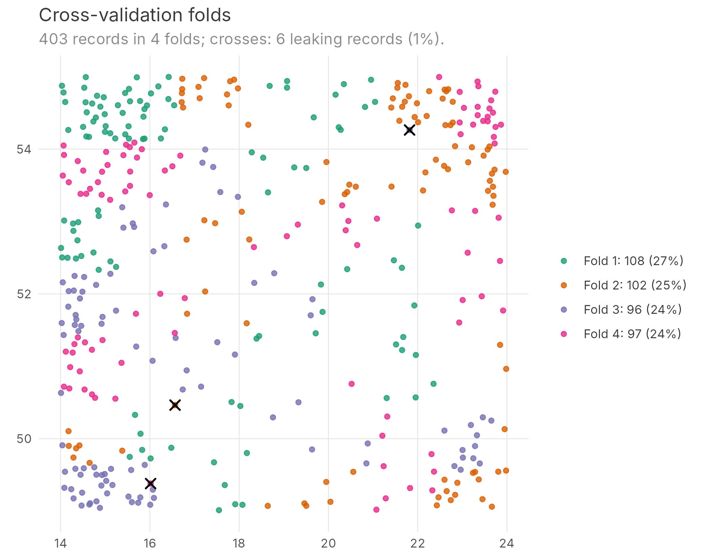

- **Leakage**: records with the same coordinates, or in the same raster
  cell, in more than one fold. The model has seen the same place and
  predictor values in training, so the metrics of those folds are inflated;
  keep one record per cell (`thin_by_cell()`) before making folds.
- **Spatial separation**: the distance from each test record to the nearest
  training record, against the block size and against the distance between
  neighbouring records. Folds whose test records are as close to training
  records as records are to each other behave like random cross-validation,
  and spatial autocorrelation makes their metrics optimistic (Yoo and Koo
  2025, *Cartography and Geographic Information Science* 52, 596-609;
  Koldasbayeva and Zaytsev 2025, *Ecological Informatics* 92, 103521).
- **Environmental separation** (with `env`): the overlap of each predictor's
  distribution between training and testing records, and the share of test
  records outside the training range (extrapolation).
- **Spatial sorting bias** (with `occ`): see below.
- **Time** (with `time`, e.g. the year of each record): the share of
  training records later than the test records. A model to be projected
  forward in time should be tested on records later than those it was
  trained on (folds ordered in time; Koldasbayeva and Zaytsev 2025). For a
  model of one period this does not matter, so it is reported, not called
  leakage.
- **Suspect predictors** (with `env`): layers named like coordinates or
  time (`lon`, `lat`, `x`, `y`, `year`, `doy`, ...), which let a model learn
  where and when records were made rather than the response to the
  environment (Stock et al. 2023, Table 1). Only the names are checked.

Give `evaluate_cv()` the coordinate columns and it audits the folds itself,
prints the audit with the metrics and **warns when leakage is found**:

```r
cv <- evaluate_cv(holdout_with_coordinates, set = "set",
                  coords = c("lon", "lat"), env = sim$env, block_size = 100)
```

**Environmental folds.** `environmental_folds(pts, env, k = 4)` places the
records in the environmental space of `thin_environment()` (a PCA of the
standardised predictors) and clusters them by k-means; each cluster is a
fold. Folds differ in size, and a fold may have no presences (a warning says
so).

**Spatial sorting bias.** Test presences usually lie closer to the training
presences than test background points do, so a model scores well by
predicting high values near known records (Hijmans 2012, *Ecology* 93,
679-688). `spatial_sorting_bias()` gives SSB = Dp / Da, the mean distance
from test presences to the nearest training presence divided by that from
test background points: 1 = no bias, near 0 = extreme. It also returns a
distance-matched sample (pairwise distance sampling): each test presence is
paired with the background point at the most similar distance from the
training presences, and evaluating on that sample removes the bias.

```r
test <- pts[pts$fold == 1, ]
train <- pts[pts$fold != 1 & pts$occ == 1, ]
s <- spatial_sorting_bias(test[test$occ == 1, ], test[test$occ == 0, ],
                          train, seed = 1)
s                                         # SSB, matched sample
p <- test[test$occ == 1, ][s$presence_index, ]
b <- test[test$occ == 0, ][s$background_index, ]   # evaluate on p and b
```

#### Fossil (temporal) validation

Hindcasts can be tested against dated records, such as fossils or pollen.
Records have no true absences, so each record is compared with background
cells *of the same time slice*. Its score is the proportion of those cells
with lower predicted suitability (0.5 = random, 1 = perfect). A record
spanning several slices, e.g. a 1000-year bin matched to ten 100-year
TraCE21k slices, gets its mean score. The mean over records is a "fossil
AUC".

```r
# sites: one row per record x time slice x model (x run), with the prediction
#        under that slice's climate, e.g. columns record, slice, model, run,
#        period, novel, pred
# bg:    the same for background cells (same cells in every slice): slice,
#        model, run, pred
fos <- temporal_validation(
  sites, bg, run = "run", period = "period", novel = "novel",
  combine = list(deep = c("Lateglacial", "Glacial")),  # the periods that matter
  thresholds = thr,       # optional: 10% presence threshold per model and run
  prefix = "fossil")
all <- merge(cv, fos, by = "model")
sel <- select_models(all,
                     min_metrics = c(AUC = 0.8, TSS = 0.6, fossil_AUC_deep = 0.7),
                     max_metrics = c(MAEbal = 0.3),   # calibration, too
                     criteria = c(AUC = "max", MAEbal = "min", fossil_AUC_deep = "max"),
                     tol = 0.01)
plot_selection(sel, x_metric = "AUC", y_metric = "fossil_AUC_deep")
```

Call `temporal_validation()` **once for all models** (the `model` column;
`thresholds` as a table with `model`, `run`, `threshold`), not once per
model: the per-record scores (`attr(fos, "records")`) then cover every
model, and the bootstrap below can compare them.

`max_metrics` sets upper limits for "lower is better" metrics. A rule
with minimum values for discrimination (AUC, TSS) and a maximum for
calibration (MAEbal) keeps models that rank sites well *and* predict
sensible values; a model with good AUC but values shifted upwards everywhere
(high MAEbal, positive bias) would otherwise pass. **Criteria are only
enforced through required values**: `criteria` decides the Pareto front and
the ranking, not which models pass. When a selected model is far worse than
the other selected models on a criterion without a required value, the
printout says so and suggests the limit to add:

```
  SELECTED: ANN, DNN, GLM, MARS, GBM, GAM, MAXNET, FDA, XGBOOST
  Note: MAXNET is selected but its MAEbal (0.332) is far higher than the other
  selected models (0.196-0.236), and MAEbal has no required value. To require
  one, add max_metrics = c(MAEbal = ...).
```

**Are the differences real? Record bootstrap.** With a few hundred fossil
records, gaps of a few hundredths may be noise. `n_boot` resamples the
records, scoring the **same resampled records for every model** (a paired
comparison):

```r
fos <- temporal_validation(sites, bg, run = "run", period = "period",
                           combine = list(deep = c("Lateglacial", "Glacial")),
                           prefix = "fossil", n_boot = 2000, seed = 1,
                           compare = "fossil_AUC_deep", margin = 0.02)
fos[c("model", "fossil_AUC_deep", "fossil_AUC_deep_lower",
      "fossil_AUC_deep_upper", "fossil_AUC_deep_diff",
      "fossil_AUC_deep_diff_lower", "fossil_AUC_deep_p_best",
      "fossil_AUC_deep_worse")]
```

Every metric gets a percentile interval (`_lower`, `_upper`). For the
`compare` metric you also get the gap to the best model with its paired
interval (`_diff`, `_diff_lower`, `_diff_upper`), the share of resamples in
which each model is the best (`_p_best`) or is beaten by the best
(`_p_worse`), and `_worse`: the gap exceeds `margin` with 95% confidence.
Because records that are hard for one model are usually hard for all, even
small gaps are often consistent; a consistent gap is not necessarily an
important one. Fix `margin` (the difference that would matter to you)
before looking at the results, and use the bootstrap to report the ranking
and its certainty rather than to drop every model that is detectably worse.

**Out-of-fold records are pooled.** When each record is scored by only one
run (spatial cross-validation: the model of fold *k* scores the records in
fold *k*), the records of all runs are pooled and every record counts once.
Averaging the fold means instead would give a few records in a small fold as
much weight as many records in a large one. When records are scored by
several runs (e.g. every background set), the run values are averaged.
`pool = TRUE`/`FALSE` forces either; the `_sd` columns are always the SD
across runs, and `attr(fos, "records")` has the score of every record.

With `thresholds`, the result also has the sensitivity (`_sens`), the share
of background predicted suitable (`_area`) and their ratio (`_lift`): a
model that predicts everything as suitable has a lift of 1, however high its
sensitivity.

**Fossil records from Neotoma** (optional; packages `neotoma2` and
`rintcal`). Find the dataset IDs of your taxon in the Neotoma Explorer, then:

```r
smp <- download_neotoma(dataset_ids, cache = "neotoma_downloads.rds")
rec <- neotoma_records(smp, taxon_regex = "^Dryas", area = m,
                       max_age = 22000)       # CHELSA-TraCE21k coverage
table(rec$FLAG)                               # why samples are not usable
sb  <- fossil_site_bins(rec, bin_years = 1000)  # one record per site and millennium
sites <- site_bin_slices(sb)                  # record x TraCE21k slice
# add each slice's prediction to `sites` (column pred), then temporal_validation()
```

Each sample keeps its own age and age window (radiocarbon ages are
calibrated with IntCal20) and is matched to the CHELSA-TraCE21k century
slices it covers (`trace21k_id()`; use `slice_fun` for other climate data).
Flags mark samples outside M, with zero values, without (calendar) ages or
older than the climate data.

Helpers for preparing the climate of each record:

- `anomaly_climate()`: past climate = high-resolution present (e.g. CHELSA)
  plus the climate-model anomaly (past minus the model's present). It uses a
  ratio for precipitation and works on point tables (fast) or rasters.
- `outside_range()`: flags non-analog climates (outside the calibration
  range). The `fossil_AUC_analog` score ignores them.
- `age_to_period()`: Holocene / Lateglacial / Glacial from ages in cal BP.
- `threshold_p10()`: the 10th-percentile training presence threshold, for
  sensitivity.

#### Plotting any metrics, zoom and 3-D

When many algorithms perform alike, the plot gets crowded in one corner.
`plot(sel)` (also drawn by `select_models()` in interactive sessions) shows
the full view and, next to it, a **zoom on the region of the best models**:
the Pareto fronts of the two plotted metrics are added one by one until at
least half of the models are included. Models outside the zoom are named in
the subtitle, and selected models are always drawn on top. Dashed lines
mark the required minimum and maximum values. Error bars (red, `bar_colour`
to change, `error_bars = FALSE` to hide) show, for each axis, the bootstrap
interval (`<metric>_lower`, `<metric>_upper`) or else +/- 1 SD across runs
(`<metric>_sd`); keep those columns when you join tables for
`select_models()`. `evaluate_models(boot_metrics = "all")` gives intervals
for every metric, not only the criteria.

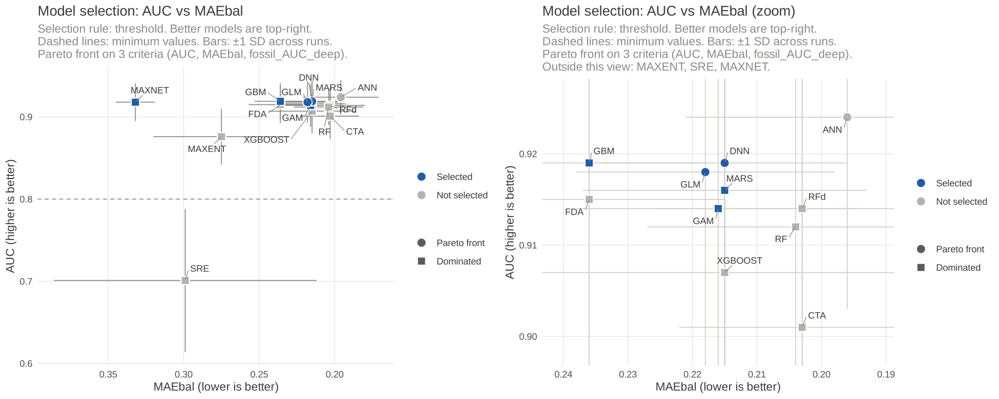

`plot_models()` draws any metrics of `select_models()`, `evaluate_models()`
or `evaluate_cv()` output (or any table with a `model` column):

```r
plot_models(sel, x = "bias", y = "AUC")                  # any pair
plot_models(sel, x = "MAEbal", y = "AUC", zoom = TRUE)   # zoom only
plot_models(sel, x = "MAEbal", y = "AUC", zoom = list(x = c(0.19, 0.24),
                                                      y = c(0.89, 0.93)))
plot_models(sel, x = "MAEbal", y = "AUC", interactive = TRUE)  # hover, zoom
plot_models(sel, x = "MAEbal", y = "AUC", z = "fossil_AUC_deep",  # 3-D
            file = "selection_3d.html")                 # saved, opens in browser
```

Interactive and 3-D plots use the `plotly` package
(`install.packages("plotly")`); they open in the RStudio viewer or the
browser, can be rotated and hovered over (all values of a model), and saved
as one HTML file. Axes always run from worse to better. Static plots are
`ggplot` objects: save them with `ggplot2::ggsave()`.

#### Ensembles and disagreement

`ensemble_models()` takes the prediction rasters of the models (a
SpatRaster or files/folders, from any software) and the result of
`select_models()` or `evaluate_models()`, and returns the ensemble together
with the disagreement between the models in every cell:

```r
ens <- ensemble_models(sim$models, sel)          # PCAm of the selected models
ens                                              # where do the models disagree?
plot_ensemble(ens, file = "ensemble.pdf")        # ensemble and SD side by side
ensemble_models(prediction_folder, sel, method = "pcam",
                filename = "ensemble.tif")       # large rasters, written to disk
```

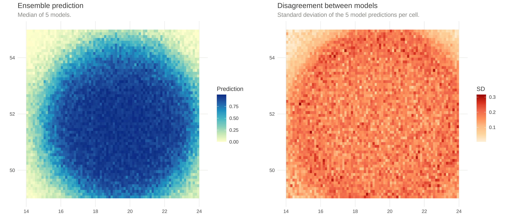

- **Which models:** only the selected models of `select_models()`, or the
  Pareto front of `evaluate_models()`; dominated or unselected models are
  left out (`use = "all"` keeps them all).
- **How they are combined:** `"pcam"` (default: the median of the half of
  the models closest to their common trend, the first principal component
  of the predictions; with fewer than three models the median), `"median"`,
  `"mean"` or `"weighted"` (weights `1 - distance`, the compromise score of
  the evaluation, or your own `weights`). Models on 0-100 or 0-1000 are
  brought to 0-1 first (see
  [Prediction scales](#prediction-scales-0-1-0-100-0-1000)).
- **Why weighting is not the default:** weights based on the evaluation
  reward predicting the data the models were evaluated on, which is not
  the same as predicting new areas or periods. In transfers across
  continents, consensus models weighted by AUC were worse than the median
  of the models closest to their common trend, and the mean was pulled by
  models with extreme predictions (Zhu et al. 2021, *Ecological Modelling*
  448, 109502). Zhu et al. recommend PCAm.
- **Disagreement:** the standard deviation (`sd`) and coefficient of
  variation (`cv`) of the predictions of the models used, per cell. The
  printout says how much the models disagree, on how much of the area the
  SD exceeds 0.1 and 0.2 (rules of thumb for predictions on the 0-1 scale),
  at which level of the ensemble prediction the disagreement is highest,
  and which model departs most from the ensemble.
- **Large rasters:** terra combines the layers block by block from disk;
  above 10 million cells every intermediate layer goes to a temporary file,
  and the block size follows `terra::terraOptions(memfrac, memmax)`.
  `filename` writes the result (layers `ensemble`, `sd`, `cv`) to a GeoTIFF.

#### Thresholds: how much does the mapped range depend on the rule?

A binary map needs a threshold, and the rules for choosing it disagree
enough to change the mapped range considerably, so report several together
(Hellegers et al. 2025, *Diversity and Distributions* 31, e70019) or choose
the rule by the goal of the study: rules that minimise underprediction
(maxTSS, DSS) suit e.g. finding where invasive species may establish, rules
that penalise overprediction (MCC, F) suit extinction-risk assessments. `thresholds()` takes the
predictions at presence and at absence/background points (two vectors, or
the table of `extract_predictions()` for several models at once) and gives,
for each rule, the threshold, sensitivity, specificity, TSS and the
predicted-suitable share (the share of absence/background points at or
above the threshold; with background that represents the study area, the
share of the area mapped as suitable):

```r
tab <- extract_predictions(models, presence, background)
th <- thresholds(tab)                          # all rules, every model
th                                             # how much the mapped range varies
plot_thresholds(th, file = "thresholds.pdf")
ag <- threshold_agreement(models[["GLM"]], th, model = "GLM")
ag                                             # area suitable under all / most / any rule
terra::writeRaster(ag$count, "GLM_rules_suitable.tif")
```

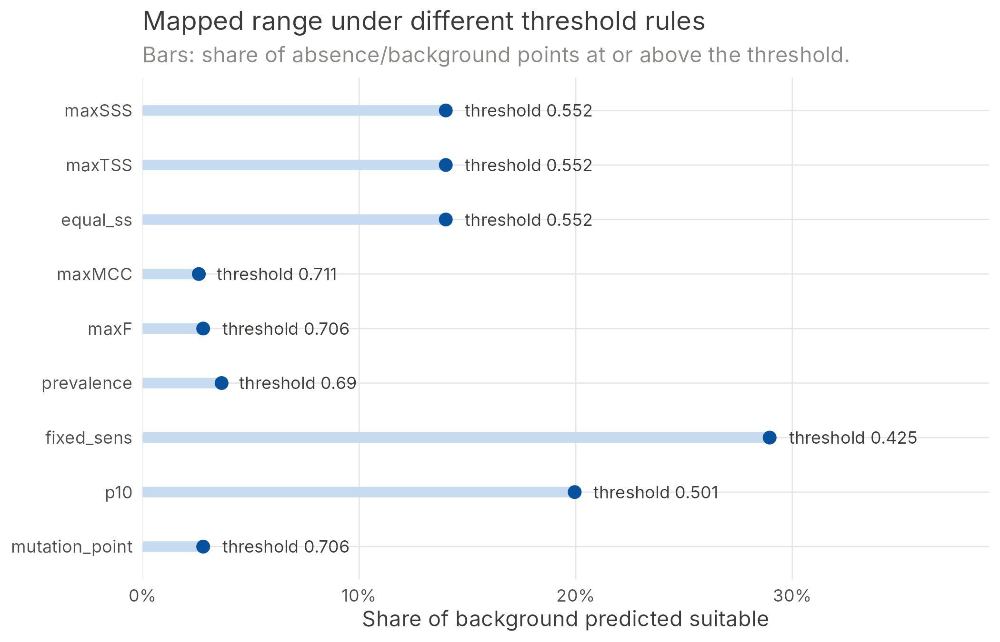

| Rule | Threshold |
|---|---|
| `maxSSS`, `maxTSS` | maximum of sensitivity + specificity (the same criterion under two names; Liu et al. 2013 recommend it for presence-background data) |
| `equal_ss` | sensitivity equal to specificity (DSS) |
| `maxMCC`, `maxF` | maximum of Matthews' correlation coefficient or of the F-measure; they penalise overprediction and give smaller ranges (in 1671 European plants the median range under maxTSS was 3.6 and 9.2 times that under MCC and F; Hellegers et al. 2025); need true or pseudo-absences |
| `prevalence` | predicted prevalence equal to the observed one, or to a `prevalence` you give |
| `fixed_sens` | keeps at least `sensitivity` of the presences (default 0.95) |
| `p10` | 10th percentile of the presence predictions (about a fixed sensitivity of 0.90) |
| `mutation_point` | the break of Boyce's predicted-to-expected curve (100 classes) found by threshold regression (BTQR, Yu et al. 2024); needs no absences, usually strict |

The printout says how many times larger the area of the most inclusive rule
is than that of the least inclusive one. `threshold_agreement()` counts, for
every cell of a prediction raster, the rules that call it suitable: the
cells suitable under all rules are the robust core of the range, those
suitable under at least one its widest extent. Restrict the set with
`rules`, e.g. `thresholds(tab, rules = c("maxSSS", "p10"))`.

### 23. Range metrics for conservation assessment

A suitability map is rarely the final product: an assessment needs the
measures of the range derived from it, the quantities of the IUCN Red List
criterion B (Omar and Elgamal 2021, *Kew Bulletin* 76, 477-496), usually
obtained with ConR (Dauby et al. 2017, *Ecology and Evolution* 7,
11292-11303) or by hand in a GIS, and the landscape structure of the range
(Curd et al. 2023, *Global Change Biology* 29, 631-647). `range_metrics()`
computes them from the binary maps under every threshold rule:

```r
th <- thresholds(tab, rules = c("maxSSS", "p10", "maxMCC"))
rm <- range_metrics(c(present = ens_now, future = ens_2070), th,
                    threat_km = 10, occurrences = records, occupied = TRUE)
rm                                     # does the rule change the category?
plot_range_metrics(rm, "AOO_km2", file = "aoo.pdf")
write_range_metrics(rm, "range_metrics")
```

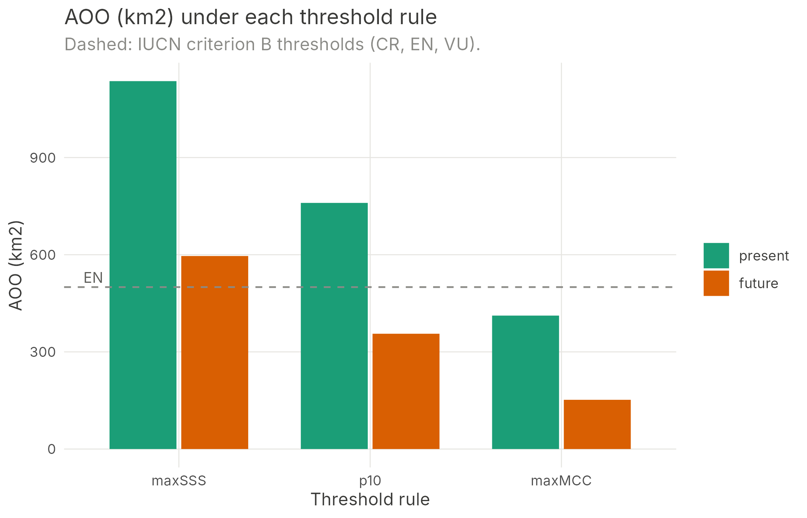

- **EOO**: the minimum convex polygon of the suitable cells; **AOO**: the
  2 x 2 km grid cells (IUCN standard) containing suitable area; the
  **number of locations**: cells of a grid of the size of one threatening
  event (`threat_km`). All three are computed in an equal-area projection
  (a warning or message says when one is set up), and the grids are placed
  to give the fewest cells, as ConR does. EOO is never smaller than AOO.
- **Area and landscape structure** (Curd et al. 2023): total suitable area,
  number and sizes of patches, largest patch index, edge density, distance
  to the nearest other patch and, for continuous input, mean suitability
  per patch.
- **Threshold sensitivity**: AOO and EOO under different rules can cross a
  Red List threshold, so the printout says when the threshold met depends
  on the rule rather than on the species. Report the range.
- **Occupied patches** (`occupied = TRUE`): only patches containing a
  record, since the predicted suitable area is larger than the occupied
  area.
- **Change** between projections, for every metric and rule. Projected
  changes are uncertain in both directions: over a century of climate and
  land-use change, models foresaw fewer than a third of the observed
  extirpations, missed many colonisations and predicted extirpations that
  had not happened where change was largest (Auffret et al. 2024,
  *Diversity and Distributions* 30, e13834).
- A threshold met is not a listing: criterion B also needs two of the
  conditions (a) to (c), and an assessment needs evidence on threats that a
  model cannot give (IUCN 2012). For millions of cells, aggregate the map
  first (e.g. to 1 km); a noisy map of 4 million cells takes about half a
  minute per rule.

### 24. Testing the models against sampling bias

A model can reach a high AUC by predicting where people record.
`null_model_test()` replaces the presences by random locations drawn in
proportion to recording effort and recomputes the metrics, many times; the
p-value is the share of these null values at least as good as the real
one:

```r
tab <- extract_predictions(models, presence, background)
null_model_test(tab, pool = models, weight = effort, n_null = 499, seed = 1)
```

`pool` supplies the predictions at candidate cells (the model rasters, or
a table); `weight` is a recording-effort raster (see
`gbif_effort_rasters()`) or a column of the table. Without `weight` the
draws are uniform. The models are not refitted, so it works with
predictions of any software; it tests the locations, not the flexibility
of the algorithm, unlike the null models of Raes and ter Steege (2007).

### 25. Is a projected change driven by the data or by the study design?

A model projected to another period can predict a decline (or an increase)
that has little to do with the species. Think of a scale that shows 2 kg
with nothing on it: before trusting a weight, you look at what the empty
scale shows. For a projection, the "empty scale" is the same model fitted
to points that know nothing about the species, that is random points from
the study area. If those models also predict a decline of 30%, then a
decline of 30% for your species is what the study design (area, variables,
algorithm, scenario) produces by itself. Warren et al. (2021) found exactly
this for several common algorithms. This pipeline works with the predictions of any software, in three steps.

**1. Draw the random points**, as many as you have records. Real records
are concentrated where people collect, so the random points should be
too; otherwise the test is too easy to pass (Warren et al. 2026):

```r
sets <- null_occurrences(area = env_m, points = occ, method = "bias",
                         weight = effort, n_sets = 99)
for (i in seq_along(sets)) {
  write.csv(sets[[i]], sprintf("null/%s.csv", names(sets)[i]), row.names = FALSE)
}
```

`method = "bias"` draws cells in proportion to recording effort (see
`gbif_effort_rasters()`), `"uniform"` draws them evenly, and `"pattern"`
moves and turns the real point pattern, which keeps its clustering when
there is no estimate of effort.

**2. Fit and project the models** for each set exactly as for the real
records (same background, variables and settings), in your software. Save
each result as one raster file with the present prediction and one layer
per projection.

**3. Compare:**

```r
tb <- transfer_bias_test(observed = "models/real.tif",
                         null = as.list(list.files("models/null", full.names = TRUE)),
                         region = present_range,     # optional second summary
                         threshold = "p10", points = occ, null_points = sets)
tb
plot_transfer_bias(tb)
terra::plot(tb$maps[[1]])
write.csv(tb$summary, "transfer_bias.csv", row.names = FALSE)
```

If you model in R, give your own function instead of the files:
`transfer_bias_test(fit = my_fit, points = occ, null_points = sets)`, where
`my_fit(points)` returns the predictions. If you have several models of the
real records (cross-validation runs, background sets, bootstrap samples of
the records), give them all as a list in `observed`: their mean is compared
with the random points, and their own variation enters `prob_exceed`.

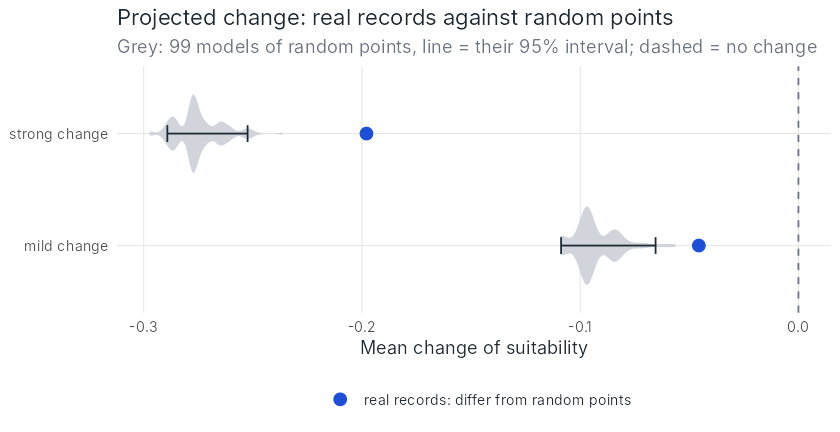

Grey is the change predicted by the models of random points and the line
their 95% interval; the dot is the model of the real records, labelled with
two numbers explained below. The verdict for each projection is one of
four:

| Verdict | Meaning |
|---|---|
| **design-driven** | The real model predicts what the random-point models predict, and those agree on the direction. Any species would give this result. |
| **not distinguishable** | The real model is within the spread of the random-point models, which do not agree on a direction. |
| **design-dominated** | The real model is outside 95% of the random-point models, but these predict at least half of its change (`dominance`), or even more. The records change the prediction, but the change itself comes mostly from the design. |
| **data-driven** | The real model is outside 95% of the random-point models, and they predict less than half of its change, or the opposite direction. |

**How different, and does it matter?** Whether the real model lies inside
the grey interval is only the first question. Two numbers answer the rest:

* **SES** (standardised effect size) = (observed − mean of random points) /
  their SD: how far the real model is from the random points, in their
  standard deviations. Unlike the p-value, which cannot go below
  1 / (number of null models + 1) and so cannot tell "just outside" from
  "far outside", it keeps growing with the distance and can be compared
  between projections, metrics and studies. |SES| below about 2 means the
  real model is among the random ones.
* **design share** = change predicted by random points / change predicted
  by the real model: the part of the predicted change that the study design
  produces by itself. 0.2 = random points give 20% of the change, the
  records the rest; 1 = all of it; above 1 (shown as "design alone 1.4x")
  random points predict *more* change than the records, which weaken it;
  below 0 random points predict the opposite direction.

Read them together. A large SES with a design share near or above 1 (the
figure: SES 7, design alone 1.4×) means the records clearly changed the
prediction, yet the predicted decline is what the design produces anyway:
it is not evidence that this species is vulnerable. A large SES with a small
design share means the change comes from the records. In short:

| SES | design share | What the predicted change is |
|---|---|---|
| \|SES\| < 2 | any | within the random points: design-driven or not distinguishable |
| large | ≥ 0.5 | different from random points, but mostly the design |
| large | < 0.5 or negative | mostly the records |

`prob_exceed` gives the probability that a model of the real records
predicts a change beyond that of a model of random points (0.5 = they
overlap completely, 1 = always beyond). With one model of the records it is
the share of random-point models it exceeds; with several models of the
records (a list in `observed`), every pair of a real and a random-point
model counts, so the variation among the real models is included.

The measures are the mean change of suitability, the share of cells where
it falls and, with a threshold, the proportional change of suitable area.
The maps show, per cell, the mean and spread of the change across the
random-point models: where the mean is far from zero and the spread is
small, the direction of the prediction is fixed by the design. A
design-driven result is not necessarily wrong (if the whole area becomes
unsuitable, every model says so), but it does not come from your records
and needs other evidence. Use 99 or more null models for stable intervals.

### 26. Which source of uncertainty dominates a set of projections?

A realistic set of projections varies at once in climate model (GCM),
scenario, algorithm and cross-validation run, and it is hard to see which
choice matters most, and where. `partition_uncertainty()` splits, in every
cell, the variance of the projected suitability among these factors, as in
an analysis of variance with the factors as main effects (the partitioning
used for climate projections by Hawkins and Sutton 2009 and for their
ecological consequences by Wilson et al. 2024, *Ecological Informatics* 80,
102537):

```r
design <- data.frame(layer = names(projections),          # one row per raster
                     gcm = ..., scenario = ..., algorithm = ..., run = ...)
pu <- partition_uncertainty(projections, design, region = alps)
pu                                       # which source dominates, overall and in the region
plot_partition(pu, file = "partition.pdf")
```

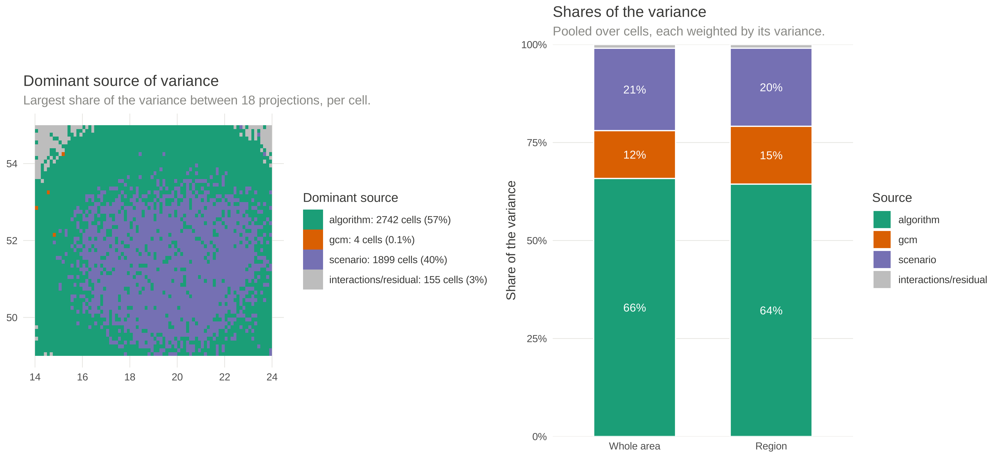

- **Shares**: the variance explained by each factor divided by the total
  variance between projections; what the main effects do not explain
  (interactions, replicate noise) is `interactions/residual`. They sum to 1
  in every cell. The result holds one share map per factor, the total
  variance and the **dominant source** of each cell.
- **Pooled shares** for the whole area and an optional `region` (as in
  `transfer_bias_test()`): each cell weighted by its variance, so places
  where the projections agree count little.
- **Balance**: with every combination of levels equally often the shares do
  not depend on the order of the factors; otherwise a warning says that
  they do (sequential sums of squares).
- **Scenario is a choice, not an error**: its share depends on which
  scenarios are included and is not directly comparable with the share of
  climate models (Wilson et al. 2024).
- Large stacks are processed block by block on disk; projections on 0-100
  or 0-1000 are rescaled to 0-1.

#### Spread due to coordinate error

Fitting one model per replicate of `jitter_uncertainty()` (section 6 above)
gives predictions that differ only in where the records were placed.
`coordinate_spread()` returns their per-cell mean, standard deviation and
coefficient of variation, computed as the disagreement layer of
`ensemble_models()`, so the two are directly comparable: with `ensemble`,
it says in which share of cells coordinate error moves the predictions
more than the choice of model.

```r
cs <- coordinate_spread("predictions/jittered", ensemble = ens)
cs                                       # IN SHORT: how much, and compared with the models
plot_coordinate_spread(cs, file = "coordinate_spread.pdf")
```

### 27. Where are the data too sparse to trust a prediction?

Where few records of any species have been made, the absence of records of
your species says little, and a prediction there rests on extrapolation.
Maps of biogeographical ignorance show this next to the prediction
(Tessarolo et al. 2021, *Ecography* 44, 1743-1755). `ignorance_map()`
turns a recording-effort raster (e.g. from `gbif_effort_rasters()`,
[section 9](#9-background-strategies-and-recording-effort)) into an
ignorance score from 0 (well recorded) to 1 (nothing recorded), and
annotates a suitability raster with it:

```r
eff <- gbif_effort_rasters("effort_table.csv", extent)
ig <- ignorance_map(eff, half = 10, radius_km = 50, suitability = ens$raster[["ensemble"]])
ig                                        # share of the suitable area that is poorly known
plot_ignorance(ig, file = "ignorance.pdf")
terra::writeRaster(ig$raster, "ignorance.tif")
```

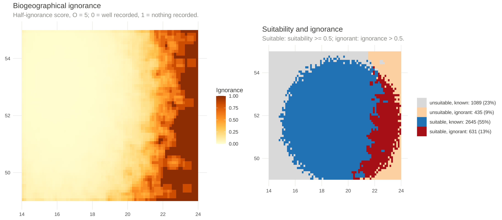

- **Scores** (Ruete 2015, *Biodiversity Data Journal* 3, e5361):
  `"half"` (default), `I = O / (N + O)` with `O` (`half`) the effort that
  halves ignorance, independent of the most recorded cell; `"log"` and
  `"linear"`, relative to the most recorded cell. `index = TRUE` uses
  records per species, less inflated by a few very common species.
- `radius_km` lets effort count for the neighbouring cells within that
  distance (information decays with distance; the range from
  `suggest_block_size()` is a natural choice).
- With `suitability`, the result adds the suitability where ignorance is low
  (`suitability_known`) and four classes: suitable or not, known or
  ignorant.
**From the records themselves.** With a records table (e.g. a GBIF
download of the reference group), `record_ignorance()` follows the
components of Tessarolo et al. more closely. Each record's quality combines
the **completeness** of its cell's inventory (`1 - f1 / N`, the expected
final slope of the species accumulation curve; cells with fewer than
`min_records` records count as incomplete), its **age** (`year`; a Gaussian
decay, half at `half_life` years), optionally its **taxonomic reliability**
(a 0-1 value per record, e.g. 1 / 0.9 / 0.75 for taxonomist / expert /
amateur identifiers, as in Tessarolo et al.) and the **precision** of its
coordinates (`coordinateUncertaintyInMeters`, an addition). A cell takes
its best record of the focal species, or the mean over the other species;
empty cells are interpolated within `radius_km`.

```r
ig <- record_ignorance("gbif_group_download.csv", grid_10km,
                       species = "Focal species", radius_km = 100,
                       reliability = c(PRESERVED_SPECIMEN = 1,
                                       HUMAN_OBSERVATION = 0.9),
                       reliability_col = "basisOfRecord",   # your choice
                       suitability = ens$raster[["ensemble"]])
```

Taxonomic reliability has no standard proxy in GBIF data: identifier
classes need expert coding. As an option, `taxon_complexity()` derives one
weight per species from the number of its synonyms and of its subspecies
and varieties in World Flora Online (via the WorldFlora package) or another
Darwin Core backbone: `1 / (1 + log(1 + n))`, a rule of thumb rather than a
published weighting (difficult groups have many synonyms, but well-studied
ones too):

```r
library(WorldFlora)
WFO.download(); WFO.remember()           # the WFO backbone, once
tc <- taxon_complexity(unique(gbif$species), WFO.data)
ig <- record_ignorance(gbif, grid_10km, species = "Focal species",
                       reliability = tc, env = predictors)
```

With `env`, empty cells are interpolated with the spatio-environmental
distance of Tessarolo et al. (geographic and environmental distances, each
rescaled to 0-1, combined as space^0.5 x environment^0.5), so records from
similar environments inform an empty cell more; cells with records of the
focal species carry half of the weight, as in Tessarolo et al.

### 28. How different are the niches of two groups?

Comparing the niches of species, lineages, cytotypes or native and
introduced ranges follows Broennimann et al. (2012, *Global Ecology and
Biogeography* 21, 481-497), as in ecospat and ENMTools (Warren et al. 2021,
*Ecography* 44, 504-511). `niche_overlap()` takes the records with a
grouping column (or a named list of tables) and the shared predictors:

```r
no <- niche_overlap(records, env, group = "cytotype",
                    background = list(diploid = m_2x, tetraploid = m_4x),
                    n_rep = 100, seed = 1)
no                                     # overlap, tests, in plain words
plot_niche_overlap(no, file = "niche_overlap.pdf")
plot_niche_overlap(no, limits = "niches")             # zoom to the two niches
plot_niche_overlap(no, limits = c(-3, 3, -2, 2.5))    # same axes for several plots
```

By default the plot shows all environments available to either group
(`limits = "available"`); `limits = "niches"` zooms to the occupied
envelopes of the pair, for niches much narrower than the available
environment, and four numbers set the window by hand. The grid of the
densities ends at the most extreme record or background point, so the
available environment can look cut off at the edges of the plot: that is
the edge of what was sampled, not of the species' niche.

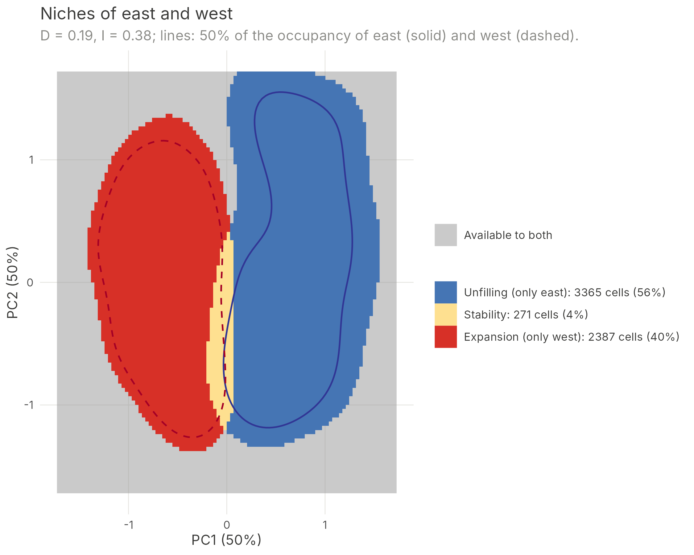

- **Space**: a PCA of the pooled backgrounds of all groups (the same PCA
  as `thin_environment()`), or two raw predictors (`space = "raw"`).
- **Densities**: records and available environments are smoothed with a
  Gaussian kernel on a `grid` x `grid` lattice; the occupancy is the record
  density divided by the environment density, so that common environments
  do not look preferred.
- **Overlap**: Schoener's D and the corrected Hellinger I (Rodder and
  Engler 2011, *Global Ecology and Biogeography* 20, 915-927; the form used
  by ecospat and ENMTools), 0 = none, 1 = identical, graded with Rodder and
  Engler's classes (below 0.2 no or very limited, ..., above 0.8 very high);
  Levins' breadth of each group. D, I and breadth use the full densities,
  as ecospat does by default. `truncate = TRUE` sets the densities outside
  the occupied envelope to 0 first (ecospat's `th.sp`); in simulations with
  known overlap this lowered D in every case (a true D of 0.5 was
  estimated as 0.40 instead of 0.48 with 200 records per group, 0.32
  instead of 0.46 with 20), so it is an option, not the default.
- **Niche dynamics** (Guisan et al. 2014, *Trends in Ecology & Evolution*
  29, 260-269): expansion, stability and unfilling of the second group
  relative to the first, within environments available to both; the
  occupied envelope holds 95% of the records (`marginal_records`), rare
  environments can be left out with `marginal_env`.
- **Tests** with null distributions, p-values and standardised effect
  sizes: equivalency (records pooled and re-split) and similarity in both
  directions (one group against random points of the other's background).
- **Geographic space**: `predictions` (one suitability raster per group)
  adds D, I and the rank correlation of the model predictions, as the
  first ENMTools did (`prediction_overlap()`); they depend on the area
  mapped, so niches are better compared in environmental space.

**Is the conclusion robust?** Background, variables, space and thinning can
decide whether a niche shift is found at all (Lo Parrino et al. 2023,
*Ecography* 2023, e06432). `overlap_scenarios()` repeats the analysis over a
grid of such choices and says whether each verdict holds in every scenario
or which choice changes it:

```r
os <- overlap_scenarios(records, env, group = "cytotype",
                        backgrounds = list(M = list(diploid = m_2x,
                                                    tetraploid = m_4x),
                                           whole = NULL),
                        spaces = c("pca", "raw"), thin_km = c(0, 10),
                        grids = c(50, 100), n_rep = 100, seed = 1)
os                                     # robust, or which choice flips it
```

### 29. Reporting with ODMAP

`odmap_table()` writes the entries of the ODMAP protocol (Zurell et al.
2020) that your workflow determines, from the objects themselves, and
leaves the others for you:

```r
od <- odmap_table(filter = res, m = m, thinning = th, records = occ_final,
                  background = bg, variables = vs, predictors = names(env),
                  truncation = tr, block_size = bs, folds = pts$fold,
                  evaluation = ev, selection = sel,
                  fields = list("Study title" = "...", "Focal Taxon" = "..."),
                  file = "odmap.csv")
```

## Citation
The package is still under development. You can use it but some functions may be upgraded or added in near future. Therefore we do not have a formal publication desribing the package. But if you wish to use it, especially if you use the model-selection method, please cite the paper
(`citation("preENM")`):

> Konowalik, K., Nosol, A. (2021). Evaluation metrics and validation of
> presence-only species distribution models based on distributional maps with
> varying coverage. *Scientific Reports* 11, 1482.
> <https://doi.org/10.1038/s41598-020-80062-1>
> (free to read: <https://rdcu.be/cjB5b>)

Depending on the module you use, `preENM` relies on several other R packages - such as `terra`, `CoordinateCleaner`, `ggplot2` and others. Please cite these underlying packages in your work as well. Additionally, most functions are based on published methodologies, so we recommend citing the original papers too.

Thanks and good luck with modelling!
