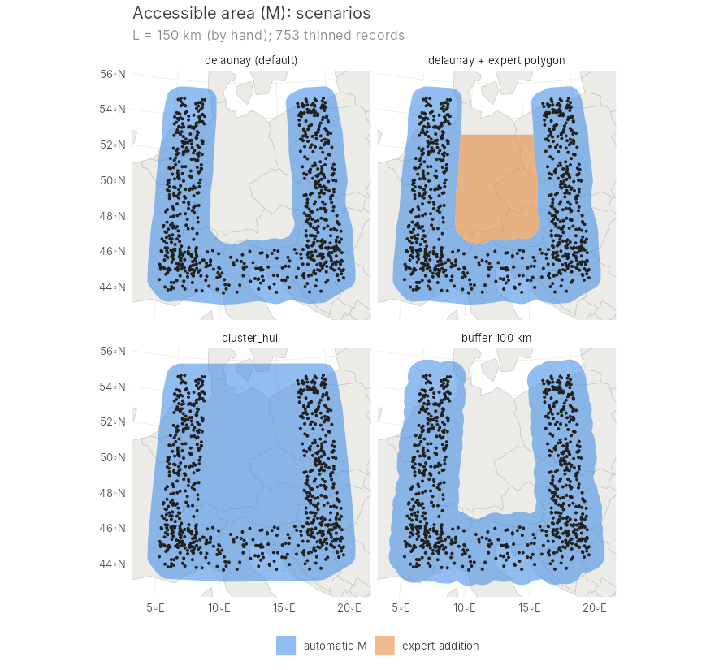
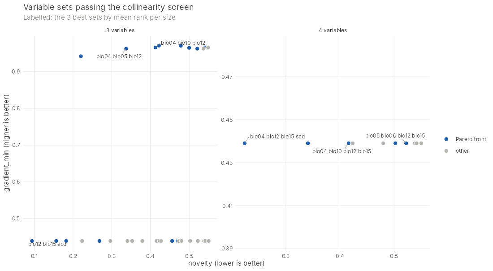
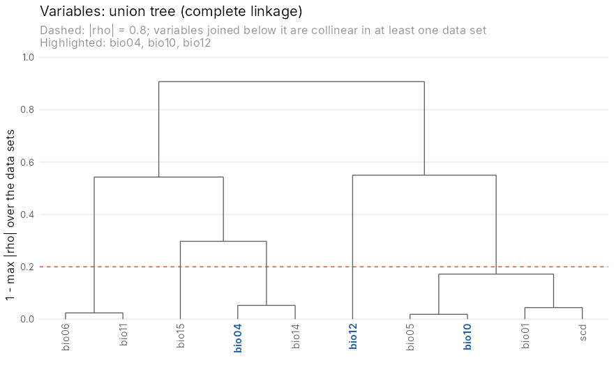
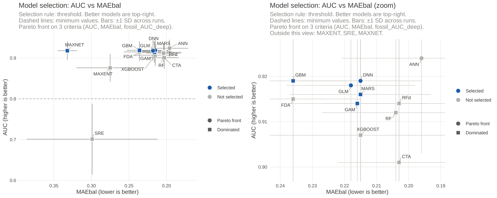

# preENM 

<!-- badges: start -->
[](https://github.com/kkonowalik/preENM/actions/workflows/R-CMD-check.yaml)
<!-- badges: end -->

**Data preparation for ENM/SDM:** point filtering, background point
selection, environmental thinning, correlation analysis, and model selection.

`preENM` covers the steps before and after fitting ecological niche models /
species distribution models. It does not fit models itself, so it works
alongside any modelling software: biomod2, ENMeval, Maxent, tidymodels or
your own code.

| Step | Status | Functions |
|---|---|---|
| **Point filtering** (especially GBIF) | **available** | `read_gbif()`, `filter_occurrences()`, `filter_settings()`, `filter_layers()` |
| **Accessible area (M)** | **available** | `linking_distance()`, `delimit_m()`, `m_scenarios()`, `plot_m_area()`, `m_report()`, `write_m_area()`, `crop_to_m()` |
| **Cutting raster files to M** | **available** | `crop_rasters()`, `crop_to_m()` |
| **One point per raster cell, background points** | **available** | `merge_occurrences()`, `thin_by_cell()`, `sample_background()` |
| **Environmental thinning** (without truncating the niche) | **available** | `thin_environment()`, `plot_env_thinning()`, `write_env_thinning()` |
| **Background strategies and recording effort** | **available** | `sample_background(method = ...)`, `gbif_effort_sql()`, `download_gbif_effort()`, `gbif_effort_rasters()` |
| **Fossil records** (optional, for hindcasts) | **available** | `download_neotoma()`, `neotoma_records()`, `calibrate_radiocarbon()`, `fossil_site_bins()`, `site_bin_slices()` |
| **Derived climate variables** (VPD, PET, moisture deficit, aridity, heat stress, summer rain, heat-rain synchrony) | **available** | `download_chelsa_monthly()`, `monthly_files()`, `climate_indices()` |
| **Correlation analysis and variable selection** (across periods, scenarios and regions) | **available** | `sample_environment()`, `select_variables()`, `best_sets()`, `plot_variable_tree()`, `plot_correlation()`, `plot_variable_sets()`, `write_variable_selection()` |
| **Model evaluation and selection** | **available** | `evaluate_models()`, `evaluate_cv()`, `spatial_folds()`, `temporal_validation()`, `select_models()`, `plot_pareto()`, `plot_selection()`, `plot_models()` |

### Model evaluation and selection

The model-selection tools implement the approach of:

> Konowalik, K., Nosol, A. (2021). Evaluation metrics and validation of
> presence-only species distribution models based on distributional maps with
> varying coverage. *Scientific Reports* 11, 1482.
> <https://doi.org/10.1038/s41598-020-80062-1>

One finding of the paper was that **AUC and MAE used together** are a reliable
way to compare models (Figure 6 in the paper). AUC measures how well a model
*ranks* presences above absences. MAE measures how *close* the predicted
suitability values are to what was observed. A model can have an excellent
AUC and still be badly calibrated, and MAE reveals this.

On top of this, the package offers:

- **any metrics you choose:** AUC vs MAE by default, plus TSS, the
  continuous Boyce index, bias or your own metrics;
- **Pareto-front selection** with a tolerance for ties, or conventional
  **minimum values**;
- **bootstrap** confidence intervals and the probability that each model is on
  the Pareto front;
- **spatial block cross-validation** across folds and background sets;
- **temporal validation** of hindcasts against fossil or other dated records;
- ready-to-publish `ggplot2` figures.

Inputs can be GeoTIFF paths, `terra` rasters, CSV files or `sf` objects.
Points are re-projected to each raster automatically.

## Installation

Install R (≥ 4.1) from <https://cran.r-project.org> and, optionally, RStudio
from <https://posit.co/download/rstudio-desktop/>. Then run in R:

```r
install.packages("remotes")
remotes::install_github("kkonowalik/preENM")
install.packages("ggrepel")   # optional: neater labels in plots
```

## Point filtering

`filter_occurrences()` removes records unsuitable for niche modelling with a
fixed, ordered list of transparent rules. It is designed especially for
**GBIF downloads**, but works on any table with coordinates: tests whose
columns are missing are skipped. Nothing is removed silently. Each record
keeps the **first** test it failed in the `reason` column and is kept only if
it passes every active test, so every decision can be checked.

| Group | Tests (in order) | Needs |
|---|---|---|
| Records and metadata | `invalid_coordinates`, `duplicate`, `grid_cell_centre` (atlas cell centres recognised from the uncertainty), `gbif_issue`, `basis_of_record`, `establishment_means`, `coord_uncertainty`, `coarse_decimals`, `garden_text`, `settlement_text`, `locality_is_country`, `too_old`, `manual_exclude`, `excluded_dataset` | GBIF columns |
| Gridded datasets | `grid_uncertainty_block`, `lattice_dataset`, `stacked_dataset` (atlas or grid data recognised per dataset) | `datasetKey` |
| CoordinateCleaner | `country_mismatch`, `coordinatecleaner` (centroids, institutions, zeros, GBIF HQ, urban areas) | the CoordinateCleaner package |
| Layers | `outside_range`, `at_sea` / `on_water`, `no_climate_data`, `built_up`, `cropland`, `ghs_dense`, `ghs_building_nearby` | range polygon, shoreline, climate, land-cover rasters |
| Isolation and climate | `isolated_climate_outlier`, `small_isolated_cluster`, `climate_limit`, `climate_soft_limit` (beyond a soft limit, kept only with a climatic refuge nearby, e.g. a valley below cold mountains) | climate raster, thresholds |

**You choose the tests and thresholds.** Two presets give sensible defaults:
`"strict"` for presence records used in modelling, and `"lenient"` for
delimiting the accessible area (M). Climate thresholds depend on the species,
so they are off until you set them.

```r
library(preENM)

occ <- read_gbif("0020328-260928105237408.zip")       # your GBIF download

settings <- filter_settings(
  "strict",
  max_coord_unc_m = 1000,
  climate_limit = 22, climate_soft_limit = 16,         # deg C, warmest quarter
  refuge_limit = 11, refuge_radius_km = 10,            # (values for Dryas)
  drop_tests = "too_old")                              # switch tests off/on

layers <- filter_layers(
  range    = "range_polygon.shp",                      # optional, any CRS
  land     = download_shoreline("data/coast"),         # GSHHG, downloaded once
  climate  = "CHELSA_bio10_1981-2010_V.2.1.tif",
  built    = download_landcover("built", "data"),      # ESA WorldCover ~1 km
  cropland = download_landcover("cropland", "data"))

res <- filter_occurrences(occ, settings, layers,
                          exclude_ids = c("1701093660"),   # gbifID lists
                          keep_ids    = c("2571281411"))
res                                    # records removed per test
filter_report(res, by = "countryCode") # which tests remove records where
filter_sensitivity(res, "climate", c(16, 18, 20, 22, 24))  # choose thresholds
record_fate(res, c("2571281411", "1701093660"))
write_filter_results(res, "results", "dryas_strict")       # CSV files
clean <- kept(res)
```

Only tests whose data you supply are run; the others are listed as
skipped. Optional helpers download the layers: `download_shoreline()`,
`download_landcover()` and `aggregate_ghs()` (GHS-BUILT-S settlement layers).
See `?filter_occurrences` and `?filter_settings` for every test and
threshold.

**Relation to CoordinateCleaner.** Its standard tests are called, not
re-implemented, so please also cite Zizka et al. (2019), *Methods in Ecology
and Evolution* 10: 744-751. The other tests are specific to `preENM`: atlas
grid detection, gridded datasets, coordinate decimals, text clues, shoreline
distance, settlement, range, climate and isolation.

## Accessible area (M)

`delimit_m()` draws the area the species could have reached (the M of the BAM
diagram), where background points are drawn and to which the predictors are
clipped. Instead of choosing buffer radii by hand, one number is derived from
the records: the **linking distance L**. The thinned records are joined by
single-linkage clustering (their minimum spanning tree). Gaps within a
continuous range are sampling gaps; gaps between separate parts of the range
are much longer. L is the last link before the largest jump in the sorted
links (searched between 100 and 600 km by default). Everything else follows
from L: buffers of L/2 join every chain of records linked at L into one
patch.

| Method | What it draws |
|---|---|
| `"delaunay"` (default) | Delaunay triangles with all edges up to L, plus L/2 buffers, closed by L/2, holes filled. Follows concave outlines; the M chosen for *Dryas octopetala* (L = 340 km). |
| `"cluster_hull"` | convex (or concave, `hull_ratio < 1`) hull of each cluster linked at L: fills hollows inside a cluster automatically |
| `"convex_hull"` | one convex hull around all records: the most generous M |
| `"buffer"` | buffers of fixed radius (`buffer_km`), e.g. as a reference |

**Room for expert judgement.** The automatic M can leave out areas the
species could have crossed, e.g. a hollow between two mountain chains. You
can then:
- add polygons drawn in a GIS (`add`);
- add sites known from the literature with a radius (`add_sites`);
- join isolated parts by corridors along the spanning tree, up to a second
  linking distance L2 (`corridors = TRUE`);
- choose a hull method that fills hollows;
- set L by hand (`link_km`), remove areas (`exclude`), clip to a study
  `extent`, or trim the sea (`land`).

The report states how much area the expert additions contribute, so it can
be reported as expert-based.

```r
env <- terra::rast(list.files("layers", "\\.tif$", full.names = TRUE))
occ <- merge_occurrences(GBIF = clean, Neotoma = fossils)  # e.g. modern + fossil
occ$time <- ifelse(occ$source == "Neotoma", "fossil", "modern")

lk <- linking_distance(occ, group = "time")   # diagnostics: is L sensible?
lk
plot_linking(lk)                              # the jump at L

m <- delimit_m(occ, group = "time",
               extent = c(-26, 74, 38, 82),                  # lon/lat box
               add = "additional_areas.gpkg",                # expert polygons
               add_sites = data.frame(name = c("Jan Mayen", "Bjornoya"),
                                      lon = c(-8.3, 19.0), lat = c(71.0, 74.4),
                                      buffer_km = 60))
m                                   # L, settings and areas
plot_m_area(m)                      # preview: automatic M + expert additions
m_report(m, raster = env)           # areas (incl. land area), records inside
m_class_shares(m, "CHELSA_kg0_1981-2010_V.2.1.tif",
               labels = koppen_geiger_labels(), fact = 3)   # climate types

# sensitivity: several methods side by side, compared with the default
sc <- m_scenarios(occ, group = "time", extent = c(-26, 74, 38, 82))
sc$comparison                       # area, records inside, overlap, Jaccard
plot_m_area(sc)

write_m_area(m, "M_area", "dryas_M")     # GeoPackage, CSV reports, PNG maps
env_m <- crop_to_m(env, m)               # predictors clipped to M
```



The example above uses simulated records with a hollow between two arms of the
range. The default Delaunay M leaves the hollow out; an expert polygon or a
cluster hull includes it.

## Computing derived climate variables

Bioclimatic variables describe temperature and precipitation, but not the
water balance or heat stress that limit many species (e.g. C3 vs C4 plants).
`climate_indices()` computes seven such variables from **monthly
climatologies**: the 12 monthly means of maximum (`tasmax`), minimum
(`tasmin`) and mean (`tas`) temperature and precipitation (`pr`). Daily data
are not needed.

| Index | Meaning | Unit |
|---|---|---|
| `vpd` | mean vapour pressure deficit (FAO-56, dew point from Tmin) | kPa |
| `pet` | potential evapotranspiration, Hargreaves-Samani (FAO-56) | mm/year |
| `cmd` | climatic moisture deficit: sum of monthly PET − P where positive | mm/year |
| `aridity` | aridity index P / PET (< 0.05 hyper-arid, > 0.65 humid) | – |
| `heat_stress` | sum over months of Tmax above 30 °C (`heat_threshold`) | °C × months |
| `sri` | summer rain index: precipitation of the warmest quarter / annual (= bio18 / bio12) | 0–1 |
| `synchronicity` | 1 = the warmest and the wettest month coincide, 0 = six months apart | 0–1 |

**1. Get the monthly files.** They can be downloaded automatically from
CHELSA V2.1 (no account needed). With `extent`, only your region is read
from the global files over the internet and saved, with the original values,
scale and offset:

```r
# present climate (1981-2010), 4 variables x 12 months
download_chelsa_monthly("chelsa_monthly", extent = c(-170, -30, -56, 72))
# future: any period, GCM and scenario
for (gcm in c("IPSL-CM6A-LR", "MPI-ESM1-2-HR", "UKESM1-0-LL"))
  for (ssp in c("ssp126", "ssp370", "ssp585"))
    download_chelsa_monthly("chelsa_monthly", period = "2071-2100",
                            gcm = gcm, ssp = ssp, extent = c(-170, -30, -56, 72))
```

A large region still means a large download (each global file is about
110 MB, and at least the full rows of the region are read; 48 files per
period and scenario). Interrupted downloads continue where they stopped.
You can also download the files by hand from
[chelsa-climate.org](https://chelsa-climate.org) (*Downloads → V2.1 →
climatologies*: `tasmax`, `tasmin`, `tas`, `pr` for months 01–12), or use
WorldClim monthly `tmax`, `tmin`, `tavg`, `prec`; any 12-layer monthly data
in °C and mm/month work. Cite CHELSA (Karger et al. 2017) when you use it.

**2. Compute the indices.**

```r
f <- function(v, ...) monthly_files("chelsa_monthly", v, must_contain = c(...))
ci <- climate_indices(tmax = f("tasmax", "1981-2010"), tmin = f("tasmin", "1981-2010"),
                      prec = f("pr", "1981-2010"), tmean = f("tas", "1981-2010"),
                      path = "indices", prefix = "CHELSA_1981-2010_")

# the same for every future scenario
for (gcm in c("ipsl-cm6a-lr", "mpi-esm1-2-hr", "ukesm1-0-ll"))
  for (ssp in c("ssp126", "ssp370", "ssp585"))
    climate_indices(f("tasmax", gcm, ssp), f("tasmin", gcm, ssp),
                    f("pr", gcm, ssp), tmean = f("tas", gcm, ssp),
                    path = "indices", prefix = paste0("CHELSA_", gcm, "_", ssp, "_"))
```

Existing output files are kept, so interrupted runs continue. Compute on
the original longitude/latitude grid (cut to your region with
`crop_rasters()` if you downloaded global files) and project the results
afterwards if you need another projection: that is faster than projecting
48 monthly layers, and the indices are computed from unsmoothed values.
Then add the new variables to `sample_environment()` / `select_variables()`
like any other layer.

**Units.** Temperatures must be in °C and precipitation in mm/month.
CHELSA V2.1 stores temperature as Kelvin × 10 with a scale and offset in the
file, which terra applies on reading: the values are already °C, so do
**not** divide them by 10. `climate_indices()` checks this: Kelvin is
converted, and values that look divided by 10 stop with an explanation.

**Formulas** (see `?climate_indices`): saturation vapour pressure
e(T) = 0.6108 exp(17.27 T / (T + 237.3)); VPD = (e(Tmax) + e(Tmin)) / 2 −
e(Tmin); PET = 0.0023 × 0.408 × Ra × (Tmean + 17.8) × √(Tmax − Tmin) mm/day,
with extraterrestrial radiation Ra (MJ m⁻² day⁻¹) from latitude and the
mid-month day (FAO-56 eq. 21; 0.408 converts it to mm of water); summer
quarters are any three consecutive months, including December–February.

## Selecting predictor variables across periods and regions

Collinearity between predictors can change through time. A set that is
uncorrelated today may be collinear at the Last Glacial Maximum or in 2070,
or inside a mountain range, and a model projected there then rests on
unstable relationships. `select_variables()` therefore searches **every**
subset of the candidate variables. It keeps the sets uncorrelated in all
periods (or scenarios) and regions, scores them on transferability, and
returns a **ranked list of sets** for you to choose from on ecological
grounds, instead of one automatic answer.

1. `sample_environment()` draws area-proportional random cells from each
   data set (e.g. present, LGM, future scenarios), plus cells common to all.
   It can add anomaly ("delta") data sets at those cells, and assigns cells
   to regions (polygons such as the Alps, the Carpathians and Scandinavia,
   or a grid of tiles).
2. **Screen:** a set passes when every pair has |Spearman rho| < 0.8 and the
   rank-based VIF is at most 5 in every data set. Inside regions the limits
   are softer (0.85 and 10). Optionally, every set must contain at least one
   variable of each group, e.g. one temperature and one moisture variable.
3. **Scores:**
   - `novelty`: the share of cells of the target period outside present
     conditions (MESS < 0);
   - `gradient_min`: whether each variable keeps its spatial pattern
     between periods;
   - `agreement_min`: the agreement of two data sources for the same period;
   - `worst_vif` and `regional_vif`.
4. **Ranking:** within each set size, the Pareto front and a transparent
   mean rank. There is no hand-made total score.

```r
vars <- c("bio01", "bio04", "bio05", "bio06", "bio07", "bio10", "bio11",
          "bio12", "bio13", "bio14", "bio15", "bio16", "bio17", "scd")
regions <- sf::st_read("regions.gpkg")        # e.g. Alps, Carpathians, Scandes

es <- sample_environment(
  list(CHELSA = "M_area_current",              # folders or SpatRasters;
       TraCE_present = "M_area_TraCE_present", # layers matched by name,
       LGM = "M_area_LGM"),                    # e.g. ..._bio01_... -> bio01
  vars = vars, regions = regions, n = 1e5, seed = 1,
  anomalies = list(LGM_delta = c(current = "CHELSA", past = "LGM",
                                 model_present = "TraCE_present")),
  ratio_vars = c("bio12", "bio13", "bio14", "bio16", "bio17"),
  bounds = list(scd = c(0, 365)), fix_scale = TRUE)  # TraCE bio07 is x 10

vs <- select_variables(
  es, sizes = 3:6,
  targets = c("LGM", "LGM_delta"),               # periods scored for novelty
  agreement = c("CHELSA", "TraCE_present"),       # same period, two sources
  require_one_of = list(
    temperature = c("bio01", "bio05", "bio06", "bio10", "bio11", "scd"),
    moisture    = c("bio12", "bio13", "bio14", "bio16", "bio17")),
  reference_sets = list(first_choice = c("bio04", "bio05", "bio06",
                                         "bio14", "bio15")))
vs                               # counts per filter, best sets per size
best_sets(vs, n = 10, size = 4)  # ranked sets with their scores
vs$frequency                     # how often each variable is in good sets
vs$pairs                         # each pair: rho per data set, driver, ...
plot_variable_tree(vs, best_sets(vs)$set[1])
plot_variable_sets(vs)
write_variable_selection(vs, "correlation", "dryas")
```

For future climate, use the scenarios as data sets, e.g.
`list(present = ..., ssp126_2070 = ..., ssp585_2070 = ...)`. Every scenario
then enters the screen, and `novelty` reports the worst one.




The figures use simulated climate (present, a second present-day source and
an LGM with exaggerated gradients).

## Cutting raster files to M

`crop_rasters()` cuts whole folders of rasters (e.g. all CHELSA-TraCE21k time
slices) to M or any polygon and writes them to a new folder. GDAL does the
work file to file, so memory use stays low. Finished files are skipped when
the run is repeated, and a failing file does not stop the others.

```r
res <- crop_rasters(c("D:/GIS/ChelsaTrace21k/bio", "D:/GIS/ChelsaTrace21k/orog"),
                    m,                                  # or "dryas_M.gpkg"
                    out_dir = "D:/GIS/ChelsaTrace21k/Dryas",
                    variables = c("bio01", "bio04", "bio05", "bio06", "bio10",
                                  "bio12", "bio17", "scd", "dem"))
table(res$status)
```

**Values are copied exactly.** CHELSA stores integers with a scale and offset
in the file metadata (e.g. temperature x 10 in Kelvin). Cropping by reading
the values into R and writing them back in the original integer type, e.g.
`terra::crop(r, v, mask = TRUE, filename = ..., datatype = datatype(r))`, can
round the values and drop the scale and offset. In our test it gave errors of
up to 0.95 deg C. `crop_rasters()` keeps the raw values, the data type, the
scale/offset and NoData, on exactly the input grid (nothing is resampled). For
a single raster in memory, `crop_to_m()` is enough.

## One point per raster cell and background points

After filtering, merge your sources, keep one record per cell of the
predictor rasters, and draw background points from the same grid:

```r
env <- crop_to_m(env, m)                     # predictors within M (see above)

occ <- merge_occurrences(sNMF = "genetic_samples.csv",   # your own samples
                         GBIF = clean,                     # filtered GBIF
                         species = "Dryas octopetala")
pres <- thin_by_cell(occ, env, priority = c("sNMF", "GBIF"))  # own samples win
bg   <- sample_background(env, n = 10000, n_sets = 10,
                          exclude = pres, seed = 123)

write.csv(pres[c("species", "lon", "lat")], "presences_1perCell.csv",
          row.names = FALSE)
for (k in unique(bg$set)) {
  write.csv(bg[bg$set == k, c("lon", "lat")],
            sprintf("background_10000_set%d.csv", k), row.names = FALSE)
}
```

`thin_by_cell()` moves each kept record to the centre of its cell and keeps
the original coordinates in `lon_orig` / `lat_orig`. Records outside the
rasters, or in cells where any layer has no value, are dropped.
`sample_background()` draws only from cells where all layers have values, one
point per cell, with an independent, reproducible seed for each set.

## Environmental thinning

One record per cell still leaves densely sampled regions (e.g. the Alps or
Scandinavia) over-represented in environmental space. `thin_environment()`
evens out that density without choosing a target number and without
truncating the niche:

```r
th <- thin_environment(pres, env,
                       radius_km = 1,          # positional accuracy of records
                       protect = list(source = "sNMF"),  # always kept
                       block_km = 50, block_min = 2,     # geographic quota
                       seed = 1)
th                                   # what was kept and why; checks
plot_env_thinning(th)                # PC pairs and the map, kept vs removed
write_env_thinning(th, "out", "presences_envThinned")
pres_env <- kept(th)
```

How it works:

1. A PCA of the whole area (random cells of `env`, precipitation amounts
   log-transformed) gives the environmental space; the first PCs with 95% of
   the variance are used (`axes = "raw"` for standardised layers).
2. **The bin width comes from the data**: the range of each axis among the
   cells within `radius_km` of a record is its environmental uncertainty;
   the median over records is the bin width. Two records in one bin differ
   less than one record's own uncertainty.
3. One record per occupied bin is kept (the most central). Every removed
   record therefore has a kept neighbour less than one bin away on every
   axis: only density changes, not the occupied space.
4. Always kept: protected records, the minimum and maximum of every layer,
   and the convex-hull vertices of every pair of axes (extreme combinations).
5. A geographic quota keeps at least `block_min` records in every
   `block_km` equal-area block, choosing the least represented environments
   first, so isolated areas are not lost.

The report shows that the ranges of all layers are identical before and
after, how far removed records are from kept ones, and how the number of
occupied bins changes with the bin width. Pass `template = th` to thin a
subset (e.g. one lineage) in exactly the same space.

## Background strategies and recording effort

`sample_background(method = ...)` offers four ways to draw background
points (each with `n_sets` reproducible sets):

| `method` | Background | Use |
|---|---|---|
| `"uniform"` (default) | random cells | the classic choice |
| `"envstrat"` | even coverage of environmental bins (PCA of the layers) | common climates no longer dominate the background |
| `"effort"` | cells weighted by recording effort | like a target-group background: corrects the sampling bias of presences |
| `"enveffort"` | environmental bins with equal weight, effort-weighted cells within each bin | both corrections at once |

No strategy is best for every species: which one gives the most
transferable models depends on how biased the records are and on how the
species' niche lies in the study area. Treat the method as one more choice
to test: fit models with two or more backgrounds and compare them on the
same hold-out folds and, where available, on independent (e.g. fossil)
records; `"uniform"` is a sound reference.

```r
bg <- sample_background(env, n = 10000, n_sets = 10, exclude = pres,
                        method = "enveffort", effort = effort$n_species,
                        seed = 123)
```

**Recording effort from GBIF.** One SQL download counts, per cell, all
vascular-plant records, the number of species recorded (the recommended
proxy) and records of companion species:

```r
q <- gbif_effort_sql(extent = c(-32, 75, 34, 82), cell = 0.1,
                     target = c("Silene acaulis", "Salix herbacea"))
tab <- download_gbif_effort(q, "gbif_effort")   # takes minutes to hours
effort <- gbif_effort_rasters(tab, c(-32, 75, 34, 82), cell = 0.1,
                              path = "gbif_effort")
```

This needs a free GBIF account and the `rgbif` package. **Never write your
password in a script.** Store the credentials once in your `.Renviron` file:
run `file.edit("~/.Renviron")` in R, add

```
GBIF_USER=your_user_name
GBIF_PWD=your_password
GBIF_EMAIL=your_email
```

save, and restart R. Cite the download DOI written to
`gbif_effort/effort_download_DOI.txt`.

## Quick start: model selection with example data

```r
library(preENM)

sim <- simulate_enm_data(seed = 1)          # 7 example "models" + points
res <- evaluate_models(sim$models, sim$presence, sim$absence,
                       n_boot = 500, seed = 1)
res
plot_pareto(res)
plot_pareto(res, zoom = TRUE)               # zoom in on the best models
```

```
ENM evaluation: 7 model(s), 100 presence and 300 absence/background points
Bootstrap: 500 resamples, 95% percentile intervals
Criteria: AUC (higher is better), MAE (lower is better)
Pareto front (best trade-offs): Maxent_LQ, GLM, Maxent_H_rm4

 rank        model   AUC AUC_lower AUC_upper   MAE MAE_lower MAE_upper   bias   TSS  Boyce pareto_front p_pareto distance
    1    Maxent_LQ 0.980     0.967     0.990 0.164     0.143     0.185 -0.109 0.850  0.908            1    1.000    0.001
    2          GLM 0.981     0.969     0.991 0.316     0.296     0.336 -0.290 0.883  0.911            1    0.386    0.234
    3 Maxent_H_rm4 0.980     0.968     0.990 0.247     0.231     0.264 -0.146 0.857  0.961            1    0.344    0.128
    4 RandomForest 0.978     0.964     0.989 0.204     0.193     0.216  0.027 0.877  0.941            2    0.352    0.062
    5          GBM 0.968     0.951     0.982 0.239     0.218     0.259 -0.162 0.820  0.978            3    0.028    0.116
    6      BIOCLIM 0.821     0.777     0.863 0.623     0.610     0.637 -0.604 0.587  0.830            4    0.000    0.739
    7       Random 0.457     0.396     0.523 0.522     0.495     0.549 -0.261 0.033 -0.263            4    0.000    0.896
```

In the plots, axes are oriented so that **better models are top-right**: the
MAE axis is reversed because lower MAE is better.


In the zoomed plot, the top five models have overlapping AUC intervals, so
AUC alone cannot separate them. MAE can. `Maxent_LQ` is on the Pareto front in
100% of bootstrap resamples, which makes it a robust choice. `GLM`,
`Maxent_H_rm4` and `RandomForest` reach the front only about a third of the
time.

## Choosing which metrics to compare

AUC vs MAE is the default, but any metric pair, or more than two metrics, can
be compared. Give each criterion a direction: `"max"` (higher is better),
`"min"` (lower is better) or `"zero"` (closer to 0 is better):

```r
# TSS and the Boyce index instead of AUC and MAE
res2 <- evaluate_models(sim$models, sim$presence, sim$absence,
                        criteria = c(TSS = "max", Boyce = "max"),
                        n_boot = 500, seed = 1)
plot_pareto(res2)

# three criteria: AUC, MAE and bias (closer to 0 is better)
res3 <- evaluate_models(sim$models, sim$presence, sim$absence,
                        criteria = c(AUC = "max", MAE = "min", bias = "zero"))
plot_pareto(res3)                         # shows AUC vs MAE, front on all three
plot_pareto(res3, x_metric = "bias")      # any metric on either axis

# your own metric, e.g. the Brier score
brier <- function(obs, pred) mean((obs - pred)^2)
res4 <- evaluate_models(sim$models, sim$presence, sim$absence,
                        metrics = list(Brier = brier),
                        criteria = c(AUC = "max", Brier = "min"))
```


The built-in metrics are `AUC`, `MAE`, `MAEbal`, `bias`, `TSS` and
`Boyce`. **`MAEbal`** (balanced MAE) averages the error on presences and on
background points, `(mean(1 - pred | presence) + mean(pred | background)) / 2`.
With thousands of background points the plain MAE is dominated by them and
rewards narrow models; MAEbal weighs both classes equally and does not depend
on the number of background points, so prefer it with presence-background
data: `criteria = c(AUC = "max", MAEbal = "min")`. A custom
metric is any `function(obs, pred)` that returns one number (`obs` is 0/1,
`pred` the predicted suitability); one with a built-in name replaces it. The same `metrics` argument works in
`evaluate_cv()`, and `select_models()` / `plot_selection()` take the same
`criteria`. The bootstrap gives confidence intervals and `p_pareto` for
whichever criteria you choose.

## Using your own data

You need three things:

1. **Model output rasters**, from Maxent, biomod2, ENMeval, `predicts`,
   `dismo`, or any other software, even outside R. Values should be on a 0–1
   scale (e.g. Maxent *cloglog* or *logistic* output).
2. **Presence points.**
3. **Absence points.** If you have no true absences, use background or
   pseudo-absence points.

```r
library(preENM)

models <- c(maxent  = "M:/GIS/models/maxent_model.tif",
            glm     = "M:/GIS/models/glm_model.tif",
            rf      = "M:/GIS/models/rf_model.tif")
# or: models <- terra::rast(list.files("M:/GIS/models", "\\.tif$", full.names = TRUE))

res <- evaluate_models(models,
                       presence = "D:/rs_pres.csv",
                       absence  = "D:/rs_abs.csv",
                       n_boot = 1000, seed = 123)
res
plot_pareto(res)

# Save the results
write.csv(res, "model_evaluation.csv", row.names = FALSE)
ggplot2::ggsave("model_selection.png", plot_pareto(res),
                width = 7, height = 5, dpi = 300)
```

Coordinate columns named `lon/lat`, `longitude/latitude`, `x/y` or
`decimalLongitude/decimalLatitude` (GBIF) are detected automatically. Otherwise
pass `coords = c("my_x_column", "my_y_column")`. Coordinates in a CSV are
assumed to be WGS84 longitude/latitude. If they are not, give the CRS, e.g.
`crs = "EPSG:3035"`. Points that fall on `NA` cells are dropped from all models
(`na_action = "common"`), so every model is compared on the same points. Use
`na_action = "per_model"` to drop them separately for each model instead.

If you already have predicted values at your points, skip the rasters:

```r
tab <- data.frame(obs = c(1, 1, 0, 0, ...),   # 1 = presence, 0 = absence
                  maxent = c(...), glm = c(...))
evaluate_models(data = tab, n_boot = 1000)
```

## Full workflow: spatial cross-validation, fossil validation, selection

A typical workflow for choosing the algorithms of an ensemble:

1. **Spatial folds.** `spatial_folds()` splits the study area into square
   blocks (side ideally larger than the spatial autocorrelation range of the
   predictors, e.g. from `blockCV::cv_spatial_autocor()`) and assigns them to
   folds with balanced numbers of presences and background points.
2. **Fit models** on all folds but one, for each algorithm, fold and,
   optionally, several background sets. Predict on the held-out fold.
3. **Hold-out metrics.** `evaluate_cv()` computes AUC, MAE, bias, TSS and the
   Boyce index per run and summarises them per algorithm. It also shows
   whether background sets or folds cause more variation, and AUC per fold.
4. **Temporal validation** (optional). `temporal_validation()` checks
   hindcasts against fossil records (see below).
5. **Selection.** `select_models()` keeps every algorithm that reaches
   conventional minimum values (default AUC >= 0.8, TSS >= 0.6), only the
   Pareto front, or both (`rule = "both"`). For an ensemble the minimum
   values are usually the better rule: the Pareto front finds the best
   *single* models, and a model can reach it through one criterion alone,
   e.g. the best present-day fit with weak hindcasts.
6. **Plots.** `plot(sel)` draws the full view and a zoom on the best
   models; `plot_models()` draws any two or three metrics, static or
   interactive (see [Plotting any metrics, zoom and 3-D](#plotting-any-metrics-zoom-and-3-d)).

A complete example you can run with the simulated data. It compares three GLMs
on 4 spatial folds and 2 background sets:

```r
library(preENM)
sim <- simulate_enm_data(seed = 1, n_presence = 150, n_absence = 600)
pts <- rbind(cbind(sim$presence, occ = 1, set = 0),                  # presences
             cbind(sim$absence, occ = 0, set = rep(1:2, each = 300))) # 2 background sets
pts$fold <- spatial_folds(pts, k = 4, block_size = 100, occ = pts$occ, seed = 1)
pts <- cbind(pts, terra::extract(sim$env, pts[c("lon", "lat")], ID = FALSE))

formulas <- list(GLM_quadratic = occ ~ env1 + I(env1^2) + env2 + I(env2^2),
                 GLM_linear    = occ ~ env1 + env2,
                 GLM_env2_only = occ ~ env2 + I(env2^2))
holdout <- list()
for (s in 1:2) for (f in 1:4) for (a in names(formulas)) {
  d <- pts[pts$set %in% c(0, s), ]              # presences + background set s
  fit <- glm(formulas[[a]], binomial, data = d[d$fold != f, ])
  test <- d[d$fold == f, ]
  holdout[[length(holdout) + 1]] <- data.frame(
    model = a, set = s, fold = f, obs = test$occ,
    pred = predict(fit, test, type = "response"))
}
cv <- evaluate_cv(do.call(rbind, holdout), set = "set")
cv
sel <- select_models(cv, min_metrics = c(AUC = 0.8, TSS = 0.6))
sel
plot_selection(sel)                       # AUC vs MAE
plot_selection(sel, x_metric = "TSS")     # AUC vs TSS
plot(sel)                                 # full view + zoom on the best models
```


The input to `evaluate_cv()` is a simple long table: one row per held-out
point and run, with columns `model`, `fold`, `obs` (1/0), `pred` and,
optionally, `set`. Any modelling software's output can be put in this form.
With biomod2, for example, project the cross-validation models on the
evaluation points and keep, for each run, the points of its held-out fold.

### Plotting any metrics, zoom and 3-D

When many algorithms perform alike, the plot gets crowded in one corner.
`plot(sel)` (also drawn by `select_models()` in interactive sessions) shows
the full view and, next to it, a **zoom on the region of the best models**:
the Pareto fronts of the two plotted metrics are added one by one until at
least half of the models are included. Models outside the zoom are named in
the subtitle, and selected models are always drawn on top. Dashed lines
mark the required minimum and maximum values. Error bars (red, `bar_colour`
to change, `error_bars = FALSE` to hide) show, for each axis, the bootstrap
interval (`<metric>_lower`, `<metric>_upper`) or else +/- 1 SD across runs
(`<metric>_sd`); keep those columns when you join tables for
`select_models()`. `evaluate_models(boot_metrics = "all")` gives intervals
for every metric, not only the criteria.



`plot_models()` draws any metrics of `select_models()`, `evaluate_models()`
or `evaluate_cv()` output (or any table with a `model` column):

```r
plot_models(sel, x = "bias", y = "AUC")                  # any pair
plot_models(sel, x = "MAEbal", y = "AUC", zoom = TRUE)   # zoom only
plot_models(sel, x = "MAEbal", y = "AUC", zoom = list(x = c(0.19, 0.24),
                                                      y = c(0.89, 0.93)))
plot_models(sel, x = "MAEbal", y = "AUC", interactive = TRUE)  # hover, zoom
plot_models(sel, x = "MAEbal", y = "AUC", z = "fossil_AUC_deep",  # 3-D
            file = "selection_3d.html")                 # saved, opens in browser
```

Interactive and 3-D plots use the `plotly` package
(`install.packages("plotly")`); they open in the RStudio viewer or the
browser, can be rotated and hovered over (all values of a model), and saved
as one HTML file. Axes always run from worse to better. Static plots are
`ggplot` objects: save them with `ggplot2::ggsave()`.

### Fossil (temporal) validation

Hindcasts can be tested against dated records, such as fossils or pollen.
Records have no true absences, so each record is compared with background
cells *of the same time slice*. Its score is the proportion of those cells
with lower predicted suitability (0.5 = random, 1 = perfect). A record
spanning several slices, e.g. a 1000-year bin matched to ten 100-year
TraCE21k slices, gets its mean score. The mean over records is a "fossil
AUC".

```r
# sites: one row per record x time slice x model (x run), with the prediction
#        under that slice's climate, e.g. columns record, slice, model, run,
#        period, novel, pred
# bg:    the same for background cells (same cells in every slice): slice,
#        model, run, pred
fos <- temporal_validation(
  sites, bg, run = "run", period = "period", novel = "novel",
  combine = list(deep = c("Lateglacial", "Glacial")),  # the periods that matter
  thresholds = thr,       # optional: 10% presence threshold per model and run
  prefix = "fossil")
all <- merge(cv, fos, by = "model")
sel <- select_models(all,
                     min_metrics = c(AUC = 0.8, TSS = 0.6, fossil_AUC_deep = 0.7),
                     max_metrics = c(MAEbal = 0.3),   # calibration, too
                     criteria = c(AUC = "max", MAEbal = "min", fossil_AUC_deep = "max"),
                     tol = 0.01)
plot_selection(sel, x_metric = "AUC", y_metric = "fossil_AUC_deep")
```

Call `temporal_validation()` **once for all models** (the `model` column;
`thresholds` as a table with `model`, `run`, `threshold`), not once per
model: the per-record scores (`attr(fos, "records")`) then cover every
model, and the bootstrap below can compare them.

`max_metrics` sets upper limits for "lower is better" metrics. A rule
with minimum values for discrimination (AUC, TSS) and a maximum for
calibration (MAEbal) keeps models that rank sites well *and* predict
sensible values; a model with good AUC but values shifted upwards everywhere
(high MAEbal, positive bias) would otherwise pass. **Criteria are only
enforced through required values**: `criteria` decides the Pareto front and
the ranking, not which models pass. When a selected model is far worse than
the other selected models on a criterion without a required value, the
printout says so and suggests the limit to add:

```
  SELECTED: ANN, DNN, GLM, MARS, GBM, GAM, MAXNET, FDA, XGBOOST
  Note: MAXNET is selected but its MAEbal (0.332) is far higher than the other
  selected models (0.196-0.236), and MAEbal has no required value. To require
  one, add max_metrics = c(MAEbal = ...).
```

**Are the differences real? Record bootstrap.** With a few hundred fossil
records, gaps of a few hundredths may be noise. `n_boot` resamples the
records, scoring the **same resampled records for every model** (a paired
comparison):

```r
fos <- temporal_validation(sites, bg, run = "run", period = "period",
                           combine = list(deep = c("Lateglacial", "Glacial")),
                           prefix = "fossil", n_boot = 2000, seed = 1,
                           compare = "fossil_AUC_deep", margin = 0.02)
fos[c("model", "fossil_AUC_deep", "fossil_AUC_deep_lower",
      "fossil_AUC_deep_upper", "fossil_AUC_deep_diff",
      "fossil_AUC_deep_diff_lower", "fossil_AUC_deep_p_best",
      "fossil_AUC_deep_worse")]
```

Every metric gets a percentile interval (`_lower`, `_upper`). For the
`compare` metric you also get the gap to the best model with its paired
interval (`_diff`, `_diff_lower`, `_diff_upper`), the share of resamples in
which each model is the best (`_p_best`) or is beaten by the best
(`_p_worse`), and `_worse`: the gap exceeds `margin` with 95% confidence.
Because records that are hard for one model are usually hard for all, even
small gaps are often consistent; a consistent gap is not necessarily an
important one. Fix `margin` (the difference that would matter to you)
before looking at the results, and use the bootstrap to report the ranking
and its certainty rather than to drop every model that is detectably worse.

**Out-of-fold records are pooled.** When each record is scored by only one
run (spatial cross-validation: the model of fold *k* scores the records in
fold *k*), the records of all runs are pooled and every record counts once.
Averaging the fold means instead would give a few records in a small fold as
much weight as many records in a large one. When records are scored by
several runs (e.g. every background set), the run values are averaged.
`pool = TRUE`/`FALSE` forces either; the `_sd` columns are always the SD
across runs, and `attr(fos, "records")` has the score of every record.

With `thresholds`, the result also has the sensitivity (`_sens`), the share
of background predicted suitable (`_area`) and their ratio (`_lift`): a
model that predicts everything as suitable has a lift of 1, however high its
sensitivity.

**Fossil records from Neotoma** (optional; packages `neotoma2` and
`rintcal`). Find the dataset IDs of your taxon in the Neotoma Explorer, then:

```r
smp <- download_neotoma(dataset_ids, cache = "neotoma_downloads.rds")
rec <- neotoma_records(smp, taxon_regex = "^Dryas", area = m,
                       max_age = 22000)       # CHELSA-TraCE21k coverage
table(rec$FLAG)                               # why samples are not usable
sb  <- fossil_site_bins(rec, bin_years = 1000)  # one record per site and millennium
sites <- site_bin_slices(sb)                  # record x TraCE21k slice
# add each slice's prediction to `sites` (column pred), then temporal_validation()
```

Each sample keeps its own age and age window (radiocarbon ages are
calibrated with IntCal20) and is matched to the CHELSA-TraCE21k century
slices it covers (`trace21k_id()`; use `slice_fun` for other climate data).
Flags mark samples outside M, with zero values, without (calendar) ages or
older than the climate data.

Helpers for preparing the climate of each record:

- `anomaly_climate()`: past climate = high-resolution present (e.g. CHELSA)
  plus the climate-model anomaly (past minus the model's present). It uses a
  ratio for precipitation and works on point tables (fast) or rasters.
- `outside_range()`: flags non-analog climates (outside the calibration
  range). The `fossil_AUC_analog` score ignores them.
- `age_to_period()`: Holocene / Lateglacial / Glacial from ages in cal BP.
- `threshold_p10()`: the 10th-percentile training presence threshold, for
  sensitivity.

## How the selection works

1. **Metrics.** For each model, compute **AUC** (Mann–Whitney formulation,
   higher is better), **MAE** (`mean(|obs − pred|)`, lower is better),
   **MAEbal** (MAE averaged over presences and background, lower is better),
   **bias** (`mean(obs − pred)`, closer to 0 is better), **TSS** and the
   **Boyce index**. AUC and MAE are the default criteria; see
   [Choosing which metrics to compare](#choosing-which-metrics-to-compare).
2. **Pareto front.** Model A *dominates* model B if A is at least as good on
   every criterion (by default AUC and MAE) and strictly better on one.
   Models that no other model dominates form the **Pareto front**. These are
   the defensible choices, each a different trade-off. With `tol`,
   differences smaller than the tolerance count as ties. Dominated models can
   be discarded. Repeating the procedure on the remaining models gives fronts 2, 3, …
   (non-dominated sorting).
3. **Compromise distance.** The criteria are rescaled to 0–1 and each
   model's distance to the *ideal point* (the best value of every criterion)
   is computed. Use it to pick one model from the front. `weights = c(AUC = 2, MAE = 1)` makes AUC
   count twice as much.
4. **Bootstrap robustness.** Presence and absence points are resampled with
   replacement (stratified) `n_boot` times and everything is recomputed. This
   gives confidence intervals for each criterion and **`p_pareto`**, the
   proportion of resamples in which a model is on the Pareto front. Small
   differences between models are often within sampling noise, and
   `p_pareto` shows how much your choice depends on the particular evaluation
   points.
5. **Final `rank`.** Models are ordered by Pareto front, then `p_pareto`, then
   distance.

`pareto_rank()` works on any table with any number of criteria, e.g. metrics
computed elsewhere such as AICc or omission rates:

```r
pareto_rank(my_table, maximize = c("AUC", "TSS"), minimize = c("MAE", "AICc"),
            zero = "bias")
```

## Citation

If you use the model-selection method, please cite the paper
(`citation("preENM")`):

> Konowalik, K., Nosol, A. (2021). Evaluation metrics and validation of
> presence-only species distribution models based on distributional maps with
> varying coverage. *Scientific Reports* 11, 1482.
> <https://doi.org/10.1038/s41598-020-80062-1>
> (free to read: <https://rdcu.be/cjB5b>)

Thanks and good luck with modelling!
